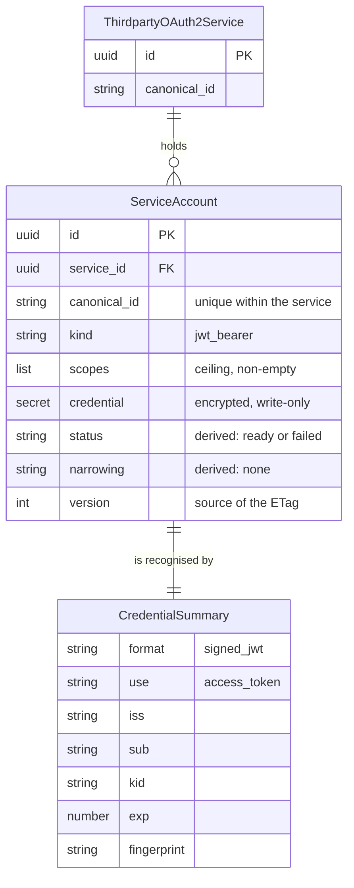
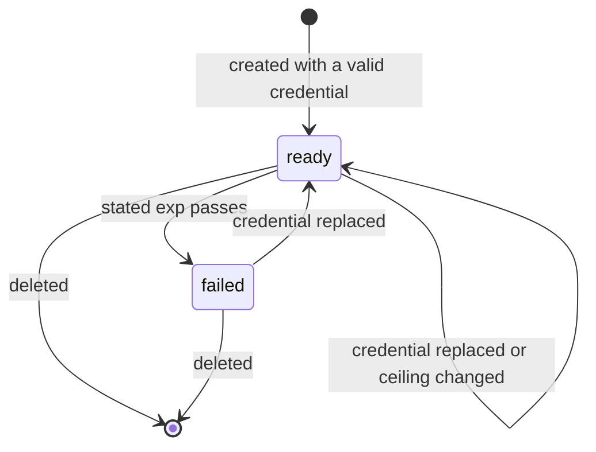

# Feature Specification: Service Accounts on Third-Party Services (First Kind: `jwt_bearer` with a Stored JWT)

**Feature Branch**: `speckit/issue-471`

**Created**: 2026-11-25

**Status**: Draft

**Input**: Issue #471, "service accounts on third-party services (first kind: jwt_bearer with a stored JWT)", step 1 of 7 of the design in issue #478, "agents acting on their own behalf (service accounts, agent grants, machine token exchange)". The decisions in #478 are settled inputs to this specification.

> Third-party services hold only a user-facing OAuth client today. Add a service account: a provider-issued machine credential attached to one service, with a scope ceiling, that agents can later be bound to.
>
> Deliver the entity, storage, admin API and the first kind, `jwt_bearer`, with its first credential format `signed_jwt`: a JWT signed outside the broker, stored and later handed out unchanged as the access token for a company-built MCP.

This feature lets an administrator register, recognise, rotate, monitor and remove such a credential. It does not yet let any agent use it: agent grants and their bindings come with #472, and the token-exchange path that hands the stored token out comes with #473.

## Clarifications

### Session 2026-11-25

Answered from the settled design. The source issue is named with each answer.

- Q: Does the broker check the stored JWT's signature, issuer or audience when it is registered? → A: No. The JWT is opaque: stored encrypted, never verified, never rebuilt. Only its form is checked on write: compact JWS, `alg` not `none`, bounded size, not expired when it states an `exp` (#471 Requirements; #478 "Create payloads per kind"). Recorded in FR-008, FR-009, SR-004.
- Q: Is a JWT without an `exp` accepted, and what is its status over time? → A: Accepted; it stays `ready`. Expiry is checked only "when it states an `exp`", and the account fails only "once a stated `exp` has passed" (#471). Recorded in FR-009, FR-014, User Story 1 Scenario 4, User Story 4 Scenario 3.
- Q: Which values does `use` accept in this feature? → A: Only `access_token`, which is also the default. `assertion` with a `token_endpoint` is prepared in the shape and refused for now (#471; #478 "Decided or deferred": a stored JWT used as an assertion is deferred). Recorded in FR-007, User Story 2 Scenario 5.
- Q: What does an update without a `credential` do? → A: It keeps the stored credential; the ceiling can be changed. Only "a `PUT` carrying a new `credential` rotates it in place" (#478 "What an administrator does" and "Create payloads per kind"). Recorded in FR-017, FR-018.
- Q: Is the delete refusal for a bound account part of this feature? → A: The rule and its conflict response are defined here; enforcement starts when agent grants exist (#471: "enforced once the agent-grants issue lands"). Recorded in FR-020. The acceptance scenario for the refusal belongs to #472, where a binding can first exist.
- Q: Can the administrator set whether an account can narrow? → A: No. Narrowing is "a fact about the provider, not a setting" and is derived as none for a stored JWT (#478 "Service accounts belong to services"; #471). Recorded in FR-003.
- Q: Under which encryption context is the credential stored? → A: The owning service's `service_id` context (#471 Requirements). Recorded in SR-001.
- Q: May values read from the stored JWT drive any decision? → A: No. They are "for display and status only, never for an authorization decision" (#478; #471). Recorded in FR-013.
- Q: Which service does an account for internal MCPs attach to, and how many accounts may a service hold? → A: The same service record users hold sessions with; a service may hold several accounts, and one per agent is expected where the downstream service must see which agent called (#478 "Internal MCPs on the company platform"; #471). Recorded in FR-001 and Assumptions.
- Q: Does the broker renew or remind about an expiring stored JWT? → A: No. Renewal is outside the broker; whoever issued the JWT replaces it through the admin API (#471 Assumptions; #478 Trade-offs). Recorded in Assumptions.
- Q: Do the two automated comments on #471 about a `broker_issued` audience default apply? → A: No. That kind was removed from the design; #478 decides that the broker signs no tokens for downstream services. Recorded in Out of Scope.

### Session 2026-11-25 (maintainer answers)

Issues #471 and #478 do not decide these points. The maintainer answered them on 2026-11-25.

- Q: Is `If-Match` required, optional or unsupported on update and delete of a service account? → A: Optional. When supplied and stale the broker answers `412` and changes nothing; without it the last writer wins. Recorded in FR-019, API-004, User Story 3 Scenario 7, User Story 5 Scenario 3 and Edge Cases.
- Q: What happens when an administrator deletes a service that still has service accounts? → A: The deletion is refused with `409` until the accounts are removed; stored machine credentials are never erased as a side effect. Recorded in FR-025, DB-002, User Story 5 Scenario 4 and Edge Cases.
- Q: Is there a read of a single service account? → A: Yes. `GET .../service-accounts/{service-account-id}` returns the same representation as the list, with the ETag header. Recorded in FR-016, API-001, User Story 1 Scenario 7.
- Q: What is the size limit for a stored JWT? → A: 16 KiB: the compact serialization may be at most 16384 bytes. The limit is fixed in the API contract and is not configurable. Recorded in FR-009, User Story 2 Scenario 4.
- Q: May `canonical_id` change after creation? → A: Yes. An update that states a different `canonical_id` renames the account, subject to uniqueness within the service (`409` when taken); an update that omits it keeps it. The account's ID never changes, and `kind` stays fixed. Recorded in FR-005, FR-017, User Story 3 Scenarios 8–9 and Edge Cases.

## User Scenarios & Testing *(mandatory)*

### User Story 1 - Register a ready-signed JWT as a service account (Priority: P1)

A platform administrator has a JWT that company infrastructure (the identity provider or a workload-identity system) signed for one agent. The administrator attaches it to the existing third-party service that represents the company platform, the same service users already hold sessions with, as a service account with a name of their choosing and a scope ceiling. The broker stores the JWT encrypted and never shows it again. The response and every later listing show only enough to recognise the credential: who issued it, for whom, with which key, until when, and a fingerprint.

**Why this priority**: Nothing else in the design for agents acting on their own behalf (#478) can exist without a stored machine credential. This story alone delivers a reviewable, auditable inventory of machine credentials per service.

**Independent Test**: Create a service account on an existing service through the admin API, then list the service's accounts. The account appears with its summary and narrowing `none`, its status reads `ready`, and the JWT appears in no response.

**Acceptance Scenarios**:

1. **Given** an existing third-party service with no service accounts, **When** an administrator creates a service account with `canonical_id`, `kind: jwt_bearer`, a non-empty `scopes` ceiling and a `signed_jwt` credential whose JWT states an `exp` in the future, **Then** the broker answers `201` with the account's generated ID, `narrowing: none`, a strong ETag, and a `credential_summary` showing `format`, `use: access_token`, and the `iss`, `sub`, `kid` and `exp` read from the JWT plus a fingerprint; the response does not contain the JWT, and the account's status reads `ready`.
2. **Given** a service with two service accounts, **When** an administrator lists the service's accounts, **Then** both are returned with their summaries and narrowing, and neither entry contains a JWT or any other credential material.
3. **Given** a valid create request whose credential omits `use`, **When** it is submitted, **Then** the account is created and its summary reports `use: access_token`.
4. **Given** a JWT that states no `exp`, **When** an administrator registers it, **Then** the account is created, its status reads `ready` and its summary reports no expiry.
5. **Given** a service that already has an account with `canonical_id` `platform-triage-bot`, **When** an administrator creates another account with the same `canonical_id` on that service, **Then** the broker answers `409` and stores nothing; the same `canonical_id` on a different service is accepted.
6. **Given** a service identifier that matches no service, **When** an administrator creates or lists service accounts under it, **Then** the broker answers `404`.
7. **Given** an existing account, **When** an administrator reads it on its own by ID or by `canonical_id`, **Then** the broker answers `200` with the same representation the list shows for it and its strong ETag, and without the JWT.

---

### User Story 2 - Refuse credentials that cannot work (Priority: P1)

An administrator pastes the wrong thing: a token truncated so that it no longer decodes, an unsigned token, an encrypted token, a token that has already expired, or a file that is far too large. The broker refuses it at the moment of writing, says which rule failed without repeating the pasted value, and stores nothing.

**Why this priority**: A stored credential that can never work would surface only later, as a failed exchange for an agent, far from the person who can fix it. Refusing unsigned tokens is also a security control (Constitution Principle I).

**Independent Test**: Submit each invalid credential on create and on update; each is refused with `400`, the service's account list is unchanged, and the refusal does not echo the submitted value.

**Acceptance Scenarios**:

1. **Given** a credential whose `jwt` is not a compact JWS (not three dot-separated segments, a segment that does not decode, or a header or payload that is not a JSON object), **When** it is submitted, **Then** the broker answers `400` and stores nothing.
2. **Given** a JWT whose header states `alg: none` in any letter case, or no `alg`, **When** it is submitted, **Then** the broker answers `400` and stores nothing.
3. **Given** a JWT that states an `exp` at or before the time of the request, **When** it is submitted, **Then** the broker answers `400` and stores nothing.
4. **Given** a JWT whose compact serialization is longer than 16384 bytes (16 KiB), **When** it is submitted, **Then** the broker answers `400` and stores nothing.
5. **Given** a credential with `use: assertion`, an unknown `use`, an unknown `format`, or an unknown `kind`, **When** it is submitted, **Then** the broker answers `400` and stores nothing.
6. **Given** a create request with an empty or missing `scopes`, a missing `credential`, or an invalid `canonical_id`, **When** it is submitted, **Then** the broker answers `400` and stores nothing.
7. **Given** any refused request above, **When** the administrator reads the error, **Then** it names the failed rule and does not contain the submitted JWT or any part of it.

---

### User Story 3 - Rotate the credential and change the ceiling (Priority: P2)

The token's issuer hands the administrator a replacement before the old token expires. The administrator replaces the credential on the existing account, so the account keeps its identity and anything bound to it later keeps working. The administrator can also change the ceiling without touching the credential.

**Why this priority**: The broker cannot renew a stored JWT; replacing it in time is the only way the account stays usable. It depends on Story 1.

**Independent Test**: Update an existing account with a new JWT, then list accounts: same ID and `canonical_id`, new `kid`, `exp` and fingerprint, new ETag. Update only the scopes: summary unchanged, ceiling changed.

**Acceptance Scenarios**:

1. **Given** a `ready` account, **When** an administrator updates it with a new valid `signed_jwt` credential, **Then** the broker answers `200`; the account keeps its ID and `canonical_id`; the summary shows the new token's `iss`, `sub`, `kid`, `exp` and fingerprint; the ETag changes; and the previous JWT is no longer stored.
2. **Given** a `ready` account, **When** an administrator updates it with different `scopes` and no `credential`, **Then** the ceiling changes, the stored credential and its summary stay as they were, and the ETag changes.
3. **Given** an account whose status is `failed` because its JWT expired, **When** an administrator updates it with a new valid JWT, **Then** its status becomes `ready`.
4. **Given** an existing account, **When** an update carries an invalid credential (any rule of Story 2), **Then** the broker answers `400` and the stored credential, ceiling, summary and ETag are unchanged.
5. **Given** an existing account, **When** an update repeats the stored JWT and the stored ceiling exactly, **Then** the broker answers `200` with the unchanged representation and the same ETag.
6. **Given** an account identifier that matches no account of the addressed service, including the ID of an account that belongs to another service, **When** an administrator updates it, **Then** the broker answers `404`.
7. **Given** an account whose current ETag is `"2"`, **When** an update or a delete carries `If-Match: "1"`, **Then** the broker answers `412` and the account is unchanged; the same request with `If-Match: "2"`, or without `If-Match`, is carried out.
8. **Given** an account with `canonical_id` `platform-triage-bot`, **When** an administrator updates it with `canonical_id` `platform-triage` and no other change, **Then** the account keeps its ID, credential, summary and ceiling, is addressable as `platform-triage` and no longer as `platform-triage-bot`, and its ETag changes.
9. **Given** a service with accounts `platform-triage-bot` and `platform-planner-bot`, **When** an administrator updates the first with `canonical_id` `platform-planner-bot`, **Then** the broker answers `409` and neither account changes.

---

### User Story 4 - See whether an account is usable (Priority: P2)

An administrator or a monitoring job asks for an account's status. A stored JWT is usable until the expiry it states; after that the account is `failed` until someone replaces the credential.

**Why this priority**: Renewal is a duty outside the broker. The status is how the people holding that duty see that it is due or overdue.

**Independent Test**: Register a JWT that expires shortly, read the status before and after the expiry, then rotate and read again.

**Acceptance Scenarios**:

1. **Given** a `ready` account whose JWT states an `exp` in the future, **When** an administrator reads its status, **Then** the answer is `ready` with no failure reason and the expiry the token states.
2. **Given** an account whose JWT's stated `exp` has passed, **When** an administrator reads its status, **Then** the account is `failed` with failure reason `credential_expired`; it is still listed, unchanged.
3. **Given** an account whose JWT states no `exp`, **When** any amount of time passes, **Then** its status stays `ready`.
4. **Given** an account identifier that matches no account of the addressed service, **When** its status is read, **Then** the broker answers `404`.

---

### User Story 5 - Remove a service account (Priority: P3)

An administrator removes an account that is no longer needed. The stored credential is gone with it. Once agent grants exist (#472), removal is refused while any agent grant still binds the account; that refusal is specified and tested with #472.

**Why this priority**: Clean-up completes the lifecycle but blocks nothing else.

**Independent Test**: Delete an account, list the service's accounts, and confirm it is absent; delete it again and receive `404`.

**Acceptance Scenarios**:

1. **Given** an account that no agent grant binds, **When** an administrator deletes it, **Then** the broker answers `204`, the account no longer appears in the service's list, and its stored credential is erased.
2. **Given** an account identifier that matches no account of the addressed service, **When** an administrator deletes it, **Then** the broker answers `404`.
3. **Given** an account whose current ETag is `"2"`, **When** a delete carries `If-Match: "1"`, **Then** the broker answers `412` and the account still exists.
4. **Given** a service that holds at least one service account, **When** an administrator deletes the service, **Then** the broker answers `409`, and the service and its accounts are unchanged; after the last account is removed the service can be deleted as before.

---

### Edge Cases

- **Expiry between validation and use**: a JWT accepted seconds before its `exp` is stored and becomes `failed` at `exp`. No grace period or clock-skew allowance is applied in either direction.
- **`nbf` in the future, or other time claims**: not interpreted. Only `exp` drives validation and status.
- **Malformed `exp`**: an `exp` that the JOSE library cannot read as a date, such as a boolean or a value beyond its range, is refused on write, because the broker could not tell when the account fails. A numeric string or a fractional value is accepted as the library reads it, in whole seconds.
- **Registered claims of the wrong type**: a JWT whose registered claim is not of its RFC 7519 type, such as a numeric `sub`, is refused, because the JOSE library refuses it.
- **Unrecognised `alg`**: an `alg` value the JOSE library does not know, including `NONE` or `None`, is refused because the token does not parse.
- **Absent `iss`, `sub` or `kid`**: accepted. The summary omits what the token does not state.
- **Encrypted JWT (JWE, five segments)**: refused as not a compact JWS.
- **Truncated signature**: a token cut off inside its signature segment is accepted when the rest still decodes, because the broker verifies no signature. It fails only at the downstream service.
- **Whitespace and base64 variants**: leading or trailing spaces and any line break are refused. Padded or standard-alphabet base64 segments are accepted because the JOSE library's decoder accepts them. Nothing is trimmed: the token is stored and fingerprinted exactly as submitted.
- **Rotation to a token from another issuer or for another subject**: accepted. The token is opaque; the summary shows the change, and the audit event records the previous and new summaries.
- **Ceiling wider or narrower than the token's own `scope` claim**: not compared. The ceiling is declared by the administrator; the token's content never drives a decision.
- **Two accounts holding the same JWT**: accepted. They show the same fingerprint.
- **Encryption unavailable**: a create or rotation fails with a server error and stores nothing; there is no plaintext fallback.
- **Service of any credential source or client registration**: service accounts attach to any existing third-party service; they do not depend on how the service's user-facing OAuth client is configured.
- **Deleting a service that still has service accounts**: refused with `409` until the accounts are removed. A stored machine credential is never erased as a side effect of another deletion.
- **Concurrent updates of one account**: a writer that sends `If-Match` with a stale ETag is refused with `412`; writers that send none overwrite each other, last writer wins. Each write is applied whole or not at all.
- **Renaming an account**: the old `canonical_id` stops addressing the account at once and becomes free for another account of the same service. The account's ID is the stable reference; records that later point at an account (#472) refer to the ID.

## Concrete Example Journeys *(mandatory)*

All journeys share one cast. **Operator**: `ops-admin@example.com`, authenticated by the trusted proxy in front of the admin server and forwarded as `X-Remote-User`. **Service**: *Company Platform* (`880e8400-e29b-41d4-a716-446655440020`, canonical ID `company-platform`), an existing third-party service that users already hold sessions with; it has no service accounts. **Agent this token was issued for**: *triage-bot* (the broker does not link the account to the agent in this feature). Admin API host: `broker-admin.example.com`. All times are 2026-11-25 UTC unless a step says otherwise. All IDs, tokens and fingerprints are synthetic. No broker configuration changes any step of these journeys, so no configuration block is shown.

**Token T1**, signed by the company identity provider, marker `eyJ...T1`:

```json
// header
{ "alg": "ES256", "kid": "2026-11", "typ": "JWT" }
// claims
{
  "iss": "https://idp.example.com",
  "sub": "triage-bot",
  "aud": "https://platform.example.com",
  "scope": "read",
  "iat": 1795478400,
  "exp": 1798675200
}
```

`exp` 1798675200 is 2026-12-31T00:00:00Z. **Token T2**, marker `eyJ...T2`, is the replacement: same `iss`, `sub`, `aud` and `scope`, header `kid` `2026-12`, `exp` 1801353600 (2027-01-31T00:00:00Z).

### Journey 1 — Register, recognise, rotate and remove an account (User Story 1, Scenarios 1–2; User Story 3, Scenarios 1–2; User Story 4, Scenario 1; User Story 5, Scenario 1)

**Step 1 — 10:00:00: the operator registers T1 as a service account**

```http
POST /api/services/company-platform/service-accounts HTTP/1.1
Host: broker-admin.example.com
X-Remote-User: ops-admin@example.com
Content-Type: application/json

{
  "canonical_id": "platform-triage-bot",
  "kind": "jwt_bearer",
  "scopes": ["read"],
  "credential": { "format": "signed_jwt", "use": "access_token", "jwt": "eyJ...T1" }
}

HTTP/1.1 201 Created
Location: /api/services/880e8400-e29b-41d4-a716-446655440020/service-accounts/990e8400-e29b-41d4-a716-446655440031
ETag: "1"
Content-Type: application/json

{
  "id": "990e8400-e29b-41d4-a716-446655440031",
  "service_id": "880e8400-e29b-41d4-a716-446655440020",
  "canonical_id": "platform-triage-bot",
  "kind": "jwt_bearer",
  "scopes": ["read"],
  "narrowing": "none",
  "credential_summary": {
    "format": "signed_jwt",
    "use": "access_token",
    "iss": "https://idp.example.com",
    "sub": "triage-bot",
    "kid": "2026-11",
    "exp": 1798675200,
    "fingerprint": "SHA256:fhbwk8g0dDlEiuXzadc7Ytx+R1pSlxRBBNgzBxN+3UQ"
  },
  "created_at": "2026-11-25T10:00:00Z",
  "updated_at": "2026-11-25T10:00:00Z"
}
```

The broker did not verify T1's signature and did not contact `idp.example.com`. The response has no `credential` member. One audit record is written for the creation, naming the service, the account and the operator, and carrying the summary but not the token.

**Step 2 — 10:00:30: the operator lists the service's accounts**

```http
GET /api/services/company-platform/service-accounts HTTP/1.1
Host: broker-admin.example.com
X-Remote-User: ops-admin@example.com

HTTP/1.1 200 OK
Content-Type: application/json

[
  {
    "id": "990e8400-e29b-41d4-a716-446655440031",
    "service_id": "880e8400-e29b-41d4-a716-446655440020",
    "canonical_id": "platform-triage-bot",
    "kind": "jwt_bearer",
    "scopes": ["read"],
    "narrowing": "none",
    "credential_summary": { "format": "signed_jwt", "use": "access_token", "iss": "https://idp.example.com", "sub": "triage-bot", "kid": "2026-11", "exp": 1798675200, "fingerprint": "SHA256:fhbwk8g0dDlEiuXzadc7Ytx+R1pSlxRBBNgzBxN+3UQ" },
    "created_at": "2026-11-25T10:00:00Z",
    "updated_at": "2026-11-25T10:00:00Z"
  }
]
```

**Step 3 — 10:01:00: the operator checks the status**

```http
GET /api/services/company-platform/service-accounts/platform-triage-bot/status HTTP/1.1
Host: broker-admin.example.com
X-Remote-User: ops-admin@example.com

HTTP/1.1 200 OK
Content-Type: application/json

{ "status": "ready", "failure_reason": null, "credential_expires_at": "2026-12-31T00:00:00Z" }
```

**Step 4 — 2026-12-20 09:00:00: the identity provider has issued T2; the operator rotates the credential and widens the ceiling**

```http
PUT /api/services/company-platform/service-accounts/platform-triage-bot HTTP/1.1
Host: broker-admin.example.com
X-Remote-User: ops-admin@example.com
If-Match: "1"
Content-Type: application/json

{
  "scopes": ["read", "write"],
  "credential": { "format": "signed_jwt", "jwt": "eyJ...T2" }
}

HTTP/1.1 200 OK
ETag: "2"
Content-Type: application/json

{
  "id": "990e8400-e29b-41d4-a716-446655440031",
  "service_id": "880e8400-e29b-41d4-a716-446655440020",
  "canonical_id": "platform-triage-bot",
  "kind": "jwt_bearer",
  "scopes": ["read", "write"],
  "narrowing": "none",
  "credential_summary": {
    "format": "signed_jwt",
    "use": "access_token",
    "iss": "https://idp.example.com",
    "sub": "triage-bot",
    "kid": "2026-12",
    "exp": 1801353600,
    "fingerprint": "SHA256:kYIMTyaG3c1Au7s4+XWRspT3DUg22fPiV9UR6yiEHVs"
  },
  "created_at": "2026-11-25T10:00:00Z",
  "updated_at": "2026-12-20T09:00:00Z"
}
```

T1 is no longer stored. `use` was omitted and defaulted to `access_token`. One audit record is written for the rotation; it carries the previous and the new summary (`kid` `2026-11` → `2026-12`, both fingerprints) and the previous and new ceiling, and neither token.

**Step 5 — 2027-02-10 14:00:00: the platform retires triage-bot; the operator removes the account**

```http
DELETE /api/services/company-platform/service-accounts/platform-triage-bot HTTP/1.1
Host: broker-admin.example.com
X-Remote-User: ops-admin@example.com

HTTP/1.1 204 No Content
```

**Observable result**: the list from Step 2 now returns `[]`. Across the journey the operator saw `kid` and fingerprint change exactly once, at the rotation, and no response, log record, span or metric ever contained `eyJ...T1` or `eyJ...T2`. Three audit records exist: created, rotated, deleted.

### Journey 2 — A missed rotation: the account fails at the stated expiry and recovers on replacement (User Story 4, Scenarios 1–2; User Story 3, Scenario 3; User Story 2, Scenario 3)

Starts from the state after Journey 1 Step 3: account `platform-triage-bot` holds T1 (`exp` 2026-12-31T00:00:00Z), ETag `"1"`. Nobody rotates it.

**Step 1 — 2026-12-30 23:59:00: status one minute before expiry**

```http
GET /api/services/company-platform/service-accounts/platform-triage-bot/status HTTP/1.1
Host: broker-admin.example.com
X-Remote-User: ops-admin@example.com

HTTP/1.1 200 OK
Content-Type: application/json

{ "status": "ready", "failure_reason": null, "credential_expires_at": "2026-12-31T00:00:00Z" }
```

**Step 2 — 2026-12-31 00:00:05: the same request five seconds after expiry**

```http
HTTP/1.1 200 OK
Content-Type: application/json

{ "status": "failed", "failure_reason": "credential_expired", "credential_expires_at": "2026-12-31T00:00:00Z" }
```

The list from Journey 1 Step 2 is unchanged: an account representation carries no status.

**Step 3 — 2026-12-31 08:00:00: the operator pastes T1 again by mistake**

```http
PUT /api/services/company-platform/service-accounts/platform-triage-bot HTTP/1.1
Host: broker-admin.example.com
X-Remote-User: ops-admin@example.com
If-Match: "1"
Content-Type: application/json

{ "scopes": ["read"], "credential": { "format": "signed_jwt", "jwt": "eyJ...T1" } }

HTTP/1.1 400 Bad Request
Content-Type: application/json

{ "error": "validation failed", "message": "credential.jwt is expired" }
```

The account is unchanged and still `failed`.

**Step 4 — 2026-12-31 08:05:00: the operator submits T2**

The request of Step 3 with `"jwt": "eyJ...T2"` answers `200` with `kid` `2026-12`, `exp` 1801353600 and ETag `"2"`, as in Journey 1 Step 4 but with `"scopes": ["read"]`; the status then reads `"status": "ready"`.

**Observable result**: between 2026-12-31T00:00:00Z and 08:05:00Z every status read reported `failed` with `credential_expired`; from 08:05:00Z the account is `ready` again under the same ID.

### Journey 3 — Refused credentials leave nothing behind (User Story 2, Scenarios 1–2, 5, 7; User Story 1, Scenario 5)

Starts from the state after Journey 1 Step 1. **Token U**, marker `eyJ...U.`, has header `{ "alg": "none" }`, the claims of T1 and an empty signature segment.

**Step 1 — 10:05:00: an unsigned token**

```http
POST /api/services/company-platform/service-accounts HTTP/1.1
Host: broker-admin.example.com
X-Remote-User: ops-admin@example.com
Content-Type: application/json

{
  "canonical_id": "platform-planner-bot",
  "kind": "jwt_bearer",
  "scopes": ["read", "write"],
  "credential": { "format": "signed_jwt", "jwt": "eyJ...U." }
}

HTTP/1.1 400 Bad Request
Content-Type: application/json

{ "error": "validation failed", "message": "credential.jwt must be a signed compact JWS" }
```

**Step 2 — 10:06:00: the right token, but with a use that is not offered yet**

The same request with `"credential": { "format": "signed_jwt", "use": "assertion", "jwt": "eyJ...T1" }` answers:

```http
HTTP/1.1 400 Bad Request
Content-Type: application/json

{ "error": "validation failed", "message": "credential.use must be access_token" }
```

**Step 3 — 10:07:00: a valid token under a name that is taken on this service**

The same request with `"canonical_id": "platform-triage-bot"` and `"credential": { "format": "signed_jwt", "jwt": "eyJ...T1" }` answers:

```http
HTTP/1.1 409 Conflict
Content-Type: application/json

{ "error": "conflict", "message": "service account canonical_id already exists on this service" }
```

**Observable result**: the list from Journey 1 Step 2 is unchanged, with exactly one account. No refusal echoed a token, and no audit record of a creation was written.

## Requirements *(mandatory)*

### Functional Requirements

**Entity and ownership**

- **FR-001**: Administrators MUST be able to attach service accounts to any existing third-party service. A service account belongs to exactly one service for its whole life; a service MAY hold any number of them. The service is the same record users hold sessions with; no separate service is created for machines.
- **FR-002**: Each service account MUST have a broker-generated ID, an administrator-chosen `canonical_id` that is unique within its service and follows the validation rules of existing canonical IDs, a `kind`, a non-empty `scopes` ceiling, a write-only `credential`, a derived `status`, a derived `narrowing`, and creation and last-change times.
- **FR-003**: `narrowing` MUST be derived from the kind and format and MUST NOT be settable. For `jwt_bearer` with `signed_jwt` it is `none`.
- **FR-004**: The ceiling MUST be a non-empty list of unique, non-empty scope values in the flat scope vocabulary of the service's identity provider. The broker MUST NOT compare the ceiling with anything inside the stored JWT.
- **FR-005**: `kind` MUST NOT change after creation; an update that states a different kind MUST be refused. `canonical_id` MAY change: an update that states a different value renames the account if that value is free within the service and MUST be refused with a conflict otherwise; an update that omits `canonical_id` keeps it. The account's ID MUST NOT change.

**The `jwt_bearer` kind with the `signed_jwt` format**

- **FR-006**: This feature MUST accept exactly one kind, `jwt_bearer`, and exactly one credential format for it, `signed_jwt`. Any other kind or format MUST be refused. `kind` selects which credential formats are accepted, and the credential is discriminated by its `format`, so that later kinds and formats (#474–#477) add a branch without changing this one.
- **FR-007**: A `signed_jwt` credential MUST carry `jwt` and MAY carry `use`. `use` MUST accept only `access_token` and MUST default to it. The value `assertion` MUST be refused until a later feature offers it; the model MUST allow that value and an accompanying `token_endpoint` to be added later without a new format.
- **FR-008**: The broker MUST treat the JWT as opaque: store it exactly as submitted, never verify its signature, never fetch keys for it, never modify or rebuild it.
- **FR-009**: On every write that carries a `signed_jwt` credential the broker MUST refuse it unless all of these hold: its compact serialization is at most 16384 bytes (16 KiB), a fixed limit that is not configurable, checked before any parsing; it parses, without verification, as a compact JWS whose payload is a JWT claims set, using the broker's JOSE library (`lestrrat-go/jwx`); its header states an `alg` that is not `none`; and, when the payload states an `exp`, that `exp` lies after the time of the request. Which encodings, `alg` values and claim types parse is the library's behaviour, not a broker rule (see Edge Cases). A JWT without `exp` MUST be accepted.
- **FR-010**: A refused write MUST store nothing, MUST leave an existing account unchanged, and MUST answer with the failed rule and without the submitted JWT or any fragment of it.

**What the administrator sees**

- **FR-011**: No response, on any operation, MUST contain the credential. Every representation of an account MUST carry a `credential_summary` instead.
- **FR-012**: For `signed_jwt` the summary MUST contain the `format`, the effective `use`, the `iss`, `sub`, `kid` and `exp` read from the JWT without verification (each omitted when the token does not state it), and a fingerprint that changes whenever the stored JWT changes and from which the JWT cannot be recovered.
- **FR-013**: Values read from the stored JWT MUST be used for display and for the account's status only. They MUST NOT take part in any authorization decision, in this feature or in those that build on it.
- **FR-014**: The account's `status` MUST be read from its status resource (FR-015); like service discovery status, the account representation does not carry it. An account MUST be `ready` when created. It MUST be `failed` with failure reason `credential_expired` from the instant its stored JWT's stated `exp` has passed, on every read, until its credential is replaced. An account whose JWT states no `exp` MUST stay `ready`.
- **FR-015**: Administrators MUST be able to read an account's status on its own: the status, the failure reason when failed, and the expiry the stored credential states, when it states one. The status model MUST leave room for the later values of #478 (waiting for bootstrap, last mint error class, observed ceiling) without changing the meaning of `ready` and `failed`.
- **FR-016**: Administrators MUST be able to list all service accounts of one service and to read a single account. Both return the same representation of an account; the single read also returns its strong ETag.

**Changing and removing**

- **FR-017**: An update that carries a credential MUST replace the stored credential in place: the account keeps its ID and service, and its `canonical_id` unless the same update renames it (FR-005); the summary, fingerprint and status are recomputed from the new credential; the previous credential MUST no longer be stored.
- **FR-018**: An update without a credential MUST keep the stored credential and MAY change the ceiling. Changing the ceiling MUST NOT alter the stored credential or its summary. A ceiling change MUST be accepted even when it lowers the ceiling below what a bound agent grant uses; an update is never refused because of a grant (#471).
- **FR-019**: Every committed change to an account MUST change its strong ETag. Update and delete MUST accept an optional `If-Match`: when it is supplied and does not equal the account's current ETag, the broker MUST answer `412` and change nothing; when it is absent, the request is carried out and the last writer wins. An update that changes nothing MUST succeed, MUST keep the ETag and last-change time, and MUST NOT write an audit record.
- **FR-020**: Deleting an account MUST erase its stored credential. Deletion MUST be refused with a conflict while any agent grant binds the account; that check is enforced from the delivery of agent grants (#472), and this feature MUST define the conflict response in the API contract now.
- **FR-021**: Operations on an account MUST address it through its service. An account addressed under a service it does not belong to MUST be reported as not found.

**Audit and observability**

- **FR-022**: The broker MUST write an audit record after each committed creation, credential rotation, ceiling change, rename and deletion of a service account. Each record MUST identify the service, the service account and the acting administrator, and MUST carry the credential summary, with the previous and new summary, ceiling and `canonical_id` on a change. A refused or failed operation MUST NOT produce a success record.
- **FR-023**: The stored JWT is a bearer credential under `coding-standards/LOGGING.md` and `coding-standards/OPENTELEMETRY.md`. Neither it, nor any fragment of it, nor its ciphertext MUST appear in a log record, span, span event, metric, or error message. Only the claim and header metadata those standards permit (`iss`, `kid`, `exp`, `alg`, validation failure reason) and the fingerprint MAY appear; `sub` MAY appear in API responses, and in audit summaries only as an `id.Principal` rendered through the principal policy of `coding-standards/LOGGING.md` section 5.

- **FR-025**: Deleting a service that still holds at least one service account MUST be refused with a conflict and MUST leave the service and its accounts unchanged.

**Scope boundary**

- **FR-024**: This feature MUST NOT hand a stored credential to any caller, change token exchange, or bind an account to an agent. Until #472 and #473 are delivered, a service account has no effect on any user or agent request.

### Domain Model





**Entities**:
- **ServiceAccount**: a machine credential at a third-party service, owned and managed by administrators, with a ceiling. Identified by its ID; named by a `canonical_id` unique within its service. Invariants: belongs to exactly one service; ceiling non-empty; always holds exactly one credential of its kind; ID and kind never change; `canonical_id` may be renamed within the service.

**Aggregates**:
- **ServiceAccount** is its own aggregate, referencing its **ThirdpartyOAuth2Service** by ID. Uniqueness of `canonical_id` is scoped to the service.

**Value Objects**:
- **Ceiling**: the set of scopes that bounds what the account may ever obtain.
- **Kind**: how a service account obtains tokens. This feature: `jwt_bearer`.
- **Credential format**: the shape of the secret within a kind. This feature: `signed_jwt`, a JWT signed outside the broker.
- **Credential use**: what a stored JWT is. This feature: `access_token`.
- **Narrowing**: whether the broker can ask for less than the ceiling when obtaining a token; a fact about kind and format. This feature: `none`.
- **CredentialSummary**: non-secret recognition data derived from the credential at write time.
- **ServiceAccountStatus**: `ready` or `failed` with a failure reason; derived, for a stored JWT, from the stated expiry and the current time.

**Domain Events**:
- **Service account created**: a credential was stored for a service.
- **Service account credential rotated**: the stored credential was replaced.
- **Service account ceiling changed**: the ceiling was changed without a rotation.
- **Service account renamed**: the `canonical_id` was changed.
- **Service account deleted**: the account and its credential were erased.

The terms Service Account, Kind, Credential Format, Ceiling, Narrowing and Credential Summary are added to the `ARCHITECTURE.md` glossary and to the root `AGENTS.md` glossary table with the definitions of #478.

### API Requirements

- **API-001**: The operations are defined in `api/admin/openapi.yaml` before implementation, on the admin server only: create and list under `/api/services/{service-id}/service-accounts`; read, update and delete under `/api/services/{service-id}/service-accounts/{service-account-id}`; status under `.../{service-account-id}/status`. No end-user API changes.
- **API-002**: The create and update request is one schema with `kind` as an enumerated member and `credential` a `oneOf` discriminated by `format` and marked write-only; an update may omit `kind`. The representation schema has no `credential`, `status` or `failure_reason` property and requires `credential_summary`, `narrowing` and `scopes`; status is only on the status resource (FR-014, FR-015).
- **API-003**: `{service-id}` keeps its existing meaning (UUID or canonical service identifier). `{service-account-id}` accepts the account's UUID or its `canonical_id` within the addressed service.
- **API-004**: Responses that return one account carry its strong ETag. Errors use the existing error envelope and the existing meanings of `400`, `401`, `404`, `409`, `412` and `500`. `If-Match` is optional on update and delete (FR-019).
- **API-005**: The contract includes examples that match the journeys of this specification, including the refusals of Journey 3, and documents the delete conflict of FR-020 and the new conflict on service deletion of FR-025.
- **API-006**: The change is additive; the Admin API version is raised by a minor step. The contract change is confirmed by the maintainer before implementation begins (Constitution Principle X).

### Database Requirements

- **DB-001**: Service accounts are persisted through a repository port with both an in-memory and a PostgreSQL implementation that behave identically for every acceptance scenario.
- **DB-002**: The schema change is one atomic migration pair in `/migrations/` under the next free number, tested in both directions against PostgreSQL. It enforces uniqueness of `canonical_id` within a service and that an account cannot exist without its service: a service that holds accounts cannot be removed (FR-025).
- **DB-003**: The credential is stored only in encrypted form. No column, index or constraint holds the JWT or a reversible derivative of it in plaintext.

### Security Requirements *(mandatory for security-critical features)*

- **SR-001**: The stored JWT MUST be encrypted before it is persisted, through the broker's existing envelope encryption, under the encryption context of the owning service (`service_id`, as defined by `adrs/008-encryption-context-optimization.md`). A credential encrypted for one service MUST NOT decrypt under another service's context.
- **SR-002**: There MUST be no plaintext fallback. If encryption fails or is unavailable, the write fails and nothing is stored (Constitution Principle I).
- **SR-003**: The fingerprint MUST be computed with a vetted hash from the Go standard library over the submitted JWT (Constitution Principle III). The JWT MUST be parsed with the broker's JOSE library (`lestrrat-go/jwx`), without verification; the broker adds no parser of its own. No custom cryptography is introduced. The broker performs no signature operation in this feature.
- **SR-004**: Storing a JWT without verifying it is not an exception to Constitution Principle I's signature rule: the broker never accepts the stored JWT as proof of anything. It authenticates nobody with it, authorizes nothing from it (FR-013), and only displays metadata read from it. Refusing `alg: none` guarantees the broker never stores, for later hand-out, a token that declares itself unsigned; because no signature is verified, an intact signature is not guaranteed (see Edge Cases, truncated signature).
- **SR-005**: The administrator access boundary is the existing one of the admin server: the trusted proxy authenticates and authorizes the administrator, and a request without an operator principal is refused with `401` before any account is read.
- **SR-006**: Tests MUST assert, for every path that handles the JWT (create, rotation, refused write, list, status, delete), that the token under test appears in no response body, log buffer, span attribute, span event or metric attribute, as the coding standards require.
- **SR-007**: Decoding the JWT for the summary MUST be bounded by the size limit of FR-009 and MUST fail closed: a token whose header or payload cannot be decoded is refused, never stored with an empty summary.

### Key Entities

- **Service account**: a machine credential that a third-party service issued to software, registered with the broker by an administrator, attached to one service, bounded by a ceiling.
- **Ceiling**: the most a service account may ever obtain, expressed as scopes.
- **Credential summary**: what an administrator sees instead of the credential, enough to recognise it and to notice a rotation.
- **Third-party service**: the existing provider record, unchanged, which now also holds service accounts.

## Success Criteria *(mandatory)*

### Measurable Outcomes

- **SC-001**: An administrator can register a ready-signed JWT on an existing service, see it listed and read its status as ready, in one request each, without changing any broker configuration.
- **SC-002**: In 100% of responses, log records, spans and metrics produced by this feature's operations, the registered JWT is absent; this is proven by automated tests for every operation.
- **SC-003**: 100% of the invalid credentials enumerated in User Story 2 are refused at write time with a reason, and none leaves a stored record.
- **SC-004**: From the instant a stored JWT's stated expiry passes, every status read reports the account as failed with the reason, with no operator action and no delay an administrator could observe.
- **SC-005**: An administrator can tell from the summary alone, without access to the token, whether a rotation took place: every rotation changes the fingerprint, and identical tokens show identical fingerprints.
- **SC-006**: Every creation, rotation, ceiling change, rename and deletion can be attributed afterwards to the administrator who performed it and to the account and service it affected.
- **SC-007**: Existing behaviour is unchanged: every existing user-facing flow, admin operation and token exchange behaves identically with and without service accounts present.
- **SC-008**: Both storage back-ends pass the same acceptance scenarios.

## Assumptions

- The other `jwt_bearer` formats (`private_key`, `google_service_account_json`) and the other kinds add only a credential branch and a token source; they come with #475 and the later issues (#471).
- Renewal is outside the broker: whoever issued the JWT replaces it through the admin API before it expires (#471). The broker sends no reminder.
- One account per agent is the expected setup where the downstream service must see which agent called (#478). The broker does not enforce or record that relation in this feature.
- The admin UI for service accounts comes later (#478: "mirrored in the admin UI later"); this feature has no frontend change.
- This feature adds no configuration parameter. The JWT size limit is a fixed value in the API contract.
- The fingerprint is a SHA-256 digest of the exact submitted compact serialization. Its textual encoding is fixed in the API contract at planning.
- The `exp` in the summary is the expiry in whole seconds since the epoch, as the JOSE library reads it from the token; the status additionally reports it as a timestamp.
- The current time used for validation and status is the broker's clock, without skew allowance.
- Scope values in a `jwt_bearer` ceiling follow the same per-value rules as service scopes today.
- Listing is unpaginated and returns a direct array, like the existing list of a service's protected resources.
- Audit event names, the fields of each record and any new span or metric follow the coding standards and are fixed in the observability contract at planning.
- An ADR records the service-account entity and the stored-JWT posture if planning finds that an accepted ADR or `ARCHITECTURE.md` needs to change; the ADR that supersedes ADR 045 decision 6 belongs to #473, not here.

## Out of Scope

- Agent grants, their service-account bindings and ceiling validation of grants (#472).
- The machine branch in token exchange, the machine token source, machine sessions, `subject_kind` in ExtProc, and any hand-out of the stored JWT (#473).
- `bootstrapped_oauth` and its authorize path and callback branch (#474); the signing `jwt_bearer` formats and `client_credentials` (#475); `github_app`, `repositories` and observed ceilings (#476); keyless service accounts (#477).
- `use: assertion` and `token_endpoint` for a stored JWT (deferred in #478).
- The admin UI.
- Any broker-issued token kind for downstream services; the broker signs nothing for downstream services (#478).
