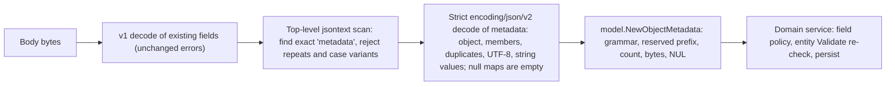

# Data Model: Labels and Annotations

## Value object

**Object Metadata** (`model.ObjectMetadata` in `internal/domain/model/object_metadata.go`) is an
immutable pair of a label map and an annotation map. It has no ID, repository, or lifecycle of its
own. Agent, ThirdpartyOAuth2Service, and PermissionSet each embed exactly one. Add **Object
Metadata**, **Label**, and **Annotation** to the `ARCHITECTURE.md` glossary before implementation.

| Member | Type | Admin write rule |
|---|---|---|
| labels | `map[string]string` (unexported) | At most 64 entries. Each key follows the key grammar and has no reserved prefix. Each value is empty or follows the label-value grammar. |
| annotations | `map[string]string` (unexported) | Keys follow the key grammar and have no reserved prefix. Values are valid UTF-8 without U+0000. The sum of the UTF-8 byte lengths of all keys and values is at most 65,536. |

`NewObjectMetadata` enforces every rule in this table. `Validate()` enforces all of them except
the reserved prefix. `RestoreObjectMetadata` enforces none, so a value rebuilt from storage can
break them (see Persistence). The rules are write policy, not type invariants.

| Operation | Behavior |
|---|---|
| `NewObjectMetadata(labels, annotations)` | Admin write constructor. Validates every rule of [contracts/object-metadata.md](contracts/object-metadata.md) §3, including the reserved prefix, and copies both inputs. A nil input means empty. On failure it returns one of the fixed errors in §4. |
| `RestoreObjectMetadata(labels, annotations)` | Persistence constructor for the storage adapters. Copies both stored maps and applies no rule, so stored metadata cannot fail a read (FR-021). A nil input means empty. |
| `Validate()` | Re-check called by the entity validators. Applies the grammar, NUL, count, and size rules, but not the reserved prefix. The entity validators also run inside the Agent repositories' `Create` and `Update`, so a reserved-prefix check here would also reject a key the broker writes itself once it defines one. Today, no path outside the Admin API writes these entities. Returns the same fixed errors. |
| `Labels()`, `Annotations()` | Return copies. Callers cannot change the value. |
| `Equal(other)` | Map equality of both maps, independent of key order. |
| `IsEmpty()` | True when both maps are empty. |
| zero value | Valid and empty. |

The grammar and size checks run on the strings exactly as received. No step trims or normalizes
them (FR-004). The annotation-key check alone ignores ASCII case, as Kubernetes does; the key is
still stored and compared exactly as sent.

## Embedding entities

| Entity | Location | New fields |
|---|---|---|
| `storage.Agent` | `internal/domain/storage/agent.go` | `ObjectMetadata model.ObjectMetadata` |
| `storage.PermissionSet` | `internal/domain/storage/permission_set.go` | `ObjectMetadata model.ObjectMetadata` |
| `model.ThirdpartyOAuth2ProviderEntity` | `internal/domain/model/thirdparty_oauth2_provider.go` | `ObjectMetadata model.ObjectMetadata`, `ObjectMetadataProvided bool` (transient request flag, never persisted) |

`Copy()` on Agent and PermissionSet keeps the value. The value is immutable, so it needs no deep
copy. The memory Service record copies the value and clears `ObjectMetadataProvided`. These fields get
no JSON tags that would make them part of any end-user serialization. End-user projections
(`consent.AgentDelegation`, `AgentDetailData`, permission-set and service views) are explicit DTOs
and gain no field (FR-019).

## Write transitions

| Request `metadata` | Agent POST / PUT / collection PUT | Permission Set POST / PUT | Service POST | Service PUT |
|---|---|---|---|---|
| Omitted | Empty | Empty | Empty | Keep stored value |
| `{}` | Empty | Empty | Empty | Empty |
| `{"labels": L}` | labels = L, annotations empty | same | same | same |
| `{"labels": L, "annotations": A}` | Replace both | Replace both | Store both | Replace both |
| `{"labels": null}` or `{"annotations": null}` | That map empty, as for an omitted member | same | same | same |
| `"metadata": null`, or a `null` map value | `400`, nothing changes | `400` | `400` | `400` |
| Invalid | `400`, nothing changes | `400` | `400` | `400` |

Keys are never merged. A `metadata` value that is sent always replaces both maps.

**Agent reconcile no-op**: `sameDefinition` returns false when `!existing.ObjectMetadata.Equal(candidate.ObjectMetadata)`.
A difference in either map is an actual update. It advances `updated_at` and emits
`agents.agent.updated`, which carries no metadata. Reordered keys compare as equal, so a replay
writes nothing and emits no audit record (FR-014, SC-002).

**Service update**: `prepareUpdate` sets `entity.ObjectMetadata = persisted.ObjectMetadata` when
`!entity.ObjectMetadataProvided`. A failed metadata validation returns before discovery, branch-key
provisioning, encryption, and repository calls.

**Permission Set update**: the handler builds the entity from the request, as it does today.
Every accepted `PUT` advances `updated_at` and emits `permissionset.permission_set.updated`
(FR-017).

## Validation flow

Each stage returns the first failure as a fixed message (contract §4). The handler maps every
metadata failure to `400 validation failed`.

## Persistence

Migration `051_object_metadata.{up,down}.sql` is atomic. It follows `050_create_service_accounts`, which the service-accounts feature added to `release/v0.2`.
Re-check for the next unused slot when the migration is written.

| Table | Column | Definition | Named constraint |
|---|---|---|---|
| `agents` | `labels` | `JSONB NOT NULL DEFAULT '{}'` | `chk_agents_labels_object` |
| `agents` | `annotations` | `JSONB NOT NULL DEFAULT '{}'` | `chk_agents_annotations_object` |
| `thirdparty_oauth2_services` | `labels` | `JSONB NOT NULL DEFAULT '{}'` | `chk_thirdparty_oauth2_services_labels_object` |
| `thirdparty_oauth2_services` | `annotations` | `JSONB NOT NULL DEFAULT '{}'` | `chk_thirdparty_oauth2_services_annotations_object` |
| `permission_sets` | `labels` | `JSONB NOT NULL DEFAULT '{}'` | `chk_permission_sets_labels_object` |
| `permission_sets` | `annotations` | `JSONB NOT NULL DEFAULT '{}'` | `chk_permission_sets_annotations_object` |

Each constraint is `CHECK (jsonb_typeof(<column>) = 'object')`. Both directions lock the three tables `NOWAIT` under a one-second `statement_timeout`, so a busy table fails the migration at once and changes nothing. There is no index (DB-003), no
backfill beyond the default, and no timestamp rewrite. Existing rows read as empty metadata. The
down migration drops the six constraints and six columns, and rollback loses only metadata.

Adapter rules:
- The PostgreSQL adapter marshals the copies returned by `Labels()` and `Annotations()`. It
  writes `'{}'` when a map is empty, never JSON `null`.
- Every explicit column list that reads or writes these entities includes `labels` and
  `annotations`. For Agents, these are `Get`, `GetByIDs`, `List`, `GetByExternalID`,
  `GetByClientID`, `GetByClientURI`, `Create`, and `Update`. Permission Sets and Services need the
  same coverage.
- Reads decode each column into a `map[string]string` and rebuild the value with
  `model.RestoreObjectMetadata`, which applies no rule. A column that is not a JSON object of
  strings becomes a storage error of kind internal, and the adapter returns no partial entity.
  A stored key with the reserved prefix, or one that breaks the grammar, reads back unchanged.
  Only a direct database edit or a later broker-defined key can store one, and the next write of
  that entity rejects a grammar violation.
- The memory adapter stores the value inside its existing records. Its tests prove that the
  value round-trips as in the PostgreSQL adapter, and that two entities with equal maps stay
  independent.

Repository interfaces in `internal/ports/storage.go` and `internal/ports/thirdparty_provider.go`
do not change.
