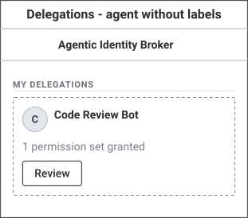
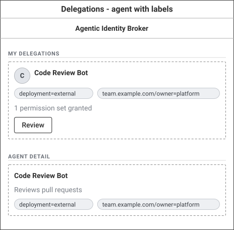
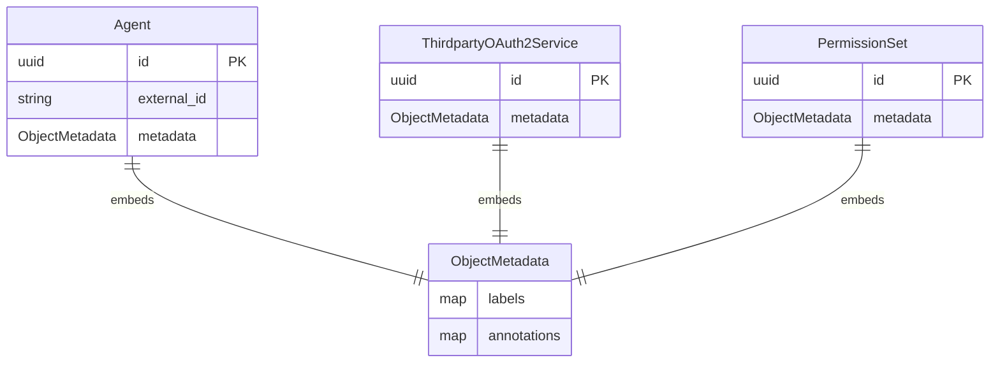
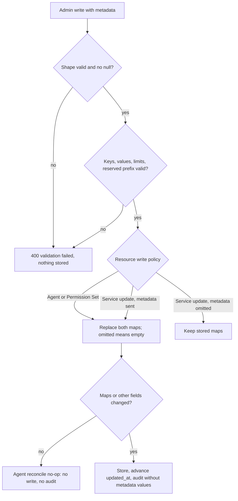

# Feature Specification: Labels and Annotations on Agents, Services, and Permission Sets

**Feature Branch**: `speckit/issue-427`

**Created**: 2026-11-27

**Status**: Draft

**Input**: [Issue #427 — Kubernetes-style labels and annotations on Agents, Services, and Permission Sets](https://github.com/zalando-incubator/agentic-identity-broker/issues/427)

Operators can attach Kubernetes-style **labels** and **annotations** to Agents, third-party OAuth2
Services, and Permission Sets through the Admin API. Labels categorize a resource, for example
`deployment=local` or `team.example.com/owner=platform`, and are designed to become policy input in
a later feature. Annotations hold non-identifying information for tools and people, such as the
GitOps source and revision of an Agent definition. End users see an Agent's labels, read-only, in
their delegation overview and agent detail. They never see annotations.

This feature stores, validates, and returns metadata. Labels and annotations play no part in
authorization, token claims, approval matching, or telemetry until a separate, accepted ADR wires
labels into CEL and OPA.

## User Scenarios & Testing *(mandatory)*

Each numbered acceptance scenario requires one corresponding E2E scenario under `tests/e2e/`
(Constitution XIII). Browser scenarios also require Playwright coverage under `tests/e2e/frontend/`.

### User Story 1 - Categorize and Annotate an Agent, Including by GitOps Reconciliation (Priority: P1)

An operator, or a GitOps controller acting through the Admin API, gives an Agent labels and
annotations when it creates, updates, or reconciles the Agent by External ID. The broker stores the
maps exactly as sent. A reconcile with the same maps in a different key order changes nothing. A
reconcile that changes only one label is a real, audited update.

**Why this priority**: Agents are the resource operators most need to categorize, and the GitOps
controller needs a place to record provenance. Reconcile replay must stay a no-op, or every
controller sync would rewrite and audit every Agent.

**Independent Test**: Create an Agent with labels and annotations, read it back, reconcile it by
External ID with reordered maps, then with one changed label, and compare `updated_at` and the
mutation audit records.

**Acceptance Scenarios**:

1. **US1.1 — Create with metadata**: **Given** an authorized Admin API caller, **When** the caller creates an Agent with `metadata.labels` and `metadata.annotations`, **Then** the `201` response and later reads and listings return both maps with exactly the submitted keys and values.
2. **US1.2 — Reordered replay is a no-op**: **Given** an Agent reconciled by External ID with labels and annotations, **When** the caller reconciles it again with an otherwise identical definition whose map keys appear in a different order, **Then** the response is `200` with the unchanged representation, `updated_at` is unchanged, nothing is written, and no mutation audit record is emitted.
3. **US1.3 — Label-only change is an update**: **Given** the same Agent, **When** the caller reconciles it with one label value changed and nothing else changed, **Then** the response is `200` with the new label, `updated_at` advances, and one mutation audit record is emitted. The audit record contains no label or annotation keys or values.
4. **US1.4 — Full replacement on Agent writes**: **Given** an Agent with labels and annotations, **When** the caller sends an ID-addressed `PUT` or an External-ID reconcile that omits `metadata`, or sends `metadata: {}`, or omits only `annotations`, **Then** each omitted or empty map is stored as empty, and the response omits empty maps.
5. **US1.5 — Null is rejected**: **Given** an Agent with metadata, **When** the caller sends `metadata`, `labels`, or `annotations` as `null` on create, update, or reconcile, **Then** the broker returns `400 validation failed` and the stored Agent is unchanged.

---

### User Story 2 - Reject Ambiguous, Malformed, or Reserved Metadata (Priority: P1)

Because labels will become policy input, the broker validates every key and value strictly and
literally. It never trims, case-folds, or normalizes them, and it rejects keys reserved for the
broker. A rejection never echoes the offending key or value.

**Why this priority**: A future policy that matches `exposure=external` must not be dodged with
`exposure=external ` or a look-alike key, and broker-defined labels must not collide with operator
keys. Validation that is lax now cannot be tightened later without breaking stored data.

**Independent Test**: Submit each invalid input class from FR-006 to FR-012 on each resource and
check for `400 validation failed`, an unchanged stored resource, and an error message that contains
neither the key nor the value.

**Acceptance Scenarios**:

1. **US2.1 — Invalid label keys and values**: **Given** an authorized caller, **When** the caller writes an Agent, Service, or Permission Set with a label key or value that violates FR-006 or FR-007, such as a value with trailing whitespace, a 64-character name, an uppercase prefix, or two `/` separators, **Then** the broker returns `400 validation failed` and stores nothing.
2. **US2.2 — Reserved prefix**: **Given** an authorized caller, **When** the caller writes a label or annotation whose key prefix is `agenticidentitybroker.dev` or a subdomain of it, such as `policy.agenticidentitybroker.dev/tier`, **Then** the broker returns `400 validation failed` and stores nothing. The prefix `example.agenticidentitybroker.dev.evil.com/` is an ordinary, allowed prefix.
3. **US2.3 — Size limits**: **Given** an authorized caller, **When** the caller writes 65 labels, or annotations whose keys and values total 65,537 UTF-8 bytes, **Then** the broker returns `400 validation failed`. 64 labels and annotations of exactly 65,536 bytes are accepted.
4. **US2.4 — No echo**: **Given** any rejected metadata write, **When** the caller reads the error response, **Then** the message names the failing map and rule category, for example `metadata.labels contains an invalid value`, and contains neither the submitted key nor the submitted value.
5. **US2.5 — Literal matching**: **Given** an Agent labeled `exposure=external`, **When** the caller writes another Agent labeled `Exposure=external`, **Then** both writes succeed, both Agents are returned with their keys exactly as sent, and the two keys are distinct.

---

### User Story 3 - Show an Agent's Labels to End Users (Priority: P2)

An end user sees an Agent's labels as read-only chips in the delegation overview and the agent
detail view. The end user never sees annotations, and cannot change labels.

**Why this priority**: Labels such as `deployment=local` help users judge an Agent before they
delegate to it. Display depends on the storage and Admin API work in User Story 1.

**Independent Test**: Give an Agent labels and annotations through the Admin API, then open the
end user's delegation overview and agent detail, and inspect both the JSON responses and the page.

**Acceptance Scenarios**:

1. **US3.1 — Labels in end-user responses**: **Given** an Agent with labels and annotations and an end user with a delegation to it, **When** the end user requests the delegation overview and the agent detail, **Then** both responses carry `metadata.labels` with exactly the stored labels and carry no annotations anywhere in the body.
2. **US3.2 — Label chips**: **Given** the same Agent, **When** the end user opens the delegation overview and the agent detail page, **Then** each view shows one read-only chip per label, ordered by key, showing `key=value`, or only `key` when the value is empty. The chips add no keyboard stop and no edit control.
3. **US3.3 — No labels**: **Given** an Agent without labels, including Agents created before this feature, **When** the end user opens both views, **Then** the responses omit `metadata` and the views show no chip area and no placeholder.
4. **US3.4 — Fresh labels after a change**: **Given** an end user who has seen an Agent's labels, **When** an operator changes them and the end user reloads the view, **Then** the view shows the new labels.

---

### User Story 4 - Categorize Permission Sets and Services (Priority: P2)

An operator attaches labels and annotations to Permission Sets and Services. Each resource keeps
its existing write policy: Permission Set writes replace metadata in full, and Service updates
keep stored metadata when the field is omitted.

**Why this priority**: Permission-set labels such as `sensitivity=high` are the second planned
policy input. Services need the same categorization. Both reuse the shared validation from User
Story 2.

**Independent Test**: Create and replace a Permission Set with and without metadata, and update a
Service with and without metadata, then read both back.

**Acceptance Scenarios**:

1. **US4.1 — Permission Set create and read**: **Given** an authorized caller, **When** the caller creates a Permission Set with labels and annotations, **Then** the response, reads, and listings return both maps unchanged.
2. **US4.2 — Permission Set PUT without metadata clears it**: **Given** a Permission Set with metadata, **When** the caller replaces it with a `PUT` that omits `metadata`, **Then** the stored labels and annotations are empty, the response omits `metadata`, and `updated_at` advances.
3. **US4.3 — Service update preserves omitted metadata**: **Given** a Service with labels and annotations, **When** the caller updates the Service without a `metadata` field, **Then** the stored metadata is unchanged.
4. **US4.4 — Service update replaces whole metadata**: **Given** the same Service, **When** the caller updates it with `metadata: {"labels": {"tier": "gold"}}`, **Then** the stored labels are exactly `{"tier": "gold"}`, the stored annotations are empty, and no previously stored key survives. `metadata: {}` clears both maps.
5. **US4.5 — Metadata has no runtime effect**: **Given** Agents, Services, and Permission Sets with labels and annotations, **When** a user consents, an agent exchanges a token, and a tool call needs approval, **Then** the consent decisions, issued token claims, and approval matching are identical to those for the same resources without metadata.

### Edge Cases

- A JSON object in `labels` or `annotations` repeats a key. The broker rejects the write with `400 validation failed` rather than keeping either value.
- A label value is the empty string. It is valid and is displayed as the key alone.
- A label value or annotation key contains trailing whitespace, a tab, or a non-ASCII letter. Label keys and values reject all of these. Annotation values accept any UTF-8 text without NUL, including whitespace, which is stored exactly.
- A key has a prefix but an empty name (`team.example.com/`), or an empty prefix (`/owner`). Both are invalid.
- A key prefix uses uppercase (`Team.example.com/owner`). Prefixes are lowercase DNS subdomains, so it is invalid. The name part may use uppercase.
- An annotation value contains U+0000 or invalid UTF-8. It is invalid.
- Annotation size is measured in UTF-8 bytes of the decoded keys and values, not of the JSON text or its escapes.
- A request sends `metadata` with unknown members besides `labels` and `annotations`. The broker rejects it with `400 validation failed`, as for other unknown request fields.
- A Service update sends `metadata: null`. The broker rejects it; `{}` is the way to clear.
- A rejected metadata write carries other valid field changes. The entire write fails without partial changes.
- Two concurrent reconciles of one External ID carry different labels. The existing last-writer-wins rule applies; each successful request stores its complete metadata.
- Existing rows created before the migration have empty labels and annotations, and their responses omit `metadata`.
- Metadata on Protected Resources and on signing or CIMD keys is out of scope; those endpoints reject or ignore `metadata` exactly as they treat other unknown fields today.

## Concrete Example Journeys *(mandatory)*

**Shared cast**: Operator Olivia (`olivia@example.com`) administers the broker through
`https://admin.broker.example.com`. The GitOps controller `agents-sync` calls the same Admin API.
The trusted proxy authenticates both and sets `X-Remote-User`. Agent **Code Review Bot**
(`550e8400-e29b-41d4-a716-446655440020`, External ID `acme/review-bot`) uses Permission Set
**GitHub Read Access** (`770e8400-e29b-41d4-a716-446655440001`) for Service **GitHub Production**
(`880e8400-e29b-41d4-a716-446655440010`). End user Alice (`alice@example.com`) holds a delegation to
Code Review Bot at `https://broker.example.com`. All values are synthetic. Times are UTC on
2026-11-27.

The `metadata` fields below describe the contract proposed by this feature, not an existing
capability. Response excerpts omit unrelated fields. No runtime configuration changes and no token
claims are involved.

### Journey 1 — A GitOps controller labels an Agent and Alice sees the labels (US1.1–US1.3, US3.1–US3.2)

**Step 1 — 10:00:00: `agents-sync` reconciles Code Review Bot from its Git source for the first time**

```http
PUT /api/agents?external_id=acme%2Freview-bot HTTP/1.1
Host: admin.broker.example.com
X-Remote-User: agents-sync
Content-Type: application/json

{
  "display_name": "Code Review Bot",
  "description": "Reviews pull requests",
  "permission_sets": [{"permission_set_id": "770e8400-e29b-41d4-a716-446655440001"}],
  "metadata": {
    "labels": {
      "deployment": "local",
      "team.example.com/owner": "platform"
    },
    "annotations": {
      "gitops.example.com/source": "https://github.com/acme/agents/blob/main/review-bot.yaml",
      "gitops.example.com/revision": "4f2c9e1"
    }
  }
}

HTTP/1.1 201 Created
Location: /api/agents/550e8400-e29b-41d4-a716-446655440020
Content-Type: application/json

{
  "id": "550e8400-e29b-41d4-a716-446655440020",
  "external_id": "acme/review-bot",
  "display_name": "Code Review Bot",
  "metadata": {
    "labels": {
      "deployment": "local",
      "team.example.com/owner": "platform"
    },
    "annotations": {
      "gitops.example.com/revision": "4f2c9e1",
      "gitops.example.com/source": "https://github.com/acme/agents/blob/main/review-bot.yaml"
    }
  },
  "created_at": "2026-11-27T10:00:00Z",
  "updated_at": "2026-11-27T10:00:00Z"
}
```

The response lists map keys in ascending byte order, whatever order the request used, so GitOps
diffs and snapshot tests stay stable.

**Step 2 — 10:05:00: the next sync sends the same maps with the keys in another order**

```http
PUT /api/agents?external_id=acme%2Freview-bot HTTP/1.1
Host: admin.broker.example.com
X-Remote-User: agents-sync
Content-Type: application/json

{
  "display_name": "Code Review Bot",
  "description": "Reviews pull requests",
  "permission_sets": [{"permission_set_id": "770e8400-e29b-41d4-a716-446655440001"}],
  "metadata": {
    "annotations": {
      "gitops.example.com/revision": "4f2c9e1",
      "gitops.example.com/source": "https://github.com/acme/agents/blob/main/review-bot.yaml"
    },
    "labels": {
      "team.example.com/owner": "platform",
      "deployment": "local"
    }
  }
}

HTTP/1.1 200 OK
Content-Type: application/json

{
  "id": "550e8400-e29b-41d4-a716-446655440020",
  "metadata": {"labels": {"deployment": "local", "team.example.com/owner": "platform"}, "annotations": {...}},
  "updated_at": "2026-11-27T10:00:00Z"
}
```

`updated_at` stays `10:00:00`. Nothing is written, and no mutation audit record is emitted.

**Step 3 — 10:10:00: the team moves the bot to an external deployment and the sync changes one label**

```http
PUT /api/agents?external_id=acme%2Freview-bot HTTP/1.1
Host: admin.broker.example.com
X-Remote-User: agents-sync
Content-Type: application/json

{
  "display_name": "Code Review Bot",
  "description": "Reviews pull requests",
  "permission_sets": [{"permission_set_id": "770e8400-e29b-41d4-a716-446655440001"}],
  "metadata": {
    "labels": {"deployment": "external", "team.example.com/owner": "platform"},
    "annotations": {
      "gitops.example.com/source": "https://github.com/acme/agents/blob/main/review-bot.yaml",
      "gitops.example.com/revision": "9b31d07"
    }
  }
}

HTTP/1.1 200 OK
Content-Type: application/json

{
  "id": "550e8400-e29b-41d4-a716-446655440020",
  "metadata": {
    "labels": {"deployment": "external", "team.example.com/owner": "platform"},
    "annotations": {
      "gitops.example.com/revision": "9b31d07",
      "gitops.example.com/source": "https://github.com/acme/agents/blob/main/review-bot.yaml"
    }
  },
  "updated_at": "2026-11-27T10:10:00Z"
}
```

`updated_at` advances and one mutation audit record names the Agent and the caller. The record
contains no label or annotation keys or values.

**Step 4 — 10:12:00: Alice opens her delegation overview**

```http
GET /api/consent/agents HTTP/1.1
Host: broker.example.com
X-Remote-User: alice@example.com

HTTP/1.1 200 OK
Content-Type: application/json

{
  "data": [
    {
      "agentId": "550e8400-e29b-41d4-a716-446655440020",
      "displayName": "Code Review Bot",
      "metadata": {
        "labels": {"deployment": "external", "team.example.com/owner": "platform"}
      },
      "activeGrantCount": 1,
      "lastModifiedAt": "2026-11-27T09:00:00Z"
    }
  ]
}
```

The body carries no `annotations` member. `GET /api/consent/agents/550e8400-e29b-41d4-a716-446655440020`
returns the same `metadata.labels` in its `AgentDetail` body.

State A — overview and detail of an Agent without labels:



<details><summary>Wireloom source</summary>

```wireloom
window "Delegations - agent without labels":
  header:
    text "Agentic Identity Broker" bold
  section "My delegations":
    panel:
      row:
        avatar "C" size=medium
        text "Code Review Bot" bold
      text "1 permission set granted" muted
      button "Review"
```

</details>

Action: `agents-sync` labels the Agent in steps 1–3. Alice reloads the overview and opens the agent
detail.

State B — label chips in the overview and the detail:



<details><summary>Wireloom source</summary>

```wireloom
window "Delegations - agent with labels":
  header:
    text "Agentic Identity Broker" bold
  section "My delegations":
    panel:
      row:
        avatar "C" size=medium
        text "Code Review Bot" bold
      row:
        chip "deployment=external"
        chip "team.example.com/owner=platform"
      text "1 permission set granted" muted
      button "Review"
  section "Agent detail":
    panel:
      text "Code Review Bot" bold
      text "Reviews pull requests" muted
      row:
        chip "deployment=external"
        chip "team.example.com/owner=platform"
```

</details>

**Observable result**: Alice sees two read-only chips, `deployment=external` and
`team.example.com/owner=platform`, in both views. She sees neither annotation.

### Journey 2 — Olivia labels a Permission Set, then replaces it without metadata (US4.1–US4.2)

**Step 1 — 11:00:00: Olivia creates a sensitive Permission Set**

```http
POST /api/permission-sets HTTP/1.1
Host: admin.broker.example.com
X-Remote-User: olivia@example.com
Content-Type: application/json

{
  "name": "GitHub Admin Access",
  "description": "Administer GitHub repositories",
  "service_scopes": [{"service_id": "880e8400-e29b-41d4-a716-446655440010", "scopes": ["admin:org"]}],
  "metadata": {
    "labels": {"sensitivity": "high"},
    "annotations": {"docs.example.com/runbook": "Ask #platform before granting."}
  }
}

HTTP/1.1 201 Created
Content-Type: application/json

{
  "id": "770e8400-e29b-41d4-a716-446655440002",
  "name": "GitHub Admin Access",
  "metadata": {
    "labels": {"sensitivity": "high"},
    "annotations": {"docs.example.com/runbook": "Ask #platform before granting."}
  },
  "created_at": "2026-11-27T11:00:00Z",
  "updated_at": "2026-11-27T11:00:00Z"
}
```

**Step 2 — 11:20:00: Olivia replaces the Permission Set with a body that has no `metadata`**

```http
PUT /api/permission-sets/770e8400-e29b-41d4-a716-446655440002 HTTP/1.1
Host: admin.broker.example.com
X-Remote-User: olivia@example.com
Content-Type: application/json

{
  "name": "GitHub Admin Access",
  "description": "Administer GitHub repositories",
  "service_scopes": [{"service_id": "880e8400-e29b-41d4-a716-446655440010", "scopes": ["admin:org"]}]
}

HTTP/1.1 200 OK
Content-Type: application/json

{
  "id": "770e8400-e29b-41d4-a716-446655440002",
  "name": "GitHub Admin Access",
  "updated_at": "2026-11-27T11:20:00Z"
}
```

**Observable result**: the response and later reads omit `metadata`; the stored labels and
annotations are empty.

### Journey 3 — Olivia updates a Service with and without metadata (US4.3–US4.4)

Service `PUT` is a full replacement with documented omission exceptions. In the requests below,
`...` stands for the Service's other required fields, repeated unchanged from its stored
configuration.

**Step 1 — 12:00:00: GitHub Production has labels `tier=gold` and `region=eu`. Olivia changes only its display name**

```http
PUT /api/services/880e8400-e29b-41d4-a716-446655440010 HTTP/1.1
Host: admin.broker.example.com
X-Remote-User: olivia@example.com
Content-Type: application/json

{"display_name": "GitHub (Production)", ...}

HTTP/1.1 200 OK
Content-Type: application/json

{
  "id": "880e8400-e29b-41d4-a716-446655440010",
  "display_name": "GitHub (Production)",
  "metadata": {"labels": {"region": "eu", "tier": "gold"}}
}
```

**Step 2 — 12:05:00: Olivia sends new metadata with only one label**

```http
PUT /api/services/880e8400-e29b-41d4-a716-446655440010 HTTP/1.1
Host: admin.broker.example.com
X-Remote-User: olivia@example.com
Content-Type: application/json

{"display_name": "GitHub (Production)", ..., "metadata": {"labels": {"tier": "platinum"}}}

HTTP/1.1 200 OK
Content-Type: application/json

{
  "id": "880e8400-e29b-41d4-a716-446655440010",
  "metadata": {"labels": {"tier": "platinum"}}
}
```

**Observable result**: `region=eu` is gone. Sent metadata replaces stored metadata whole; keys are
never merged.

### Journey 4 — The broker rejects a reserved key without echoing it (US2.2, US2.4)

**Step 1 — 13:00:00: a misconfigured sync sends a broker-reserved label**

```http
POST /api/agents HTTP/1.1
Host: admin.broker.example.com
X-Remote-User: agents-sync
Content-Type: application/json

{
  "display_name": "Docs Bot",
  "description": "Answers documentation questions",
  "permission_sets": [{"permission_set_id": "770e8400-e29b-41d4-a716-446655440001"}],
  "metadata": {"labels": {"policy.agenticidentitybroker.dev/tier": "trusted"}}
}

HTTP/1.1 400 Bad Request
Content-Type: application/json

{
  "error": "validation failed",
  "message": "metadata.labels contains a reserved key"
}
```

**Observable result**: no Agent is created, and the message contains neither the key nor the value.

## Requirements *(mandatory)*

### Functional Requirements

**Shape**

- **FR-001**: The Admin API representations of Agent, Service, and Permission Set MUST accept and return an optional `metadata` object whose only members are `labels` and `annotations`. Each is an object that maps string keys to string values.
- **FR-002**: `id`, `external_id`, `canonical_id`, `display_name`, `name`, and timestamps MUST stay at the top level. The change MUST be additive for existing clients that never send `metadata`.
- **FR-003**: Responses MUST omit an empty `labels` or `annotations` map, and MUST omit `metadata` when both are empty. Map members MUST be serialized in ascending byte order of their keys.

**Validation** (shared by all three resources)

- **FR-004**: The broker MUST match keys and values literally. It MUST NOT trim, case-fold, or apply Unicode normalization to them, before validation, in storage, or in responses.
- **FR-005**: Label and annotation keys MUST have the form `[prefix/]name`. The optional prefix is a lowercase RFC 1123 DNS subdomain of at most 253 characters. The name has 1–63 characters, starts and ends with `[A-Za-z0-9]`, and contains only `[A-Za-z0-9]`, `-`, `_`, and `.` in between. A key contains at most one `/`.
- **FR-006**: Label values MUST be empty, or have 1–63 characters that start and end with `[A-Za-z0-9]` and contain only `[A-Za-z0-9]`, `-`, `_`, and `.` in between.
- **FR-007**: An object MUST hold at most 64 labels.
- **FR-008**: Annotation values MUST be valid UTF-8 without U+0000. The UTF-8 byte lengths of all annotation keys and values of one object MUST total at most 65,536 bytes, measured after JSON decoding.
- **FR-009**: Keys whose prefix is `agenticidentitybroker.dev` or ends with `.agenticidentitybroker.dev` are reserved for the broker. Admin API writes containing such a key in `labels` or `annotations` MUST be rejected.
- **FR-010**: A `labels` or `annotations` object that repeats a key, and a `metadata` object with members other than `labels` and `annotations`, MUST be rejected.
- **FR-011**: `null` for `metadata`, `labels`, or `annotations` MUST be rejected on every write of every resource.
- **FR-012**: A failed metadata validation MUST return the existing `400 validation failed` envelope. Its message MUST name the map (`metadata.labels` or `metadata.annotations`) and the rule category, and MUST NOT contain the offending key or value. The whole write MUST fail without partial changes.

**Write semantics**

- **FR-013**: Agent create, ID-addressed `PUT`, and External-ID collection `PUT` MUST replace metadata in full. An omitted or empty `metadata`, `labels`, or `annotations` means empty. This extends the update-branch field policy of `adrs/047-unique-agent-external-id-reconcile.md`.
- **FR-014**: The Agent reconcile no-op comparison MUST compare labels and annotations as maps, independent of key order. A difference in either map MUST be a real update that advances `updated_at` and emits the existing mutation audit record.
- **FR-015**: Permission Set create and `PUT` MUST replace metadata in full; an omitted `metadata` means empty.
- **FR-016**: Service create MUST treat an omitted `metadata` as empty. Service update (`PUT`) MUST add `metadata` to its documented omission exceptions: it MUST keep stored metadata when `metadata` is omitted and MUST replace both maps whole when `metadata` is sent, treating an omitted member as empty. Keys are never merged.
- **FR-017**: Any accepted change to labels or annotations of a Service or Permission Set MUST advance its `updated_at` and be audited as the resource's existing updates are.
- **FR-018**: Only Admin API callers MUST be able to write metadata. No end-user, agent, OAuth2, or token-exchange endpoint accepts or changes it.

**End-user exposure**

- **FR-019**: The end-user `AgentDelegation` and `AgentDetail` representations MUST carry the Agent's labels, read-only, as `metadata.labels`, following FR-003. They MUST NOT carry annotations. Service and Permission Set metadata MUST NOT appear in any end-user response. [NEEDS CLARIFICATION: The issue's Decision 2 says "End-user visibility: admin-only for now", while its comparison table and scope items 2–3 expose Agent labels read-only to end users and show them as chips. Which applies? Recommended: Agent labels are shown to end users, annotations never; this spec assumes so.]
- **FR-020**: The SPA delegation overview and agent detail MUST show each label as a read-only chip ordered by key, with the text `key=value`, or `key` when the value is empty. The views MUST offer no label filtering or editing.

**Isolation from runtime behavior and telemetry**

- **FR-021**: Labels and annotations MUST NOT influence authorization, consent, token issuance or claims, CEL evaluation, ExtProc or OPA input, approval matching, or AuthZEN Grant Context.
- **FR-022**: Label and annotation keys and values MUST NOT appear in any log record, audit record, span attribute, span event, or metric attribute.

### Domain Model





**Value Objects**:
- **Object Metadata**: an immutable pair of a label map and an annotation map, validated as a
  whole on construction under FR-004 to FR-011. Equality is map equality, independent of order.
  Agent, ThirdpartyOAuth2Service, and PermissionSet each embed exactly one.
- **Label**: an identifying, categorizing key/value pair under FR-005 and FR-006. Designed as
  future policy input; until an accepted ADR says otherwise it has no runtime effect.
- **Annotation**: a non-identifying key/value pair for tools and people under FR-005 and FR-008.
  Never policy input.

**Domain Events**: none new. Metadata changes are ordinary updates of the embedding resource.

*Label, Annotation, and Object Metadata MUST be added to the `ARCHITECTURE.md` glossary.*

### API Requirements

- **API-001**: The Admin API MUST add `metadata` to `Agent`, `AgentCreateRequest`, `AgentUpdateRequest`, `Service`, `ServiceCreateRequest`, `ServiceUpdateRequest`, `CreatePermissionSetRequest`, and `PermissionSetResponse` in `api/admin/openapi.yaml`, with the rules of FR-003 to FR-017, and bump its version from 3.0.0 to 3.1.0. The collection `PUT` field-policy table MUST gain a `metadata` row.
- **API-002**: The End-User API MUST add read-only `metadata.labels` to `AgentDelegation` and `AgentDetail` in `api/enduser/openapi.yaml` and bump its minor version. The issue names 1.2.0 → 1.3.0; the document is already at 1.3.0, so the bump is 1.3.0 → 1.4.0.
- **API-003**: Both documents MUST show examples with labels and annotations, the omission of empty maps, and the `validation failed` messages of FR-012.
- **API-004**: All API changes MUST be confirmed by the maintainer before implementation (Constitution X).

### Database Requirements

- **DB-001**: One atomic migration MUST add `labels JSONB NOT NULL DEFAULT '{}'` and `annotations JSONB NOT NULL DEFAULT '{}'` to `agents`, `thirdparty_oauth2_services`, and `permission_sets`, with a down migration that removes them.
- **DB-002**: The in-memory and PostgreSQL adapters MUST both store and return metadata, with integration tests for both and for the migration in both directions.
- **DB-003**: No index on the new columns is added; label selectors and their index are a follow-up.

### Security Requirements

- **SR-001**: Metadata validation MUST fail closed: any doubt about a key, value, shape, or size rejects the whole write.
- **SR-002**: Only the Admin API, behind its existing authentication, can write metadata (FR-018).
- **SR-003**: The reserved prefix of FR-009 MUST be enforced on every Admin write path, including collection `PUT`.
- **SR-004**: Error responses, logs, audit records, and telemetry MUST NOT contain metadata keys or values (FR-012, FR-022).
- **SR-005**: An ADR MUST record the metadata model, the validation rules, the reserved prefix, the write semantics, and the decision that metadata has no runtime effect until a superseding ADR wires labels into CEL and OPA.

### Frontend/Design System Requirements

- Label chips MUST use the design system's existing badge or chip primitive and semantic tokens
  from `web/src/design-system/`, as chosen through `DECISION_TREES.md`. No new universal component
  is expected.
- Chips are static text: they are not focusable and not interactive, and they wrap at narrow
  viewports without truncating the key or value.
- WCAG 2.1 AA contrast applies to chip text.

### Key Entities

- **Agent**, **ThirdpartyOAuth2Service**, **PermissionSet**: existing entities, each gaining one
  Object Metadata value.
- **Object Metadata**, **Label**, **Annotation**: new value objects; see Domain Model.

## Success Criteria *(mandatory)*

### Measurable Outcomes

- **SC-001**: An operator can label and annotate an Agent, a Service, and a Permission Set in one Admin API request each, and reads return 100% of the submitted keys and values byte for byte.
- **SC-002**: 100 consecutive reconciles of an unchanged Agent definition, with map keys shuffled in each request, produce zero writes, zero `updated_at` changes, and zero mutation audit records.
- **SC-003**: Every input class of FR-005 to FR-011 is rejected on every write path of all three resources, and none of the error messages contains the offending key or value.
- **SC-004**: End users see an Agent's labels in both the delegation overview and the agent detail, and no end-user response contains an annotation.
- **SC-005**: Consent decisions, token claims, and approval matching are identical with and without metadata on the involved resources.
- **SC-006**: No log record, audit record, span, or metric produced by the E2E suite contains a label or annotation key or value used by the suite.

## Assumptions

- `null` is rejected for `metadata`, `labels`, and `annotations` on all three resources, including Service updates; `{}` clears. The issue states this for Agents only; applying it everywhere keeps one validation rule and one way to clear.
- Inside a sent `metadata` object, an omitted `labels` or `annotations` member means empty for every resource, consistent with "keys are never merged".
- Label keys and values use the Kubernetes character rules; annotation keys use the same key rules, and annotation values are free UTF-8 text without NUL.
- A repeated key in one JSON object is rejected rather than resolved last-wins, because the stored result would otherwise depend on parser behavior.
- The existing mutation audit records for Agents, Services, and Permission Sets are reused unchanged; they name the resource and caller but not metadata values.
- The delegation overview and agent detail already load fresh data on navigation or reload; no live push of label changes is required.

### Out of Scope

- Label selectors on `GET /api/agents` and `GET /api/services`, and their index.
- Admin UI display or filtering of metadata.
- Exposing labels to CEL, ExtProc, OPA, or the AuthZEN Grant Context. This needs its own ADR, which also decides which labels reach OPA, their freshness, and any tighter write control for particular keys.
- Showing Permission Set labels to end users on the consent screen.
- Metadata on Protected Resources and on signing or CIMD keys.

### Dependencies

- `adrs/047-unique-agent-external-id-reconcile.md`: External-ID reconcile, full-replacement policy, and the no-op rule extended by FR-013 and FR-014.
- `adrs/048-authzen-delegation-pip.md`: the Grant Context that a later ADR may extend with labels.
- `coding-standards/LOGGING.md` and `coding-standards/OPENTELEMETRY.md`: the basis for FR-022.
