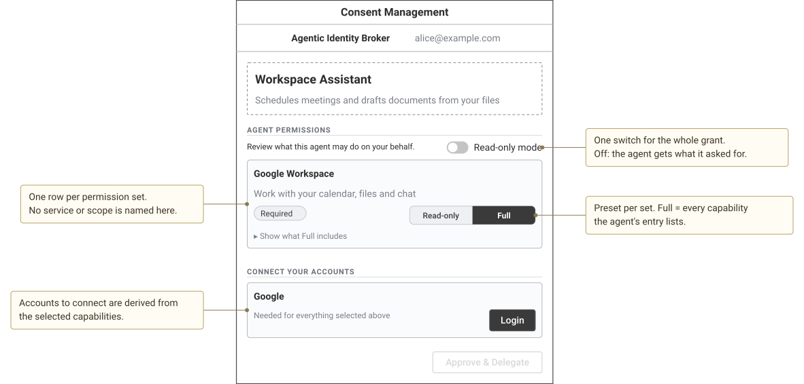
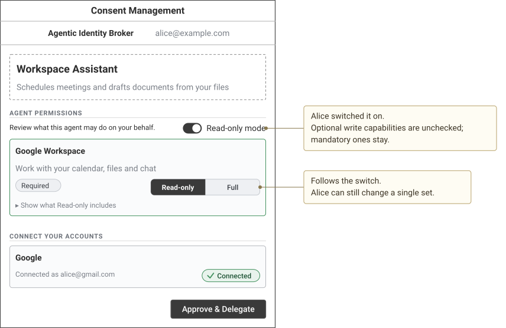
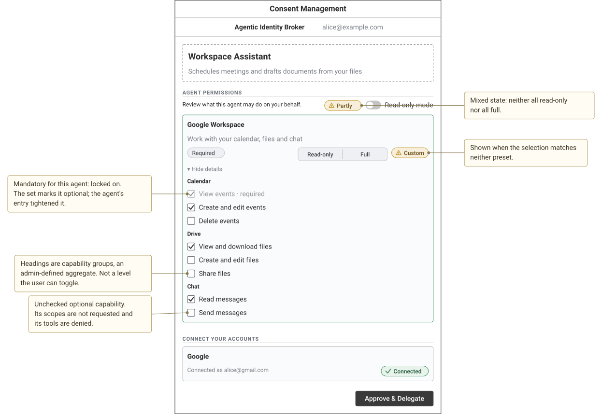
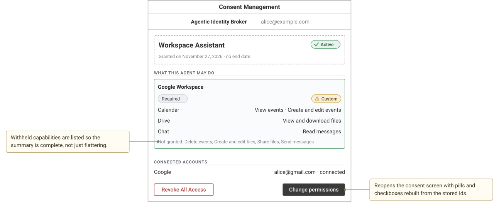
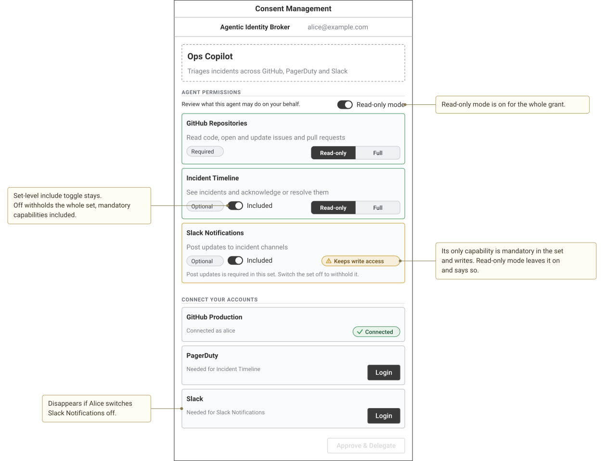
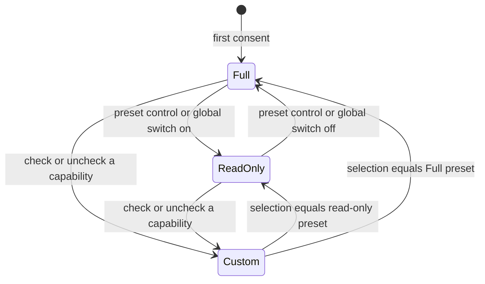

# Feature Specification: Read-Only Mode and Capability-Level Consent

**Feature Branch**: `speckit/issue-580`

**Created**: 2026-11-27

**Status**: Draft

**Input**: [Issue #580 — Read-only mode and capability-level choice on the consent screen](https://github.com/zalando-incubator/agentic-identity-broker/issues/580), part 2 of 2 of [issue #285](https://github.com/zalando-incubator/agentic-identity-broker/issues/285). It depends on Feature 1, [Capability Model for Permission Sets](https://github.com/zalando-incubator/agentic-identity-broker/blob/speckit/issue-579/specs/20261127-140720-capability-model/spec.md).

Users can narrow what an agent may do on the consent screen. They can switch on one read-only switch or choose individual capabilities inside a permission set. They never see an OAuth2 service or scope.
The grant stores the user's choice, and the accounts to connect follow from it.
Feature 1's model then requests only the chosen capabilities' scopes and gives their canonical IDs to ExtProc policy, so tools behind withheld capabilities are denied at the gateway.
After approval, users can review what they granted and withheld, and change it.

## User Scenarios & Testing *(mandatory)*

Each numbered acceptance scenario requires one corresponding E2E scenario under `tests/e2e/` (Constitution XIII).
Consent-screen scenarios also require Playwright coverage under `tests/e2e/frontend/`, with screenshots of each wireframed state.
Enforcement scenarios run in the ExtProc E2E suite against the embedded OPA engine.

The examples use the following cast, which [Concrete Example Journeys](#concrete-example-journeys-mandatory) defines in full.
The *Google Workspace* permission set includes eight optional capabilities in three groups:

- Calendar: *View events* (read-only), *Create and edit events*, and *Delete events*.
- Drive: *View and download files* (read-only), *Create and edit files*, and *Share files*.
- Chat: *Read messages* (read-only) and *Send messages*.

Agent *Workspace Assistant* lists all eight capabilities and makes *View events* mandatory.

### User Story 1 - Grant an Agent Read-Only Access with One Switch (Priority: P1)

Alice opens the consent screen for an agent. She wants the agent to look but not change anything.
She switches **Read-only mode** on, connects the accounts that the selection needs, and approves.
The agent can then use read-only tools. Tools that write are denied unless a capability that writes is mandatory, and the screen named that capability before Alice approved.

**Why this priority**: This is the most common narrowing a user wants. It must take one action and must not expose OAuth2 terms.

**Independent Test**: Seed the Workspace Assistant cast. Open the consent screen, switch Read-only mode on, and approve. Inspect the stored grant and the token-exchange result.

**Acceptance Scenarios**:

1. **US1.1 — First consent as loaded**: **Given** Alice has never consented to Workspace Assistant and has no Google session, **When** she opens the consent screen, **Then** she sees one row for *Google Workspace* with its preset control at **Full**, a collapsed details link, and no service or scope name on the permissions card. Connect Your Accounts lists only Google. **Approve & Delegate** stays disabled until Google is connected.
2. **US1.2 — Read-only mode unchecks optional writes**: **Given** Alice has connected Google, **When** she switches Read-only mode on, **Then** every optional capability that is not read-only is unchecked. *View events*, *View and download files*, and *Read messages* stay checked. The row's preset control shows **Read-only**. Approving stores exactly those three capability IDs.
3. **US1.3 — Mandatory write stays on and is named**: **Given** agent *Ops Copilot* includes the optional *Slack Notifications* set, whose only capability, *Post updates*, is mandatory and writes, **When** Alice switches Read-only mode on and keeps the set included, **Then** the Slack row shows **Keeps write access** and names *Post updates*. GitHub Repositories and Incident Timeline change to their read-only presets.
4. **US1.4 — Switching a set off withholds it entirely**: **Given** the state in US1.3, **When** Alice switches *Slack Notifications* off and approves, **Then** the grant has no entry for that set. Connect Your Accounts no longer asks for a Slack login. The broker does not request Slack scopes for that grant.
5. **US1.5 — Accounts follow the selection**: **Given** a set whose capabilities need two services, **When** Alice unchecks every capability that needs one of them, **Then** that service disappears from Connect Your Accounts. Approve no longer waits for that service's connection.

### User Story 2 - Choose Individual Capabilities Inside a Permission Set (Priority: P1)

Alice expands a permission set and chooses individual capabilities under their group headings.
The screen shows that her selection is custom, and the agent can do exactly what she checked.

**Why this priority**: Read-only mode can be too coarse. Per-capability choice gives users exact control with the same unit, so it does not add another concept.

**Independent Test**: Expand the Google Workspace row, check one capability that writes on top of the read-only preset, and approve. Verify the stored IDs, the requested scopes, and policy decisions for two tools.

**Acceptance Scenarios**:

1. **US2.1 — Group headings and locked mandatory entries**: **Given** the consent screen for Workspace Assistant, **When** Alice expands the Google Workspace row, **Then** she sees the headings Calendar, Drive and Chat, each with its capabilities as checkboxes. *View events* is checked, disabled, and marked required, because the agent's entry made it mandatory.
2. **US2.2 — Custom and Partly states**: **Given** Read-only mode is on, **When** Alice additionally checks *Create and edit events*, **Then** the row shows **Custom** and the global switch shows **Partly**. Approving stores four capability IDs: *View events*, *Create and edit events*, *View and download files*, and *Read messages*.
3. **US2.3 — Presets are derived, not stored**: **Given** Alice checks, in a custom selection, exactly the capabilities of the set's read-only preset, **When** the screen recomputes, **Then** the row shows **Read-only** instead of **Custom**. The stored grant is identical to one approved through the preset.
4. **US2.4 — Invalid selections are rejected**: **Given** a grant request that omits a capability mandatory for the agent, includes a capability that the set does not include, or repeats a capability, **When** the broker receives it, **Then** the broker rejects it with `400` and a problem detail that names the offending entry. The previous grant remains unchanged.

### User Story 3 - Withheld Capabilities Are Denied at the Gateway (Priority: P1)

The operator's policy maps tools to capabilities, as Feature 1 introduced. After Alice narrows her grant, the agent can call only the tools behind capabilities she granted, and the upstream token carries only their scopes.

**Why this priority**: Without enforcement, the choice on the consent screen is cosmetic.

**Independent Test**: Use the ExtProc E2E suite with Feature 1's sample policy. Exchange a token for Alice's custom grant from US2.2 and send two `tools/call` requests.

**Acceptance Scenarios**:

1. **US3.1 — Granted capability allows the tool**: **Given** Alice's grant from US2.2 and the sample policy, **When** the agent calls `calendar_create_event`, **Then** OPA receives the canonical IDs `google-calendar-edit`, `google-calendar-view`, `google-chat-read`, and `google-drive-view`. The call is forwarded to the MCP target server.
2. **US3.2 — Withheld capability denies the tool**: **Given** the same grant, **When** the agent calls `drive_share_file`, **Then** ExtProc denies the call before it reaches the MCP target server. The response is the existing policy-denial response and carries the consent-page error URI.
3. **US3.3 — Scopes follow the selection**: **Given** the same grant, **When** the broker performs the token exchange for Google, **Then** it requests the Calendar write scope together with only the read scopes for Drive and Chat. The agent's service-requirement scope ceiling still caps the requested scopes.

### User Story 4 - Review and Change a Delegation (Priority: P2)

Alice reopens an agent from *My Agent Delegations*. She sees what the agent may do, grouped by capability group, and what she withheld.
**Change permissions** reopens the consent screen as she left it.

**Why this priority**: Users must be able to check and correct a delegation after approval. They should not need to remember which boxes they checked.

**Independent Test**: Approve the custom grant from US2.2. Open the delegation detail page, then choose Change permissions.

**Acceptance Scenarios**:

1. **US4.1 — Complete summary**: **Given** Alice approved the grant from US2.2, **When** she opens Workspace Assistant from My Agent Delegations, **Then** she sees, under *Google Workspace* marked **Custom**: Calendar "View events · Create and edit events", Drive "View and download files", and Chat "Read messages". A "Not granted" line lists *Delete events*, *Create and edit files*, *Share files*, and *Send messages*. Connected accounts appear in their own section.
2. **US4.2 — Change permissions restores the selection**: **Given** the same page, **When** Alice chooses Change permissions, **Then** the consent screen opens with the same four capabilities checked. It shows the Custom and Partly states, and *View events* stays locked.

### Edge Cases

- **Operator adds a capability to a set after Alice consented**: The outcome depends on whether **Full** is stored as intent or as a snapshot. See FR-004.
- **A capability that is mandatory and writes, inside a mandatory set**: Read-only mode cannot remove it, and the set cannot be switched off. The row shows **Keeps write access**, and the global switch shows **Partly** instead of on (FR-002, FR-005).
- **Every optional capability of a set is unchecked**: The set's entry still contains its mandatory capabilities. An optional set with no mandatory capabilities and nothing checked counts as switched off and has no entry.
- **A capability needs two services**: Both services appear in Connect Your Accounts while the capability is checked.
- **A grant from before this feature**: Its stored capabilities, from Feature 1, rebuild the screen like any other grant. If they match neither preset, the row shows **Custom**.
- **A capability the agent entry does not list**: It is not shown and cannot be granted for this agent.

## Concrete Example Journeys *(mandatory)*

All IDs, tokens and accounts are synthetic. All times are 2026-11-27 UTC.

**Cast** (used by every journey):

- User Alice, `alice@example.com`, asserted by the pre-authentication proxy as `X-Remote-User`. Her Google account is `alice@gmail.com`.
- Agent *Workspace Assistant* `550e8400-e29b-41d4-a716-446655440000` (canonical `workspace-assistant`). Its mandatory entry for *Google Workspace* lists all eight capabilities and tightens *View events* to mandatory.
- Agent *Ops Copilot* `550e8400-e29b-41d4-a716-446655440001`. It has entries for *GitHub Repositories* (mandatory), *Incident Timeline* (optional), and *Slack Notifications* (optional).
- Service *Google* `880e8400-e29b-41d4-a716-446655440010` (canonical `google`).
- Permission set *Google Workspace* `770e8400-e29b-41d4-a716-446655440001` (canonical `google-workspace`), with all eight entries optional.
- The operator configured these capability groups and capabilities through Feature 1's Admin API:

| Group (canonical) | Capability | UUID | Canonical ID | `read_only` | Google scopes |
|---|---|---|---|---|---|
| Calendar (`google-calendar`) | View events | `9a7e0000-0000-4000-8000-000000000001` | `google-calendar-view` | true | `calendar.readonly` |
| | Create and edit events | `9a7e0000-0000-4000-8000-000000000002` | `google-calendar-edit` | false | `calendar.events` |
| | Delete events | `9a7e0000-0000-4000-8000-000000000003` | `google-calendar-delete` | false | `calendar.events` |
| Drive (`google-drive`) | View and download files | `9a7e0000-0000-4000-8000-000000000004` | `google-drive-view` | true | `drive.readonly` |
| | Create and edit files | `9a7e0000-0000-4000-8000-000000000005` | `google-drive-edit` | false | `drive.file` |
| | Share files | `9a7e0000-0000-4000-8000-000000000006` | `google-drive-share` | false | `drive` |
| Chat (`google-chat`) | Read messages | `9a7e0000-0000-4000-8000-000000000007` | `google-chat-read` | true | `chat.messages.readonly` |
| | Send messages | `9a7e0000-0000-4000-8000-000000000008` | `google-chat-send` | false | `chat.messages.create` |

Scope names abbreviate `https://www.googleapis.com/auth/<name>`. The ExtProc policy is Feature 1's sample, which maps `calendar_list_events` to `google-calendar-view`, `calendar_create_event` to `google-calendar-edit`, and `drive_share_file` to `google-drive-share`.

### Journey 1 — Alice approves Workspace Assistant in read-only mode (User Story 1, Scenarios US1.1–US1.2; User Story 3, Scenario US3.2)

**Step 1 — 09:30:00: Alice opens the consent screen (US1.1)**



<details><summary>Wireloom source</summary>

```wireloom
window "Consent Management":
  header:
    row:
      text "Agentic Identity Broker" bold
      spacer
      text "alice@example.com" muted
  panel:
    text "Workspace Assistant" bold size=large
    text "Schedules meetings and drafts documents from your files" muted
  section "Agent Permissions":
    row:
      text "Review what this agent may do on your behalf." size=small
      spacer
      toggle "Read-only mode" off label-right id="ro-mode"
    slot "Google Workspace" id="ps-row":
      text "Work with your calendar, files and chat" muted
      row:
        chip "Required"
        spacer
        segmented id="level":
          segment "Read-only"
          segment "Full" selected
      text "▸ Show what Full includes" size=small muted id="details"
  section "Connect Your Accounts":
    slot "Google" id="connect":
      row:
        text "Needed for everything selected above" muted size=small
        spacer
        button "Login" primary
  row align=right:
    button "Approve & Delegate" disabled id="approve"

annotation "One switch for the whole grant.\nOff: the agent gets what it asked for." target="ro-mode" position=right
annotation "One row per permission set.\nNo service or scope is named here." target="ps-row" position=left
annotation "Preset per set. Full = every capability\nthe agent's entry lists." target="level" position=right
annotation "Accounts to connect are derived from\nthe selected capabilities." target="connect" position=left
```

</details>

**Step 2 — 09:30:40: Alice connects Google, then switches Read-only mode on (US1.2)**



<details><summary>Wireloom source</summary>

```wireloom
window "Consent Management":
  header:
    row:
      text "Agentic Identity Broker" bold
      spacer
      text "alice@example.com" muted
  panel:
    text "Workspace Assistant" bold size=large
    text "Schedules meetings and drafts documents from your files" muted
  section "Agent Permissions":
    row:
      text "Review what this agent may do on your behalf." size=small
      spacer
      toggle "Read-only mode" on label-right id="ro-mode"
    slot "Google Workspace" accent=success:
      text "Work with your calendar, files and chat" muted
      row:
        chip "Required"
        spacer
        segmented id="level":
          segment "Read-only" selected
          segment "Full"
      text "▸ Show what Read-only includes" size=small muted
  section "Connect Your Accounts":
    slot "Google":
      row:
        text "Connected as alice@gmail.com" muted size=small
        spacer
        status "Connected" kind=success
  row align=right:
    button "Approve & Delegate" primary

annotation "Alice switched it on.\nOptional write capabilities are unchecked;\nmandatory ones stay." target="ro-mode" position=right
annotation "Follows the switch.\nAlice can still change a single set." target="level" position=right
```

</details>

**Step 3 — 09:31:05: Alice approves**. The request field name and shape follow the decision in FR-004 and the end-user OpenAPI design (API-001). This journey shows the explicit-ID form.

```http
POST /api/consent/agents/550e8400-e29b-41d4-a716-446655440000/grants HTTP/1.1
Host: broker.example.com
X-Remote-User: alice@example.com
Content-Type: application/json

{
  "granted_permission_sets": {
    "770e8400-e29b-41d4-a716-446655440001": {
      "granted_capability_ids": [
        "9a7e0000-0000-4000-8000-000000000001",
        "9a7e0000-0000-4000-8000-000000000004",
        "9a7e0000-0000-4000-8000-000000000007"
      ]
    }
  }
}

HTTP/1.1 201 Created
Content-Type: application/json

{ "grant_id": "aa000000-0000-4000-8000-000000000001", "...": "..." }
```

**Step 4 — 09:40:00: the agent calls `drive_share_file` through the gateway (US3.2)**. The broker requested `calendar.readonly drive.readonly chat.messages.readonly` from Google. Policy receives, abbreviated:

```json
{
  "type": "mcp_tool_call",
  "mcp": { "tool_name": "drive_share_file" },
  "context": {
    "granted_capabilities": ["google-calendar-view", "google-chat-read", "google-drive-view"]
  }
}
```

**Observable result**: `google-drive-share` is not in the list, so the agent receives the existing ExtProc policy-denial response, and the call never reaches the Google MCP server. A `calendar_list_events` call is forwarded.

### Journey 2 — Alice adds one write capability to the read-only preset (User Story 2, Scenarios US2.1–US2.2; User Story 3, Scenarios US3.1, US3.3; User Story 4)

**Step 1 — 10:00:00: from State B, Alice expands the row and checks *Create and edit events***



<details><summary>Wireloom source</summary>

```wireloom
window "Consent Management":
  header:
    row:
      text "Agentic Identity Broker" bold
      spacer
      text "alice@example.com" muted
  panel:
    text "Workspace Assistant" bold size=large
    text "Schedules meetings and drafts documents from your files" muted
  section "Agent Permissions":
    row:
      text "Review what this agent may do on your behalf." size=small
      spacer
      status "Partly" kind=warning id="partly"
      toggle "Read-only mode" off label-right id="ro-mode"
    slot "Google Workspace" accent=success:
      text "Work with your calendar, files and chat" muted
      row:
        chip "Required"
        spacer
        segmented:
          segment "Read-only"
          segment "Full"
        status "Custom" kind=warning id="custom"
      text "▾ Hide details" size=small muted
      text "Calendar" bold size=small
      checkbox "View events · required" checked disabled label-right id="cap-view-events"
      checkbox "Create and edit events" checked label-right
      checkbox "Delete events" label-right
      text "Drive" bold size=small
      checkbox "View and download files" checked label-right
      checkbox "Create and edit files" label-right
      checkbox "Share files" label-right id="cap-share"
      text "Chat" bold size=small
      checkbox "Read messages" checked label-right
      checkbox "Send messages" label-right id="cap-send"
  section "Connect Your Accounts":
    slot "Google":
      row:
        text "Connected as alice@gmail.com" muted size=small
        spacer
        status "Connected" kind=success
  row align=right:
    button "Approve & Delegate" primary

annotation "Mixed state: neither all read-only\nnor all full." target="partly" position=right
annotation "Shown when the selection matches\nneither preset." target="custom" position=right
annotation "Mandatory for this agent: locked on.\nThe set marks it optional; the agent's\nentry tightened it." target="cap-view-events" position=left
annotation "Headings are capability groups, an\nadmin-defined aggregate. Not a level\nthe user can toggle." target="cap-share" position=left
annotation "Unchecked optional capability.\nIts scopes are not requested and\nits tools are denied." target="cap-send" position=left
```

</details>

**Step 2 — 10:00:20: Alice approves**. The stored IDs end in `…0001`, `…0002`, `…0004`, and `…0007`. At exchange time the broker requests `calendar.readonly calendar.events drive.readonly chat.messages.readonly`, capped by the agent's Google service-requirement ceiling. Policy receives `["google-calendar-edit", "google-calendar-view", "google-chat-read", "google-drive-view"]`.

**Step 3 — 10:05:00: the agent calls `calendar_create_event`**. The call is allowed (US3.1). A later `drive_share_file` call is denied.

**Step 4 — 11:00:00: Alice opens the agent from My Agent Delegations (US4.1)**



<details><summary>Wireloom source</summary>

```wireloom
window "Consent Management":
  header:
    row:
      text "Agentic Identity Broker" bold
      spacer
      text "alice@example.com" muted
  panel:
    row:
      text "Workspace Assistant" bold size=large
      spacer
      status "Active" kind=success
    text "Granted on November 27, 2026 · no end date" muted size=small
  section "What this agent may do":
    slot "Google Workspace" accent=success:
      row:
        chip "Required"
        spacer
        status "Custom" kind=warning
      kv "Calendar" "View events · Create and edit events"
      kv "Drive" "View and download files"
      kv "Chat" "Read messages"
      text "Not granted: Delete events, Create and edit files, Share files, Send messages" muted size=small id="not-granted"
  section "Connected accounts":
    kv "Google" "alice@gmail.com · connected"
  row justify=between:
    button "Revoke All Access" accent=danger
    button "Change permissions" primary id="change"

annotation "Withheld capabilities are listed so the\nsummary is complete, not just flattering." target="not-granted" position=left
annotation "Reopens the consent screen with pills and\ncheckboxes rebuilt from the stored ids." target="change" position=right
```

</details>

**Observable result**: Choosing **Change permissions** reopens State C with the same checkboxes (US4.2).

### Journey 3 — Read-only mode across several sets with a mandatory write (User Story 1, Scenarios US1.3–US1.4)

**Cast additions**: In *Ops Copilot*, *GitHub Repositories* needs service *GitHub Production*, *Incident Timeline* needs *PagerDuty*, and *Slack Notifications* needs *Slack*. The only capability of *Slack Notifications*, *Post updates* (`slack-channels-post`, `read_only: false`), is mandatory in that set. Alice is connected to GitHub Production only.

**Step 1 — 12:00:00: Alice switches Read-only mode on and keeps all three sets included**



<details><summary>Wireloom source</summary>

```wireloom
window "Consent Management":
  header:
    row:
      text "Agentic Identity Broker" bold
      spacer
      text "alice@example.com" muted
  panel:
    text "Ops Copilot" bold size=large
    text "Triages incidents across GitHub, PagerDuty and Slack" muted
  section "Agent Permissions":
    row:
      text "Review what this agent may do on your behalf." size=small
      spacer
      toggle "Read-only mode" on label-right id="ro-mode"
    slot "GitHub Repositories" accent=success:
      text "Read code, open and update issues and pull requests" muted
      row:
        chip "Required"
        spacer
        segmented:
          segment "Read-only" selected
          segment "Full"
    slot "Incident Timeline" accent=success:
      text "See incidents and acknowledge or resolve them" muted
      row:
        chip "Optional"
        toggle "Included" on label-right id="opt-on"
        spacer
        segmented:
          segment "Read-only" selected
          segment "Full"
    slot "Slack Notifications" accent=warning id="keeps-write":
      text "Post updates to incident channels" muted
      row:
        chip "Optional"
        toggle "Included" on label-right
        spacer
        status "Keeps write access" kind=warning id="keeps-badge"
      text "Post updates is required in this set. Switch the set off to withhold it." size=small muted
  section "Connect Your Accounts":
    slot "GitHub Production":
      row:
        text "Connected as alice" muted size=small
        spacer
        status "Connected" kind=success
    slot "PagerDuty":
      row:
        text "Needed for Incident Timeline" muted size=small
        spacer
        button "Login" primary
    slot "Slack" id="slack-login":
      row:
        text "Needed for Slack Notifications" muted size=small
        spacer
        button "Login" primary
  row align=right:
    button "Approve & Delegate" disabled

annotation "Read-only mode is on for the whole grant." target="ro-mode" position=right
annotation "Set-level include toggle stays.\nOff withholds the whole set, mandatory\ncapabilities included." target="opt-on" position=left
annotation "Its only capability is mandatory in the set\nand writes. Read-only mode leaves it on\nand says so." target="keeps-badge" position=right
annotation "Disappears if Alice switches\nSlack Notifications off." target="slack-login" position=left
```

</details>

**Step 2 — 12:00:30: Alice switches *Slack Notifications* off**. The Slack login slot disappears. She connects PagerDuty and approves.

**Observable result**: The grant has entries for GitHub Repositories and Incident Timeline only. Policy receives `["github-repo-read", "pagerduty-incidents-view"]`. The broker never requests Slack scopes for this grant.

## Requirements *(mandatory)*

### Functional Requirements

**Consent screen**

- **FR-001**: The permissions card MUST NOT show OAuth2 service names or scopes. It shows permission sets and, in the expanded row, capability labels under group-name headings. It shows only the capabilities that the agent's entry lists.
- **FR-002**: The consent screen MUST provide one global **Read-only mode** switch. Switching it on unchecks every optional capability that is not read-only in every included set. Switching it off restores each set's Full preset. Its displayed state is derived: on when every included set is exactly at its read-only preset, off when every included set is at its Full preset, and **Partly** otherwise.
- **FR-003**: Each included set MUST show a **Read-only / Full** preset control. The read-only preset is the read-only capabilities plus the mandatory ones. The Full preset is every capability that the agent's entry lists. The control shows **Custom** when the selection matches neither preset. Optional sets keep today's include toggle, and switching a set off withholds all its capabilities, mandatory ones included.
- **FR-004**: On first consent, the capabilities in the agent entry's list MUST start checked, and mandatory ones MUST be locked on. [NEEDS CLARIFICATION: Is a Full selection stored as intent ("all capabilities the agent entry lists", so capabilities that an operator adds later are granted automatically) or as a snapshot of explicit IDs (so a later addition requires new consent)? Issue #285 asks for intent, but it also says that presets are never stored. Feature 1 stores explicit IDs, so intent would add a grant field.]
- **FR-005**: When a mandatory capability that writes remains granted under Read-only mode, its set's row MUST show **Keeps write access** and name that capability.
- **FR-006**: Connect Your Accounts MUST list exactly the services in the union of the selected capabilities' service scopes. Approve MUST require a connection only for those services.
- **FR-007**: The delegation detail page MUST summarise granted capabilities by group for each set, show the derived preset state, list withheld capabilities, and show connected accounts separately. **Change permissions** MUST rebuild the consent screen's selection from the stored grant.

**Grant**

- **FR-008**: The end-user grant request MUST carry the per-set capability selection, and the broker MUST store it as Feature 1's granted capabilities. The broker MUST reject, with `400` and no change, a grant that omits a capability mandatory for the agent, includes a capability outside the agent entry's list, or repeats a capability.
- **FR-009**: Whether Feature 1's included-service request shape remains accepted next to the new shape MUST be decided with the end-user API version in `/speckit-plan`. If it remains, it keeps Feature 1's meaning.
- **FR-010**: The agent detail returned to the consent screen MUST expose, for each set, the capability entries that the agent may request, with group name, label, description, effective requirement, read-only flag, and the services each capability needs.

### Domain Model

This feature adds no entity. It uses Feature 1's Capability, Capability Group, Capability Entry and granted capabilities.

**Value Objects**:

- **Capability Preset** (Read-only, Full, Custom): Derived per set from the read-only flags, the effective requirements and the selection. It is never stored as such, subject to FR-004.
- **Read-only Mode state** (on, off, Partly): Derived across all included sets.



*New glossary terms for `ARCHITECTURE.md`: Read-only Mode, Capability Preset.*

### API Requirements

- **API-001**: The end-user API (`api/enduser/openapi.yaml`) grant request and response MUST carry each set's capability selection (FR-008, FR-009). Agent detail MUST carry the data in FR-010. Delegation detail MUST expose granted and withheld capabilities.
- **API-002**: The Admin API, the token-exchange response and the permit are unchanged from Feature 1.
- **API-003**: All API changes MUST follow the Zalando RESTful API Guidelines and receive stakeholder approval before implementation (Constitution IV, X).

### Security Requirements

- **SR-001**: Unchecked optional capabilities MUST NOT be granted, so their scopes are not requested and policy denies their tools.
- **SR-002**: The consent screen's claims, such as "Read-only mode", MUST NOT exceed what Feature 1's ADR states about the deployment controls behind gateway enforcement.
- **SR-003**: Every validation failure in FR-008 MUST fail closed. The broker MUST NOT widen a selection to "all capabilities" on bad data.

### Frontend/Design System Requirements

- Application-specific components extend `PermissionSetsList`, `PermissionSetCard` and the delegation detail view in `web/src/components/consent/`. The service chips and the `ScopeList` usage move off the permissions card.
- The segmented preset control, the indeterminate (**Partly**) switch state and grouped checkboxes MUST use design-system primitives. A missing primitive, such as a segmented control, is a design-system contribution with Storybook stories.
- The design MUST meet WCAG 2.1 AA. The global switch exposes its mixed state to assistive technology (`aria-checked="mixed"` or an equivalent pattern). Locked mandatory checkboxes announce why they are locked. All controls are reachable by keyboard.

### Key Entities

- **Granted capabilities** (from Feature 1): Now chosen by the user instead of derived from included services.

## Success Criteria *(mandatory)*

### Measurable Outcomes

- **SC-001**: A user can restrict a multi-set agent to read-only access in one action: one switch, then Approve.
- **SC-002**: No consent-screen permissions card shows an OAuth2 scope string or service name. Each state in the E2E suite verifies this.
- **SC-003**: In the ExtProc E2E suite, every tool mapped to a capability that the user withheld is denied and every tool mapped to a granted capability is allowed (100% of mapped tools).
- **SC-004**: Every wireframed state (A–E) has a passing Playwright test and a screenshot.

## Assumptions

- Feature 1 has shipped: capabilities exist, grants store them, token exchange derives scopes from them, and policy receives their canonical IDs.
- Capability labels and descriptions are operator-supplied plain text and are not localised by the broker.
- A grant's validity period, revocation and the session-token resumption flow are unchanged.
- "Writes" means `read_only: false`. The broker does not infer read-only status from scope names.
- Migrated capabilities from Feature 1 have `read_only: false`. Until operators remodel a legacy set, its read-only preset is its mandatory capabilities.
