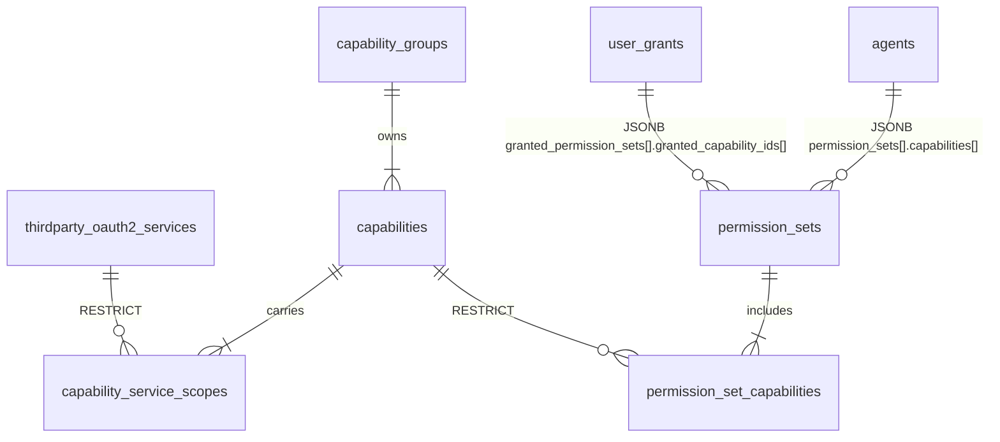

# Data Model: Capability Model for Permission Sets

**Feature**: `specs/20261127-140720-capability-model` | **Spec**: [spec.md](spec.md) | **Research**: [research.md](research.md)

## Typed IDs (ADR `013-strongly-typed-entity-ids`)

Add both to `uuidTypes` in `internal/domain/id/gen_ids.go`, regenerate `uuid_ids_gen.go`, and list them in `internal/domain/id/AGENTS.md`:

| Type | Prefix label |
|---|---|
| `CapabilityGroupID` | `capability_group` |
| `CapabilityID` | `capability` |

## Domain entities (`internal/domain/storage/capability.go`)

### CapabilityGroup (aggregate root)

| Field | Type | Rules |
|---|---|---|
| `ID` | `id.CapabilityGroupID` | Non-zero on `Validate`; generated on create |
| `CanonicalID` | `*string` | Optional; `storage.ValidateCanonicalID`; unique among groups |
| `Name` | `string` | Required, ≤255 |
| `Description` | `string` | Required |
| `Capabilities` | `[]Capability` | At least one; order preserved |
| `CreatedAt`, `UpdatedAt` | `time.Time` | Set by the repository |

**Invariants**:

- Every capability belongs to this group.
- Capability canonical IDs are unique within the request and globally (enforced by the database).
- No two capabilities share an `ID`.

### Capability (entity inside the group)

| Field | Type | Rules |
|---|---|---|
| `ID` | `id.CapabilityID` | Generated when absent from a create or `PUT` |
| `GroupID` | `id.CapabilityGroupID` | Set by the aggregate |
| `CanonicalID` | `string` | **Required**; `canonical.Validate` (1–128, `[A-Za-z0-9._-]`, not UUID-shaped); globally unique |
| `Name` | `string` | Required, ≤255 |
| `Description` | `string` | Required |
| `ReadOnly` | `bool` | Required in the API (no default) |
| `ServiceScopes` | `[]CapabilityServiceScope` | At least one; no duplicate `ServiceID` |

### CapabilityServiceScope (value object)

| Field | Type | Rules |
|---|---|---|
| `ServiceID` | `id.ServiceID` | Non-zero; references an existing service (application check plus `RESTRICT` FK) |
| `Scopes` | `[]string` | At least one, non-blank, no duplicates; each defined on the service, as for today's `ServiceScope` |

### CapabilityEntry (value object)

| Field | Type | Rules |
|---|---|---|
| `CapabilityID` | `id.CapabilityID` | Non-zero |
| `RequirementType` | `RequirementType` | `mandatory` or `optional`, required |

### PermissionSet (changed)

The `ServiceScopes []ServiceScope` field is replaced by `Capabilities []CapabilityEntry`, which needs at least one entry, no duplicates and no upper bound (FR-003). Every entry must reference an existing capability. The `ServiceScope` type and its per-service `RequirementType` are removed from the permission set.

### AgentPermissionSetEntry (changed)

`Capabilities []CapabilityEntry` is added, with `json:"capabilities,omitempty"`.

- `nil` means every set entry with the set's requirement types (FR-007).
- An empty array is invalid, so the API rejects `[]`.
- Agent validation (`agents.Service`, at create, update and reconcile) checks against the resolved set:
  - every entry's capability is in the set (`400` otherwise);
  - there are no duplicates;
  - no entry marks `optional` a capability the set marks `mandatory` (`400`, FR-005).

### GrantedPermissionSetEntry (changed)

`IncludedServiceIDs []id.ServiceID` is replaced by `GrantedCapabilityIDs []id.CapabilityID` (JSON `granted_capability_ids`). `UserGrant.Validate` requires at least one ID per entry, each non-zero, with no duplicates. Feature 2 adds Full intent (FR-009).

## Derived views (domain functions, no storage)

### EffectiveCapability

`permissionset.EffectiveCapabilities(set, agentEntry) []EffectiveCapability` returns `{CapabilityID, RequirementType}`:

- the agent entry's list, or every set entry when the agent entry has none;
- `RequirementType` is `mandatory` if the set entry or the agent entry says mandatory (FR-006);
- order follows the set's entry order.

### Derived service view (end-user API, unchanged shape)

For each effective capability's services:

- The service is listed when any effective capability needs it.
- It is `mandatory` when any capability that is mandatory for the agent needs it.

### Derived included services (policy and read models, FR-015)

For a grant entry, the included services are the union of the services of its granted capabilities. This feeds:

- `granted_permission_sets` in the token-exchange response and in OPA input;
- the end-user grant read model;
- the AuthZEN `permission_sets[].services`, whose scopes are the union over the granted capabilities for that set.

### Granted capability references (FR-014)

One `{id, canonical_id}` reference per granted capability in a grant, unioned across entries, de-duplicated by `id` and sorted bytewise by `canonical_id`. This is the reference shape that the permit's `agent` and `permission_sets` entries use, with `canonical_id` always present because capabilities require it.

## Relationships and lifecycle



| Change | Behavior |
|---|---|
| Delete a group | `409` if any of its capabilities is included by a set or referenced by an active grant; otherwise the group and its capabilities and scopes are removed (CASCADE inside the group) |
| `PUT` a group without a capability it had | Same `409` rule for the omitted capability |
| Update a set and drop a capability | `409` if an agent entry lists it (R3); allowed if only grants reference it, after which exchange fails closed for those grants (US3.4) |
| Update a set and make a capability mandatory | `409` if an agent entry marks it `optional` (R3) |
| Add a capability to a set | Agents without a capability list see it on next consent; existing grants do not hold it |
| Delete a service | Blocked while any capability scope references it (`RESTRICT`), replacing today's set-scope check |

## PostgreSQL schema (migration `050_capability_model`)

All `SELECT`s list explicit columns. Up and down SQL are specified in [contracts/migration-050.md](contracts/migration-050.md).

```sql
CREATE TABLE capability_groups (
    id           UUID PRIMARY KEY,
    canonical_id VARCHAR(255),
    name         VARCHAR(255) NOT NULL,
    description  TEXT NOT NULL,
    created_at   TIMESTAMP NOT NULL DEFAULT CURRENT_TIMESTAMP,
    updated_at   TIMESTAMP NOT NULL DEFAULT CURRENT_TIMESTAMP
);
CREATE UNIQUE INDEX uq_capability_groups_canonical_id ON capability_groups (canonical_id) WHERE canonical_id IS NOT NULL;

CREATE TABLE capabilities (
    id           UUID PRIMARY KEY,
    group_id     UUID NOT NULL REFERENCES capability_groups (id) ON DELETE CASCADE,
    position     INTEGER NOT NULL,
    canonical_id VARCHAR(128) NOT NULL,
    name         VARCHAR(255) NOT NULL,
    description  TEXT NOT NULL,
    read_only    BOOLEAN NOT NULL,
    created_at   TIMESTAMP NOT NULL DEFAULT CURRENT_TIMESTAMP,
    updated_at   TIMESTAMP NOT NULL DEFAULT CURRENT_TIMESTAMP,
    CONSTRAINT uq_capabilities_canonical_id UNIQUE (canonical_id),
    CONSTRAINT uq_capabilities_group_position UNIQUE (group_id, position)
);

CREATE TABLE capability_service_scopes (
    capability_id UUID NOT NULL REFERENCES capabilities (id) ON DELETE CASCADE,
    service_id    UUID NOT NULL REFERENCES thirdparty_oauth2_services (id) ON DELETE RESTRICT,
    scopes        JSONB NOT NULL,
    PRIMARY KEY (capability_id, service_id)
);

CREATE TABLE permission_set_capabilities (
    permission_set_id UUID NOT NULL REFERENCES permission_sets (id) ON DELETE CASCADE,
    capability_id     UUID NOT NULL REFERENCES capabilities (id) ON DELETE RESTRICT,
    position          INTEGER NOT NULL,
    requirement_type  TEXT NOT NULL CHECK (requirement_type IN ('mandatory', 'optional')),
    PRIMARY KEY (permission_set_id, capability_id),
    CONSTRAINT uq_permission_set_capabilities_position UNIQUE (permission_set_id, position)
);
CREATE INDEX idx_permission_set_capabilities_capability ON permission_set_capabilities (capability_id);
CREATE INDEX idx_capability_service_scopes_service ON capability_service_scopes (service_id);

DROP TABLE permission_set_service_scopes;
```

The group's `ON DELETE CASCADE` reaches its capabilities. The `RESTRICT` from `permission_set_capabilities` makes the database reject deleting a set-referenced capability even if the advisory check races.

**JSONB shapes after `050`**:

```json
// agents.permission_sets[]
{ "permission_set_id": "<uuid>", "requirement_type": "mandatory",
  "capabilities": [ { "capability_id": "<uuid>", "requirement_type": "optional" } ] }

// user_grants.granted_permission_sets[]
{ "permission_set_id": "<uuid>", "granted_capability_ids": ["<uuid>"] }
```

**Queries that change**:

- `user_grants.go`, `CountAgentsByPrincipalAndServiceID` and `ListByPrincipalAndServiceID` (lines 602 and 634) join `granted_capability_ids` to `capability_service_scopes.service_id`.
- `PermissionSetRepository.List(serviceID)` and `CountPermissionSetsForService` join through `permission_set_capabilities` and `capability_service_scopes`.

## Ports (`internal/ports/storage.go`)

| Interface | Methods (≤7, ISP) |
|---|---|
| `CapabilityGroupRepository` | `Create`, `Get`, `Update`, `Delete (bool, error)`, `List` |
| `CapabilityRepository` | `GetByIDs`, `CountPermissionSetsReferencingCapability`, `CountActiveGrantsReferencingCapability` |
| `CapabilityCanonicalIDRepository` | `ResolveGroupCanonicalID`, `ResolveCapabilityCanonicalID`, `CanonicalIDs` |
| `PermissionSetRepository` (changed) | Same methods. `Create` and `Update` persist capability entries; `List(serviceID)` and `CountPermissionSetsForService` join through capabilities |
| `AgentPermissionSetReferenceRepository` (new) | `ListByPermissionSet(ctx, id.PermissionSetID) ([]storage.Agent, error)`, used by the R3 set-update check. The PostgreSQL adapter re-checks in the set update's serializable transaction |

Both adapters (`memory`, `postgres`) implement every method. The memory adapter emulates `RESTRICT` and the containment checks.

## Validation error mapping

| Condition | Domain error | HTTP |
|---|---|---|
| Missing, invalid or duplicate canonical ID; missing service scopes; empty capability list; duplicate entry; unknown capability or service; `service_scopes` on a permission-set request; agent entry not a subset; agent relaxes mandatory | `ErrorKindValidation` | 400 |
| Referenced capability or group deleted; set change invalidates an agent entry | `ErrorKindConflict` | 409 |
| Capability canonical ID already used (unique violation) | `ErrorKindValidation` | 400 (US1.2) |
| Consent: mandatory capability needs an excluded service; included service yields no capability | `ErrInvalidServiceInclusion` | 400 |
| Exchange or permit: granted capability no longer in set | `access_denied`, detail `grant_permission_set_missing` | 403 or AuthZEN deny with consent URL |
| Exchange or permit: granted capability not in the agent's effective list | `access_denied`, detail `grant_permission_set_undeclared` | 403 or AuthZEN deny |

## Glossary additions (`ARCHITECTURE.md`)

- **Capability**, **Capability Group**, **Capability Entry**, **Effective Capability**.
- Revised: **PermissionSet**, **ServiceScope** (now on capabilities), **AgentPermissionSetEntry**, **GrantedPermissionSetEntry**.
- Replace the stale **granted_permission_set_ids** entry with **GrantedPermissionSetEntry**, because the entry is being edited anyway.
