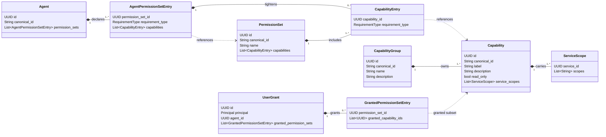
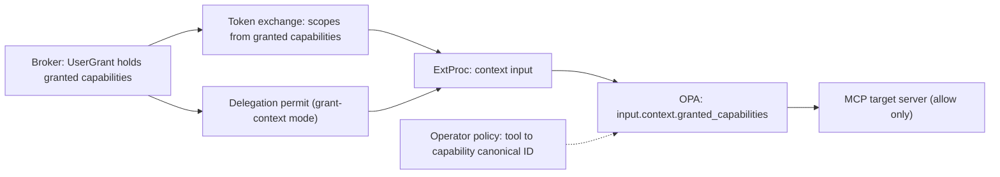

# Feature Specification: Capability Model for Permission Sets

**Feature Branch**: `speckit/issue-579`

**Created**: 2026-11-27

**Status**: Draft

**Input**: [Issue #579 — Capability model for permission sets, with capability-based policy input](https://github.com/zalando-incubator/agentic-identity-broker/issues/579), part 1 of 2 of [issue #285](https://github.com/zalando-incubator/agentic-identity-broker/issues/285). Feature 2, [Read-Only Mode and Capability-Level Consent](https://github.com/zalando-incubator/agentic-identity-broker/blob/speckit/issue-580/specs/20261127-103502-consent-capability-narrowing/spec.md), builds on this model.

Operators define **capabilities** in **capability groups**. Each capability has a canonical ID, a read-only flag, and the service scopes it needs.
Permission sets include capabilities instead of carrying service scopes directly, and an agent's permission-set entry can tighten the set's capability entries.
Grants store the granted capabilities. At token exchange, the broker derives each service's scopes from them, and ExtProc policy receives their canonical IDs, so operator Rego can map MCP tools to capabilities.
Users see no change in this feature. The consent screen and the end-user grant request keep their current shape, and every existing permission set, agent, grant and policy behaves as before the upgrade.

## Clarifications

### Session 2026-11-27

- Q: How should the migration record old grants in which the user left out an optional service, so that no grant gains access it didn't have before? → A: Split each legacy permission set into one capability per service scope entry. Each capability keeps that entry's `requirement_type`, and a left-out service becomes a capability that the grant does not hold.

## User Scenarios & Testing *(mandatory)*

Each numbered acceptance scenario requires one corresponding E2E scenario under `tests/e2e/` (Constitution XIII).
Policy-input scenarios run in the ExtProc E2E suite against the embedded OPA engine. Migration scenarios also require PostgreSQL integration tests for both directions.

### User Story 1 - Operators Define Capabilities and Compose Permission Sets (Priority: P1)

An operator creates capability groups and their capabilities through the Admin API.
The operator then composes permission sets from capability entries, and can tighten individual entries per agent.

**Why this priority**: Every later narrowing, whether by policy or on the consent screen, needs capabilities that operators have defined.

**Independent Test**: Use the Admin API to create a group with capabilities, a set that includes them, and an agent entry that tightens one capability. Verify validation and deletion protection.

**Acceptance Scenarios**:

1. **US1.1 — Create a group with capabilities**: **Given** an authorized operator, **When** the operator creates group `google-calendar` with *View events* (`read_only: true`) and *Create and edit events*, each with at least one service scope, **Then** Admin reads and listings return both capabilities, their canonical IDs, flags and service scopes.
2. **US1.2 — Capability validation**: **Given** a capability request without a canonical ID, with a canonical ID that another capability uses, with a UUID-shaped or non-URL-safe canonical ID, or without service scopes, **When** it is submitted, **Then** it is rejected with `400`. Nothing is stored.
3. **US1.3 — Compose a set**: **Given** existing capabilities, **When** the operator creates a permission set with capability entries `{capability_id, requirement_type}`, **Then** the set is stored. An empty entry list or a duplicate entry is rejected with `400`. The broker accepts any number of entries.
4. **US1.4 — Agent entries tighten, never relax**: **Given** a set that marks a capability mandatory, **When** an operator saves an agent entry that marks the same capability optional, **Then** the request is rejected with `400`. Restating mandatory, tightening optional to mandatory, and listing a subset of the set's entries are accepted. An entry that lists a capability the set does not include is rejected.
5. **US1.5 — Referenced entities cannot be deleted**: **Given** a capability that a permission set or a grant references, **When** the operator deletes it or its group, **Then** the broker responds `409` and nothing changes. The same applies to permission sets today.

### User Story 2 - Existing Permission Sets and Grants Keep Working After Upgrade (Priority: P1)

An operator upgrades a broker that has existing permission sets, agents and grants.
No user loses access they granted, and no user gains access they did not grant.

**Why this priority**: The data model changes shape, and the migration must preserve existing delegations, which carry security weight.

**Independent Test**: Seed a pre-upgrade database with a set that spans a mandatory and an optional service, and grants with and without the optional service. Apply the migrations, then exchange tokens for both grants.

**Acceptance Scenarios**:

1. **US2.1 — Sets become capabilities**: **Given** a permission set with service scopes before the upgrade, **When** the migration runs, **Then** the set includes one capability per former service scope entry, each carrying that entry's scopes and `requirement_type`, in a capability group named after the set. The agents that reference the set remain valid without changes.
2. **US2.2 — Grants are not broadened**: **Given** a pre-upgrade grant that omitted an optional service of a set, **When** the migration runs and the agent exchanges a token, **Then** the grant holds only the capabilities generated for its included services, and the capability generated for the omitted service is not granted (FR-018). The effective scopes and the `granted_permission_sets` policy input are identical to those before the upgrade.
3. **US2.3 — Down migration**: **Given** an upgraded database whose capabilities, sets and grants are still the ones the migration created, **When** the down migration runs, **Then** permission sets and grants return to their pre-upgrade shape and values.
4. **US2.4 — Consent is unchanged for users**: **Given** an upgraded broker, **When** Alice consents to an agent through today's consent screen and grant request, **Then** the request and response shapes are unchanged. The broker stores the capabilities that match her included services (FR-010), and token exchange yields the same scopes as before the upgrade.

### User Story 3 - Policy Receives the Granted Capabilities (Priority: P1)

The operator maps each MCP tool to one capability canonical ID in Rego.
ExtProc gives policy the grant's capability canonical IDs as a flat list next to today's inputs.

**Why this priority**: Operators can write and test capability-based policy before users can narrow, and Feature 2 then only changes which capabilities a grant holds.

**Independent Test**: Use the ExtProc E2E suite with the sample policy under `examples/`. Exchange a token for a migrated grant and send `tools/call` requests.

**Acceptance Scenarios**:

1. **US3.1 — Capabilities reach policy**: **Given** a grant that holds the capabilities `google-calendar-view` and `google-calendar-edit`, and the sample policy, **When** the agent calls `calendar_create_event`, **Then** OPA receives `input.context.granted_capabilities` containing both canonical IDs. The call is forwarded to the MCP target server.
2. **US3.2 — Unmapped capability denies the tool**: **Given** the same grant, **When** the agent calls `drive_share_file`, which the sample policy maps to `google-drive-share`, **Then** ExtProc denies the call before it reaches the MCP target server.
3. **US3.3 — Union across sets**: **Given** a grant in which two granted sets both include `google-drive-view`, **When** policy input is built, **Then** `google-drive-view` appears exactly once in the sorted list. The input does not identify which set granted it.
4. **US3.4 — Stale capability fails closed**: **Given** a stored grant that references a capability its set no longer includes, **When** token exchange or permit resolution runs for that grant, **Then** it fails closed. The response matches the existing handling for a missing permission set, and the caller receives the consent-page error URI.
5. **US3.5 — Existing policies keep working**: **Given** a deployed policy that reads only today's `granted_permission_sets` input, **When** the feature ships, **Then** that policy produces the same decisions for an upgraded grant as before the upgrade.

### Edge Cases

- **A set marks a capability optional and the agent entry makes it mandatory**: The capability is mandatory for this agent (FR-006). Today's consent screen shows it through the service it needs, which is then mandatory for the agent.
- **An agent entry without `capabilities[]`**: It means every capability in the set, with the set's requirement types. Today's agents stay valid (FR-007).
- **A capability needs two services**: Under FR-010, today's included-service request grants it only when both services are included.
- **A capability is deleted while a grant references it**: The broker blocks the deletion with `409` (US1.5). If a set stops including a capability that a grant references, exchange fails closed (US3.4).
- **A policy maps a tool to a canonical ID that no capability uses**: The tool is denied for every grant. This is operator policy, not a broker error.
- **Disabled versus enabled grant-context mode** (ADR `048-authzen-delegation-pip`): See FR-016.
- **Two legacy sets migrated under the same name**: Each gets its own group. Generated canonical IDs stay unique (FR-019).

## Concrete Example Journeys *(mandatory)*

All IDs, tokens and accounts are synthetic. All times are 2026-11-27 UTC. Scope names abbreviate `https://www.googleapis.com/auth/<name>`.

### Journey 1 — An operator models Google Calendar as capabilities (User Story 1, Scenarios US1.1, US1.3, US1.4; User Story 3, Scenarios US3.1–US3.2)

**Cast**: Operator with Admin API access at `broker-admin.example.com`. Service *Google* `880e8400-e29b-41d4-a716-446655440010`. Agent *Workspace Assistant* `550e8400-e29b-41d4-a716-446655440000`. User Alice, `alice@example.com`.

**Step 1 — 09:00:00: the operator creates the Calendar group**

```http
POST /admin/v1/capability-groups HTTP/1.1
Host: broker-admin.example.com
Content-Type: application/json

{
  "canonical_id": "google-calendar",
  "name": "Calendar",
  "description": "Your Google calendars and events",
  "capabilities": [
    {
      "canonical_id": "google-calendar-view",
      "label": "View events",
      "description": "See your calendars and events",
      "read_only": true,
      "service_scopes": [
        { "service_id": "880e8400-e29b-41d4-a716-446655440010",
          "scopes": ["https://www.googleapis.com/auth/calendar.readonly"] }
      ]
    },
    {
      "canonical_id": "google-calendar-edit",
      "label": "Create and edit events",
      "description": "Add events and change existing ones",
      "read_only": false,
      "service_scopes": [
        { "service_id": "880e8400-e29b-41d4-a716-446655440010",
          "scopes": ["https://www.googleapis.com/auth/calendar.events"] }
      ]
    }
  ]
}

HTTP/1.1 201 Created
Content-Type: application/json

{
  "id": "3f1c0000-0000-4000-8000-000000000001",
  "canonical_id": "google-calendar",
  "name": "Calendar",
  "capabilities": [
    { "id": "9a7e0000-0000-4000-8000-000000000001", "canonical_id": "google-calendar-view", "...": "..." },
    { "id": "9a7e0000-0000-4000-8000-000000000002", "canonical_id": "google-calendar-edit", "...": "..." }
  ]
}
```

The resource path and exact schema are designed in `/speckit-plan` (API-001). This exchange shows the information that the operator supplies.

**Step 2 — 09:01:00: the operator composes the *Google Calendar* set and the agent entry**

```json
{
  "canonical_id": "google-calendar",
  "name": "Google Calendar",
  "description": "Work with your calendar",
  "capabilities": [
    { "capability_id": "9a7e0000-0000-4000-8000-000000000001", "requirement_type": "optional" },
    { "capability_id": "9a7e0000-0000-4000-8000-000000000002", "requirement_type": "optional" }
  ]
}
```

The agent entry makes *View events* mandatory for Workspace Assistant (US1.4):

```json
{
  "permission_set_id": "770e8400-e29b-41d4-a716-446655440003",
  "requirement_type": "mandatory",
  "capabilities": [
    { "capability_id": "9a7e0000-0000-4000-8000-000000000001", "requirement_type": "mandatory" },
    { "capability_id": "9a7e0000-0000-4000-8000-000000000002", "requirement_type": "optional" }
  ]
}
```

**Step 3 — 09:30:00: Alice consents through today's screen**. Today's request includes Google for the set. Both capabilities need only Google, so the grant holds both (FR-010).

**Step 4 — 09:40:00: the agent calls tools through the gateway**. Policy receives, abbreviated:

```json
{
  "type": "mcp_tool_call",
  "mcp": { "tool_name": "drive_share_file" },
  "context": {
    "granted_permission_sets": { "770e8400-e29b-41d4-a716-446655440003": ["880e8400-e29b-41d4-a716-446655440010"] },
    "granted_capabilities": ["google-calendar-edit", "google-calendar-view"]
  }
}
```

The sample policy under `examples/`:

```rego
tool_requirements := {
  "calendar_list_events":  "google-calendar-view",
  "calendar_create_event": "google-calendar-edit",
  "drive_share_file":      "google-drive-share",
}

allow contains {"reason": "capability granted"} if {
  input.type == "mcp_tool_call"
  tool_requirements[input.mcp.tool_name] in input.context.granted_capabilities
}
```

**Observable result**: `calendar_create_event` is forwarded. `drive_share_file` receives the existing ExtProc policy-denial response and never reaches the MCP target server.

### Journey 2 — Upgrade preserves a grant that excluded an optional service (User Story 2, Scenarios US2.1–US2.2)

**Cast**: Legacy set *Ops Tools* `770e8400-e29b-41d4-a716-446655440002` (canonical `ops-tools`), whose service scopes are GitHub Production `880e8400-e29b-41d4-a716-446655440011` (mandatory, `repo:read`) and Slack `880e8400-e29b-41d4-a716-446655440012` (optional, `chat:write`). Alice's grant for agent *Ops Copilot* `550e8400-e29b-41d4-a716-446655440001` includes GitHub only.

**Step 1 — before the upgrade**: The stored grant entry is:

```json
{ "permission_set_id": "770e8400-e29b-41d4-a716-446655440002",
  "included_service_ids": ["880e8400-e29b-41d4-a716-446655440011"] }
```

**Step 2 — the migration runs**. It creates group *Ops Tools* with two capabilities:

| Canonical ID | Service | Scopes | Set entry | `read_only` |
|---|---|---|---|---|
| `ops-tools-github-production` | GitHub Production | `repo:read` | mandatory | false |
| `ops-tools-slack` | Slack | `chat:write` | optional | false |

The grant entry now holds the GitHub capability only. Migration cannot know whether legacy scopes are read-only, so it sets `read_only: false` (FR-018).

**Step 3 — 10:00:00: the agent exchanges a token for GitHub**. The requested scopes are `repo:read`, as before.

**Observable result**: No Slack scopes are requested. `granted_permission_sets` still maps the set to GitHub Production only, and `granted_capabilities` is `["ops-tools-github-production"]`.

## Requirements *(mandatory)*

### Functional Requirements

**Capability model**

- **FR-001**: Operators MUST be able to create, read, update, list and delete **capability groups**. A group has a name, a description and an optional canonical ID, and it owns its capabilities.
- **FR-002**: Each **capability** MUST belong to exactly one group. It has a required canonical ID that is unique across all capabilities and follows the existing canonical-ID rules (1–128 characters, URL-safe, not UUID-shaped). It also has a label, a description, a `read_only` flag, and at least one service scope `{service_id, scopes[]}`.
- **FR-003**: A permission set MUST include one or more capability entries `{capability_id, requirement_type}` with no duplicates, and the broker MUST set no upper bound on their number. These entries replace the set's direct service scopes.
- **FR-004**: The same capability MAY be included by several permission sets.
- **FR-005**: An agent's permission-set entry MAY list capability entries `{capability_id, requirement_type}`. They MUST be a subset of the set's entries with no duplicates. An agent entry MUST NOT mark optional a capability that the set marks mandatory, and the broker MUST reject such an entry with a validation error instead of silently overriding it.
- **FR-006**: A capability is mandatory for an agent when the set's entry or the agent's entry marks it mandatory.
- **FR-007**: An agent entry without a capability list MUST mean every capability in the set, with the set's requirement types.
- **FR-008**: The broker MUST reject with `409`, and leave unchanged, the deletion of a capability that any permission set or grant references, and the deletion of a group that owns such a capability.

**Grants and token exchange**

- **FR-009**: For each granted set, the grant MUST store the granted capabilities, and this replaces the stored included-service list.
- **FR-010**: Until Feature 2 ships capability selection, the end-user grant request MUST keep its current included-service shape. For each set, the broker MUST store every capability that the agent entry lists and whose services are all included. The request MUST be rejected with `400` when a capability that is mandatory for the agent needs a service that the request excludes. Every other grant validation stays as today.
- **FR-011**: At token exchange, the scopes for each service MUST be the union of the granted capabilities' scopes for that service, capped by the agent's service-requirement ceiling as today.
- **FR-012**: Token exchange and permit resolution MUST fail closed when a grant references a capability that its set no longer includes, with the same response and consent-page error URI as for a missing permission set.
- **FR-013**: The end-user API and the consent screen MUST NOT expose capabilities in this feature. Feature 2 adds them.

**Policy input**

- **FR-014**: ExtProc policy input MUST carry a flat, de-duplicated, sorted list of the granted capabilities' canonical IDs, unioned across all granted sets, as `input.context.granted_capabilities`.
- **FR-015**: Today's `granted_permission_sets` and enabled-mode `permission_sets` inputs MUST remain populated with unchanged meaning. For a set, the included services are the union of the services of its granted capabilities.
- **FR-016**: The capability list MUST reach policy through the source that ADR `048-authzen-delegation-pip` assigns to the mode. [NEEDS CLARIFICATION: ADR 048 deprecates `TokenExchangeResponse.granted_permission_sets` and makes the AuthZEN permit the enabled-mode source of policy context. Should the capability list (A) travel in both the token-exchange response (disabled mode) and the delegation permit (enabled mode), (B) travel only in the permit, so capability enforcement requires `grant_context.enabled`, or (C) travel only in the token-exchange response?]
- **FR-017**: The broker MUST NOT learn or store MCP tool names. A sample policy under `examples/` MUST map tools to capability canonical IDs and deny by default.

**Migration**

- **FR-018**: The migration MUST convert each existing permission set into one capability per former service scope entry, in a capability group named after the set. Each capability MUST carry exactly that entry's service and scopes, have `read_only: false`, and be included by the set with that entry's `requirement_type`. Each migrated grant entry MUST hold exactly the capabilities whose service was in its included-service list. The migration MUST NOT keep a legacy inclusion mask or mark grants for re-consent. Existing agents MUST stay valid without operator action.
- **FR-019**: Generated canonical IDs MUST be unique, valid under FR-002, and derived deterministically from the set's canonical ID, or from its UUID when it has none. The mapping is designed in `/speckit-plan`.
- **FR-020**: For every existing grant, the effective scopes and policy-visible permission-set contents after migration MUST equal those before migration. The migration MUST NOT broaden any grant (US2.2).

### Domain Model





**Entities**:

- **Capability**: An operator-defined unit of agent behaviour that a grant can hold or withhold. Its canonical ID is the policy key and never replaces its UUID in storage or references. Invariants: it belongs to exactly one group, it has at least one service scope, and its canonical ID is unique.
- **Capability Group**: Aggregate root that owns capabilities. Feature 2 uses its name as a consent-screen heading.
- **Permission Set** (changed): Still the unit that users see, but now composed of capability entries instead of service scopes.

**Aggregates**:

- **CapabilityGroup**: Root of its capabilities. Invariants: capability canonical IDs are globally unique, each capability has at least one service scope, and referenced capabilities cannot be deleted.

**Value Objects**:

- **CapabilityEntry** `{capability_id, requirement_type}`: The reference shape used by permission sets and agent entries.

**Domain Events**: Changes to capability groups and capabilities are audited like other Admin API mutations. Grant audit events include the granted capability IDs.

*New glossary terms for `ARCHITECTURE.md`: Capability, Capability Group, Capability Entry.*

### API Requirements

- **API-001**: The Admin API (`api/admin/openapi.yaml`) MUST add capability-group resources with nested capabilities, replace permission-set `service_scopes` with `capabilities[]`, and add optional `capabilities[]` to agent permission-set entries. This is a breaking change to the released Admin API `3.0.0`, so the version bump and its compatibility handling MUST be settled in `/speckit-plan`.
- **API-002**: The token-exchange response and/or the AuthZEN permit MUST carry the granted capability canonical IDs as FR-016 decides. Existing fields keep their meaning.
- **API-003**: The end-user grant request and response MUST stay unchanged (FR-010, FR-013).
- **API-004**: All API changes MUST follow the Zalando RESTful API Guidelines and receive stakeholder approval before implementation (Constitution IV, X).

### Database Requirements

- **DB-001**: New tables for capability groups and capabilities, and new shapes for permission-set entries, agent entries and grant entries, MUST ship as new `migrations/NNN_*.{up,down}.sql` pairs after `049`.
- **DB-002**: Each migration MUST be atomic (Constitution IX). The data migration MUST satisfy FR-018 to FR-020.
- **DB-003**: In-memory and PostgreSQL adapters MUST both implement the new repositories, with PostgreSQL integration tests for both migration directions.
- **DB-004**: Queries MUST list explicit columns.

### Security Requirements

- **SR-001**: The broker MUST request scopes only for granted capabilities.
- **SR-002**: Capability enforcement depends on every upstream call passing through ExtProc. ADR `029-token-exchange-client-assertion-trust-anchor` is Proposed, not Accepted. This feature's ADR MUST therefore state the deployment controls that keep agents away from direct token exchange and direct upstream access.
- **SR-003**: Every validation failure in FR-005, FR-010 and FR-012 MUST fail closed. There is no silent narrowing, broadening or fallback to "all capabilities" on bad data.
- **SR-004**: Log records and spans MUST follow `coding-standards/LOGGING.md` and `coding-standards/OPENTELEMETRY.md`. Capability canonical IDs are configuration identifiers, not credentials, and principals appear only as `id.Principal`.

### Key Entities

- **Capability Group**, **Capability**, **Capability Entry**: See Domain Model.
- **Granted Permission Set Entry** (changed): The granted capabilities replace the stored included-service list.

## Success Criteria *(mandatory)*

### Measurable Outcomes

- **SC-001**: After upgrade, 100% of pre-existing grants in the migration test fixtures yield identical effective scopes and identical `granted_permission_sets` policy input.
- **SC-002**: Deployed policies that use only today's inputs make the same decisions before and after the upgrade.
- **SC-003**: In the ExtProc E2E suite, every tool that the sample policy maps to a capability the grant does not hold is denied, and every tool mapped to a held capability is allowed (100% of mapped tools).
- **SC-004**: An operator can define a capability group, compose a set from it and see the result in policy input without any consent-screen or end-user API change.

## Assumptions

- Capability enforcement is only as strong as the operator's policy. A tool without a mapping falls to the policy's default, which is deny in the sample.
- The upstream provider token keeps the OAuth2 scopes that the granted capabilities imply. The broker does not downscope further, and the gateway is the enforcement point.
- Capability labels and descriptions are operator-supplied plain text, as permission-set names are today.
- ADR `048-authzen-delegation-pip`'s permit freshness, result binding and deprecation timeline remain in force. This feature adds a member to policy context and changes no existing member.
- A new ADR for the capability model, its invariants and the gateway-only enforcement assumption accompanies the plan of this feature.
- Feature 2 depends on this feature and can start planning once this feature's API contracts are approved.
