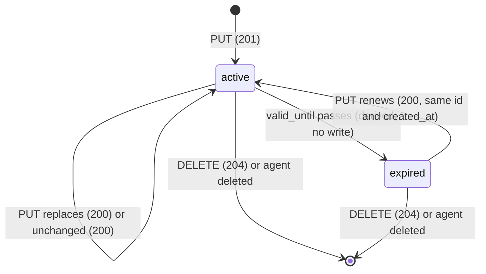
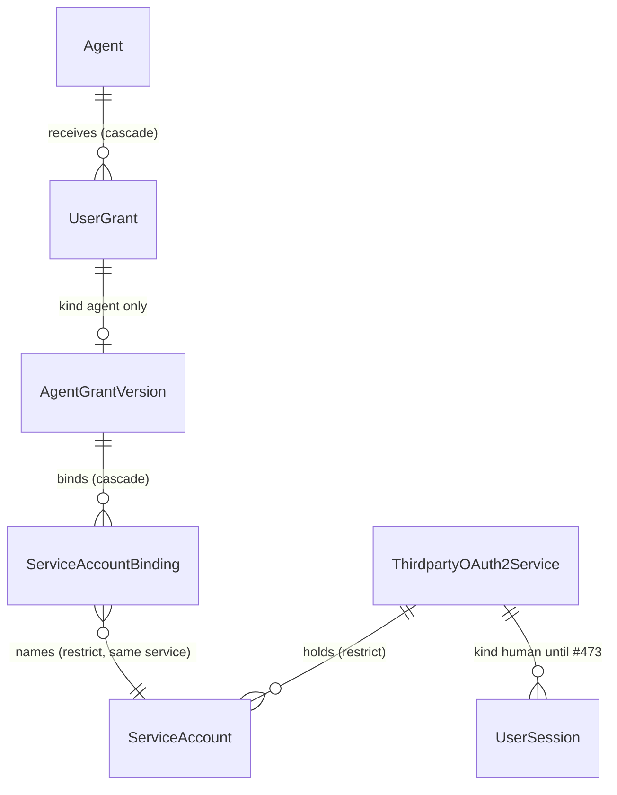

# Data Model: Agent Grants

**Feature**: [spec.md](./spec.md) | **Plan**: [plan.md](./plan.md) | **Research**: [research.md](./research.md)

## Value object: PrincipalKind

Location: `internal/domain/storage/principal_kind.go`.

| Value | Written by | Meaning |
|---|---|---|
| `human` | Consent writes and session writes, through `UserGrantRepository` and `UserSessionRepository` | A person authenticated by the pre-authentication source. Every row from before migration `051`. |
| `agent` | Agent-grant writes, through `AgentGrantRepository` only | The agent itself; the principal text is the agent's UUID. |

`UserGrant` and `UserSession` gain a `PrincipalKind` field. The zero value is not a valid stored
kind. The human ports write `human` when the field is empty, and refuse any other value.
`UserGrant.Copy` copies it. The kind is never derived from `Principal`
([research R2](./research.md#r2--principal-kind-identity-in-storage-human-scope-on-the-existing-ports)).

## Entity: AgentGrant

Location: `internal/domain/storage/agent_grant.go`. This is the aggregate root for agent-grant
writes. It is persisted as one `user_grants` row of kind `agent`, one `agent_grants` row and zero
or more binding rows.

| Field | Type | Rules |
|---|---|---|
| `Grant` | `UserGrant` | `PrincipalKind = agent`. `Principal = id.Principal(AgentID.String())`. `GrantedPermissionSets` as resolved (below). `ValidUntil` optional and in the future when written. `ID` and `CreatedAt` are fixed by the first write and kept by every replacement. |
| `Bindings` | `[]ServiceAccountBinding` | At most one per service, sorted by service ID. |
| `Version` | `int64` | Starts at 1, incremented on every committed write; the strong ETag. |

Accessors: `AgentID()` returns `Grant.AgentID`. `PermissionSetIDs()` returns the sorted granted
set IDs.

### Value object: ServiceAccountBinding

| Field | Type | Rule |
|---|---|---|
| `ServiceID` | `id.ServiceID` | A service that some granted set covers |
| `ServiceAccountID` | `id.ServiceAccountID` | An existing account of that service |

### Resolution and invariants (write time)

`consent.AgentGrantService.Put` builds the candidate from the request. It evaluates the rules in
this order and stops at the first failure. Every failure answers `400`, with `error: validation
failed`, and stores nothing.

| # | Rule | Message (`message`) | Source |
|---|---|---|---|
| 1 | `valid_until`, when given, lies after the request time | `valid_until must be in the future` | FR-006 |
| 2 | `permission_sets` has no duplicate | `permission_sets must not contain duplicates` | Edge Cases |
| 3 | Every listed set is declared by the agent | `permission set <id> is not declared by the agent` | FR-004 |
| 4 | Granted = mandatory declared sets ∪ listed; non-empty | `agent grant must contain at least one permission set` | FR-004 |
| 5 | Every granted set still exists | `permission set <id> no longer exists` | SR-002 |
| 6 | Every granted set covers ≥ 1 service: its `ServiceScopes` services, ∩ the agent's service requirements when it declares any | `permission set <id> covers no service of the agent` | FR-004a |
| 7 | Every binding key is a covered service | `service_account_bindings[<service>]: service is not covered by the grant` | FR-008 |
| 8 | Every binding names an account of that service | `service_account_bindings[<service>]: service account <account> is not an account of this service` | FR-009 |
| 9 | Every effectively mandatory covered service is bound | `service_account_bindings[<service>]: service is mandatory for the agent and must be bound` | FR-004b |
| 10 | For each bound service, effective scopes ⊆ the account's ceiling, compared byte for byte | `service_account_bindings[<service>]: scopes [<excess, sorted, space-separated>] exceed the ceiling of service account <account>` | FR-011, FR-012 |

Rules 7–10 iterate services in ascending UUID order. Rule 6 iterates granted sets in ascending
UUID order. After rule 6 the entries pass the shared consent structure check (research R10) and
`UserGrant.ValidateForCreate` as defence in depth.

**Effectively mandatory service**: the agent's service requirements mark it mandatory, or a
granted set's `ServiceScope` marks it mandatory and it lies within the agent's service
requirements where the agent declares any. This is the definition user consent uses
(`consent/service.go`, "psMandatoryServices").

**Effective scopes** on a service come from `storage.EffectiveScopes(agent, entries, sets)`, the
function the shared grant resolution uses from Phase 0 on
([research R8](./research.md#r8--ceiling-check-and-one-effective-scope-definition)):

1. The union, over granted entries that include the service, of the set's scopes on it.
2. When the agent declares service requirements, drop a service outside them. A
   `require_all_scopes` requirement passes the union. Other requirements intersect it with
   `required_scopes`, and a service whose intersection is empty is dropped.

What is **not** checked at write time: the account's status (FR-014), sessions (FR-005), and
anything about later changes (FR-013).

### Write outcomes

| Outcome | Condition | HTTP | Effect |
|---|---|---|---|
| `created` | No grant existed | `201` | Insert, version 1, audit `consent.agent_grant.created` |
| `replaced` | A grant existed (expired or not) and the candidate differs | `200` | Same `id`, `created_at`; version + 1; `updated_at = now`; audit `consent.agent_grant.replaced` |
| `unchanged` | Candidate equals the stored grant: same granted sets and coverage, same bindings, same `valid_until` | `200` | No write, same ETag, no audit |
| `deleted` | `DELETE` of an existing grant | `204` | Grant row, version row and bindings removed; audit `consent.agent_grant.deleted` |

Preconditions ([research R5](./research.md#r5--concurrency-etag-and-no-op-writes)). Request errors
win: `404` for the agent and every `400` (`If-Match` syntax, body, rules 1–10) are reported
before a failed precondition (`412`), as on service accounts:

| `If-Match` | Grant | Result |
|---|---|---|
| absent | any | Carried out; last writer wins (with up to three attempts on a concurrent commit; `412` when the third attempt also loses) |
| equal to current ETag | present | Carried out |
| different | present | `412`, nothing changed |
| any | absent | `412`, nothing created or deleted |
| weak or malformed | any | `400` |

### State



Expiry is derived, as for user grants. An expired agent grant is still the agent's grant for every
admin operation, and its bindings still hold their accounts (FR-006, FR-015).

## Repository port

`internal/ports/storage.go`:

```go
// AgentGrantRepository stores the one agent grant of an agent: a user_grants row of principal
// kind agent, its version and its service-account bindings, written together.
type AgentGrantRepository interface {
    Get(ctx context.Context, agentID id.AgentID) (*storage.AgentGrant, error)
    Save(ctx context.Context, grant *storage.AgentGrant, expectedVersion *int64) (created bool, err error)
    Delete(ctx context.Context, agentID id.AgentID, expectedVersion *int64) (*storage.AgentGrant, error)
    ListAgentsBindingServiceAccount(ctx context.Context, accountID id.ServiceAccountID) ([]id.AgentID, error)
}

var (
    ErrAgentGrantVersionMismatch  = errors.New("agent grant version mismatch")
    ErrAgentGrantReferenceMissing = errors.New("agent grant references a missing permission set or service account")
    ErrServiceAccountReferenced   = errors.New("service account is referenced by an agent grant")
)
```

The contract is identical for both adapters and is tested by one shared contract in
`tests/integration/storage/contract/`:

- `Get`: grant, bindings sorted by service ID, version. Expired grants included. Missing →
  `not_found`.
- `Save`:
  - `expectedVersion == nil`: insert when absent (`created = true`, version 1), otherwise replace
    (version + 1). A concurrent first insert that loses the unique race returns `conflict`
    wrapping `ErrAgentGrantVersionMismatch`, and the service re-reads.
  - `expectedVersion != nil`: replace only where the stored version equals it. Absent or
    different → `conflict` wrapping `ErrAgentGrantVersionMismatch`.
  - A replacement keeps `Grant.ID` and `Grant.CreatedAt` and replaces the binding set whole.
  - A missing permission set, a missing account or an account of another service → `not_found`
    wrapping `ErrAgentGrantReferenceMissing`, with nothing written. This is checked in the
    transaction, with the permission-set existence lock the human grant `Create` already takes,
    and with the binding foreign key.
  - It writes the kind `agent` and `Principal = AgentID`. It refuses a grant whose fields say
    otherwise (`validation`).
  - It copies the persisted `ID`, `CreatedAt`, `UpdatedAt` and `Version` back to the entity.
- `Delete`: missing → `not_found`, or `conflict` wrapping the mismatch sentinel when
  `expectedVersion` is set. On success it returns the deleted snapshot.
- `ListAgentsBindingServiceAccount`: distinct agent UUIDs in ascending order, expired grants
  included. It returns an empty slice when there are none.
- All errors are `storage.StorageError`. Reads use the read timeout and writes the write timeout.

### Changed contracts on existing ports

| Port / method | Change |
|---|---|
| `UserGrantRepository`: all methods except `DeleteByAgent` and `CountGrantsReferencingPermissionSet` | Human-scoped: read and change only `principal_kind = 'human'` rows. `Create` writes `human` (`ON CONFLICT (principal_kind, principal, agent_id)`). |
| `UserGrantRepository.DeleteByAgent`, `CountGrantsReferencingPermissionSet` | Kind-agnostic (documented) |
| `UserSessionRepository`: all methods except `CountByService`; `UserSessionRefreshRepository.WithLockedSession` | Human-scoped. `Create` and `CreateIfAbsent` write `human` (`ON CONFLICT (principal_kind, principal, service_id)`). |
| `UserSessionRepository.CountByService`, `UserSessionExpiryRepository`, `UserSessionHealthRepository` | Kind-agnostic (documented) |
| `ServiceAccountRepository.Delete` | PostgreSQL `23503` from the binding key → `conflict` wrapping `ErrServiceAccountReferenced`. Memory runs the delete inside the binding guard. |
| `thirdparty.ServiceAccountBindingChecker` | `BindingAgents(ctx, accountID) ([]id.AgentID, error)` replaces `IsBound` |

The memory indexes add the kind as a key prefix (`kind + ":" + principal + ":" + agent`, and the
same for sessions). One memory grant store serves both `UserGrantRepository` and
`AgentGrantRepository` under one mutex, so the kind-scoped unique index is shared exactly as in
PostgreSQL. Lock order is the agent-grant store, then the service-account store
([research R9](./research.md#r9--service-account-delete-guard-and-bound_by_agents)).

## Domain service

`internal/domain/consent/agent_grant_service.go`, constructed in `builder.go`:

```go
func NewAgentGrantService(
    agents ports.AgentRepository,
    permissionSets PermissionSetQuerier,
    accounts ServiceAccountReader, // Get(ctx, serviceID, accountID) (*model.ServiceAccount, error)
    grants ports.AgentGrantRepository,
    now func() time.Time,
    logger *slog.Logger,
) *AgentGrantService
```

| Method | Behaviour |
|---|---|
| `Get(ctx, agentID)` | Agent must exist (`404 agent not found`). Grant or `404 agent grant not found`. |
| `Put(ctx, operator, agentID, req, expectedVersion)` | Agent; load grant; resolution rules 1–10; precondition; no-op check; conditional `Save` with re-read; audit. Returns grant and outcome. |
| `Delete(ctx, operator, agentID, expectedVersion)` | Agent; load grant; precondition; conditional `Delete`; audit. |

The request type is `AgentGrantRequest{PermissionSetIDs []id.PermissionSetID; Bindings map[id.ServiceID]id.ServiceAccountID; ValidUntil *time.Time}`.
No method reads, decrypts or returns a credential (SR-004).

## PostgreSQL schema — migration `051_agent_grants_principal_kind`

One atomic pair, go-migrate naming, no `-- migrate:no-transaction`
([research R3](./research.md#r3--migration-051-principal-kind-binding-storage-constraints)).

### `051_agent_grants_principal_kind.up.sql`

`user_grants`:

| Change | Definition |
|---|---|
| Column | `principal_kind VARCHAR(16) NOT NULL DEFAULT 'human'` |
| Check | `chk_user_grants_principal_kind CHECK (principal_kind IN ('human', 'agent'))` |
| Check | `chk_user_grants_agent_principal CHECK (principal_kind <> 'agent' OR principal = agent_id::text)` |
| Unique | drop `uq_principal_agent`; add `uq_user_grants_kind_principal_agent UNIQUE (principal_kind, principal, agent_id)` |

`user_sessions`:

| Change | Definition |
|---|---|
| Column | `principal_kind VARCHAR(16) NOT NULL DEFAULT 'human'` |
| Check | `chk_user_sessions_principal_kind CHECK (principal_kind IN ('human', 'agent'))` |
| Unique | drop `user_sessions_principal_service_unique`; add `uq_user_sessions_kind_principal_service UNIQUE (principal_kind, principal, service_id)` |
| Index | drop `idx_user_sessions_principal_service` (covered by the new constraint) |

`service_accounts`: add `uq_service_accounts_id_service UNIQUE (id, service_id)`.

New `agent_grants`:

| Column | Type | Constraint |
|---|---|---|
| `grant_id` | `UUID` | `PRIMARY KEY REFERENCES user_grants(id) ON DELETE CASCADE` |
| `version` | `BIGINT` | `NOT NULL DEFAULT 1`, `CHECK (version >= 1)` |

New `agent_grant_service_account_bindings`:

| Column | Type | Constraint |
|---|---|---|
| `grant_id` | `UUID` | `NOT NULL REFERENCES agent_grants(grant_id) ON DELETE CASCADE` |
| `service_id` | `UUID` | `NOT NULL` |
| `service_account_id` | `UUID` | `NOT NULL` |

- `PRIMARY KEY (grant_id, service_id)`: at most one binding per service (FR-007).
- `CONSTRAINT fk_agent_grant_bindings_account FOREIGN KEY (service_account_id, service_id)
  REFERENCES service_accounts(id, service_id) ON DELETE RESTRICT`: the account belongs to the
  service, and a bound account cannot be deleted (FR-009, FR-015, DB-002).
- `INDEX idx_agent_grant_bindings_account (service_account_id)`: delete guard and
  `bound_by_agents`.

Table, column and constraint comments state the kind's meaning and the `RESTRICT` rule.

The existing `idx_grants_principal` and `idx_grants_active (principal, agent_id)` indexes stay.
`principal_kind` has two values, so the human-scoped lookups use the new unique index
`(principal_kind, principal, agent_id)`.

Deleting an agent cascades: `agents` → `user_grants` (`003`) → `agent_grants` →
`agent_grant_service_account_bindings`.

### `051_agent_grants_principal_kind.down.sql`

1. `DELETE FROM user_grants WHERE principal_kind = 'agent'`. This cascades to the two new tables
   and erases every agent grant. The ADR and the migration's comments say so.
2. Drop `agent_grant_service_account_bindings`, then `agent_grants`.
3. Drop `uq_service_accounts_id_service`.
4. On `user_sessions`: drop the new unique constraint, restore
   `user_sessions_principal_service_unique UNIQUE (principal, service_id)` and
   `idx_user_sessions_principal_service`, then drop the checks and the column.
5. On `user_grants`: drop the new unique constraint and checks, restore `uq_principal_agent
   UNIQUE (principal, agent_id)`, then drop the column.

Restoring the session constraint cannot fail: only `human` sessions exist until #473.

All queries list their columns explicitly (no `SELECT *` or `RETURNING *`).

## Admin representation

See [contracts/admin-agent-grants-openapi.yaml](./contracts/admin-agent-grants-openapi.yaml).

| Member | Request | Response |
|---|---|---|
| `id` | — | `Grant.ID` |
| `agent_id` | — | Agent UUID |
| `permission_sets` | Optional set IDs to add (may be empty or omitted) | All granted set IDs, ascending |
| `granted_permission_sets` | — (refused if sent) | Map set ID → covered service IDs, both ascending |
| `service_account_bindings` | Map service ID → account ID (may be empty or omitted) | The stored map |
| `valid_until` | Optional RFC 3339 instant | Instant or `null` |
| `created_at`, `updated_at` | — | RFC 3339 UTC |

The `409` of `DELETE /api/services/{service-id}/service-accounts/{service-account-id}` adds
`bound_by_agents`: sorted agent UUIDs.

## Relationships



`AgentGrantVersion` is the `agent_grants` table. In the domain it is the `Version` field of
`AgentGrant`.

## Glossary entries to add

To `ARCHITECTURE.md` and the root `AGENTS.md` glossary table, with the definitions of #478:

- **Agent Grant**: an administrator's delegation of permission sets to an agent for its own use,
  persisted as a `UserGrant` of principal kind `agent` whose principal is the agent's UUID. At most
  one per agent. The broker always includes the agent's mandatory sets.
- **Service-Account Binding**: the explicit choice, on an agent grant, of which account of a
  covered service the agent uses. There is no default, and it is referenced by account ID.
- **Principal Kind**: `human` or `agent`. It is part of every grant's and session's identity, set
  by the writing operation and never inferred from the principal's text.

The glossary entry names the potential confusion with the end-user route comment "Get agent
grants" (`GET /api/consent/agents/{agent-id}/grants`), which lists a user's own consents to an
agent. No end-user name changes.
