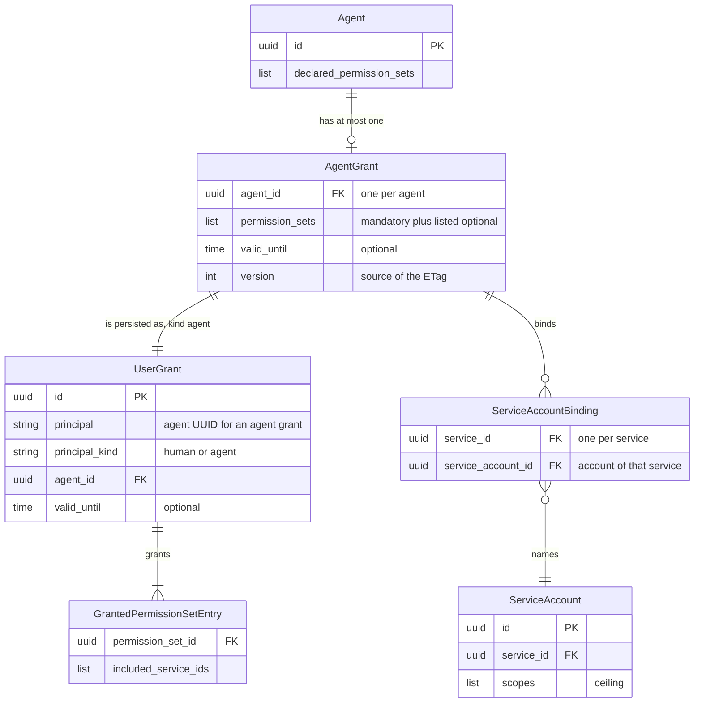
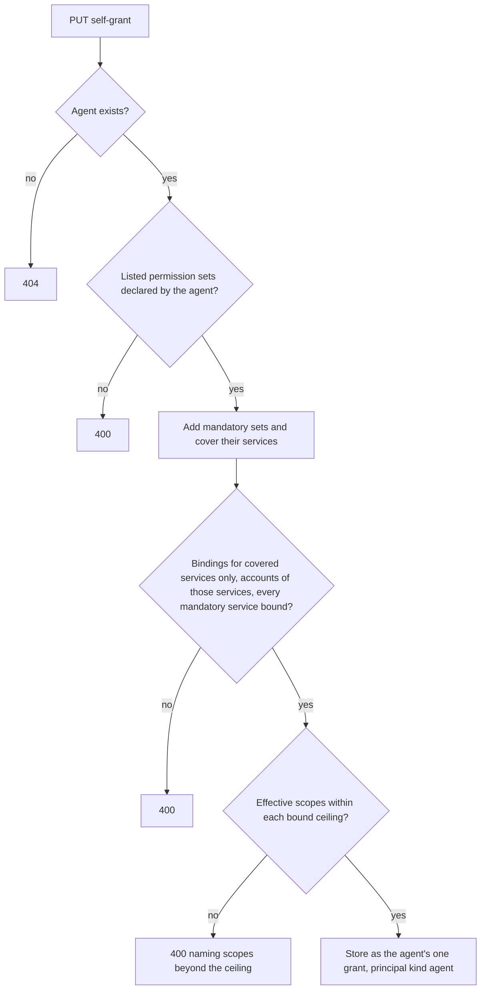

# Feature Specification: Agent Grants (Admin-Issued Delegation to an Agent for Itself)

**Feature Branch**: `speckit/issue-472`

**Created**: 2026-11-27

**Status**: Draft

**Input**: Issue #472, "agent grants (admin-issued delegation to an agent for itself)", step 2 of 7 of the design in issue #478, "agents acting on their own behalf (service accounts, agent grants, machine token exchange)". It builds on step 1, issue #471, delivered as `specs/20261125-152113-service-accounts-stored-jwt/` and `adrs/20261125-154231-service-accounts-stored-jwt.md`. The decisions in #478 are settled inputs to this specification.

> Nobody can delegate permission sets to an agent acting as itself. Add the agent grant: an administrator's delegation stored as a `UserGrant` with principal = agent UUID, so the shared grant resolution, effective-scope resolution and the gateway's permission-set input work unchanged.

This feature lets an administrator grant an agent permission sets for its own use, bind each covered service to one of that service's service accounts, and see the grant refused when it would exceed a bound account's ceiling. It does not yet let any agent obtain a token with it: the machine branch in token exchange and in the gateway's delegation check comes with #473. Until then an agent grant changes no exchange or delegation-check decision.

## Clarifications

### Session 2026-11-27

Answered from the settled design and from the merged step 1. The source is named with each answer.

- Q: Is there a default service account when a covered service holds exactly one? → A: No. A binding is always explicit; a covered but unbound service gives the agent no token, and adding a second account later changes nothing for existing grants (#472 Requirements; #478 "Agent grants mirror user consent"). Recorded in FR-007, FR-010, User Story 2 Scenarios 1 and 6.
- Q: How does a binding refer to its account? → A: By the account's ID, never its `canonical_id`, because `canonical_id` can be renamed (#471 FR-005 and Edge Cases, "Renaming an account"). Recorded in FR-009, User Story 2 Scenario 5.
- Q: Are bindings per permission set or per grant? → A: Per grant, one per service, because effective access is computed per service across all granted permission sets (#478 "Agent grants mirror user consent"). Recorded in FR-007.
- Q: How is containment in the ceiling decided for flat scopes? → A: Literal set containment of exact values; a ceiling must list `drive.readonly` as well as `drive`. Only `permission:level` scopes are ordered, and they come with #476 (#472 Requirements; #478 "Minting follows the grant"). Recorded in FR-012, User Story 3 Scenario 2.
- Q: Which effective scopes are compared with the ceiling? → A: The ones the shared grant resolution computes today: the union over the granted permission sets of their scopes on the service, limited to covered services and to the agent's service-requirement scopes. #472 requires effective-scope resolution to work unchanged. Recorded in FR-011, User Story 3 Scenario 3.
- Q: Is a grant re-validated or changed when a ceiling is lowered or a permission set widened later? → A: No. Lowering a ceiling is always accepted (#471 FR-018); the write-time check is a convenience, and the request-time check of #473 is the guarantee (#472 Requirements). Recorded in FR-013, User Story 3 Scenarios 5–6.
- Q: Does an account's status (`ready` or `failed`) affect whether a binding is accepted? → A: No. #478 lists ceiling excess as the only write-time refusal ("What an administrator does": "Refused when the granted access exceeds the bound account's ceiling"); readiness is a request-time step of the exchange ("The exchange decision"). Recorded in FR-014 and Edge Cases.
- Q: What does deleting a bound service account return? → A: `409` with the response #471 defined in the admin contract, `service account is bound by an agent grant`. #471 defines the rule; this feature enforces it (#471 FR-020; #472 dependency). Recorded in FR-015, User Story 4 Scenario 3, Journey 1 Step 3.
- Q: Can an agent grant expire? → A: Yes, through `valid_until` as on user grants. #478 names grant expiry as a compensating control for administrator delegation (Trade-offs, "Administrators delegate for machines"). Recorded in FR-006, User Story 1 Scenario 8.
- Q: Who may create agent grants, and is there an approval step? → A: Administrators only, through the admin API; no approval workflow (#472 Requirements and Assumptions; #478 Trade-offs). Recorded in FR-001, SR-001.
- Q: May the grant contain permission sets the agent does not declare? → A: No. The agent's declared permission sets are the most any agent grant may contain (#478 "What already exists"). Recorded in FR-004, User Story 1 Scenario 6.
- Q: Does this feature change what token exchange or the delegation check decide for an agent subject? → A: No. An agent-subject token is still rejected under ADR 045 decision 6. The machine branch in the shared `tokenexchange.GrantResolver` belongs to #473 (#473 Requirements). Recorded in FR-018, FR-020, SR-005, User Story 5 Scenario 3.
- Q: Does the active-session requirement of user consent apply? → A: No. An agent has no user session; its credential at the service is the bound account (#478 "Problem", point 2). Recorded in FR-005.

### Session 2026-11-27 (maintainer answers)

Issues #472, #478 and #471 do not decide these points. The maintainer answered them on 2026-11-27, relayed by the orchestrating session.

- Q: Is the principal kind part of a grant's and a session's identity, or only a filter? → A: Part of the identity. A stored kind takes part in the uniqueness of grants (principal kind, principal, agent) and sessions (principal kind, principal, service) and in every lookup. Existing rows are `human`. The kind is never inferred from the principal's text. Recorded in FR-016, DB-002, User Story 5 Scenarios 2, 4 and 6, and Edge Cases.
- Q: Does the request name the services each permission set covers, or only list permission sets? → A: First answered as the consent API's map `{permission_set_id: [service_id]}`. Revised by the maintainer later the same day, together with the next answer: the request lists optional permission-set IDs, and each granted set covers all of its services. Bindings alone decide which services the agent can reach, as #478 expresses it ("for each service the agent should reach, the account to use"). Recorded in FR-002, FR-004a, API-002 and the Journeys.
- Q: Must an agent grant contain the agent's mandatory permission sets, as consent requires? → A: Yes, always. First answered as "the same rule as for users", where a write that omits one is refused. Refined by the maintainer later the same day: the broker always includes the agent's mandatory permission sets itself, the administrator lists only the optional sets to add, and the result is copied into the stored grant on every write (copy on write). Recorded in FR-004, FR-004c, User Story 1 Scenarios 10–11, Journey 1 Step 1 and Journey 2 Step 1.
- Q: Does every covered service need a binding, now that granted sets cover all their services? → A: Only effectively mandatory services: a service the agent's service requirements mark mandatory, or one a granted permission set marks mandatory, within the agent's service requirements where it declares any. A write that leaves one unbound is refused. Other covered services may stay unbound and give no token (#472). This keeps the fixed part of the grant usable and puts every mandatory service under the write-time ceiling check (maintainer answer, 2026-11-27). Recorded in FR-004b, User Story 2 Scenarios 1 and 7, and Edge Cases.
- Q: Is the agent grant the same domain object as a user's consent? → A: The same stored record, not the same domain object. It is persisted as a `UserGrant` with principal kind `agent`, so the shared grant resolution reads it unchanged (#472). An Agent Grant entity owns the agent-only rules and the service-account bindings, which are stored beside the grant record, not inside `UserGrant`. No new bounded context is created (maintainer answer, 2026-11-27). Recorded in the Domain Model and DB-002.
- Q: Does the agent grant carry a strong ETag with an optional `If-Match`? → A: Yes, as service accounts do (#471). A stale `If-Match` on `PUT` or `DELETE` gets `412` and nothing changes; without `If-Match` the last writer wins. Recorded in FR-003, API-003, User Story 1 Scenario 12, and Edge Cases.
- Q: What do the admin API and the service-account delete guard do with an agent grant whose `valid_until` has passed? → A: It stays visible and keeps protecting its accounts. The admin `GET` returns it (`200`, with its `valid_until`). Its bindings still block deletion of the accounts it binds until the grant is deleted or rewritten without them. A `PUT` replaces it (`200`), keeping its `id` and `created_at`, as consent renewal does. Expiry makes the grant absent only for decision paths (#473). Recorded in FR-006, FR-015, User Story 1 Scenario 13, User Story 4 Scenario 6, and Edge Cases.

## User Scenarios & Testing *(mandatory)*

### User Story 1 - Grant an agent permission sets for its own use (Priority: P1)

A platform administrator wants *triage-bot* to read the company platform as itself. The platform service already has a service account holding a token issued for triage-bot (#471). The administrator writes one agent grant for triage-bot with a binding of the platform service to triage-bot's service account. The broker adds *Platform reader*, which triage-bot declares as mandatory, and covers the platform service with it. The broker checks that what the grant gives fits inside the account's ceiling and stores it. Reading it back shows exactly what was granted and which account each service uses.

**Why this priority**: Without a stored delegation there is nothing for the machine path of #473 to evaluate. This story alone gives administrators an auditable record of what each agent may do for itself.

**Independent Test**: Create a service account (#471), write an agent grant that binds it, read the grant back, and replace it. The grant is returned with its permission sets and bindings; a second write replaces the first; every agent has at most one.

**Acceptance Scenarios**:

1. **Given** an agent that declares permission set *Platform reader* and a service *Company Platform* that holds account `platform-triage-bot` with ceiling `["read"]`, and the agent has no agent grant, **When** an administrator writes an agent grant with a binding of *Company Platform* to that account's ID, **Then** the broker answers `201` with a strong ETag and a grant that contains *Platform reader*, which the agent declares as mandatory, covering *Company Platform*, plus the binding.
2. **Given** that grant, **When** an administrator reads the agent's grant, **Then** the broker answers `200` with the same representation and ETag.
3. **Given** that grant, **When** an administrator writes a different grant for the same agent, **Then** the broker answers `200`, the new content replaces the old one entirely, and the agent still has exactly one agent grant.
4. **Given** an agent without an agent grant, **When** an administrator reads its grant, **Then** the broker answers `404`.
5. **Given** an agent identifier that matches no agent, **When** an administrator writes, reads or deletes its grant, **Then** the broker answers `404` and stores nothing.
6. **Given** a grant that lists a permission set the agent does not declare, **When** it is written, **Then** the broker answers `400` and stores nothing.
7. **Given** a permission set that scopes two services, one of which the agent's service requirements do not name, **When** the grant lists it, **Then** the stored grant covers only the service within the agent's service requirements.
8. **Given** a grant with a `valid_until` in the past, **When** it is written, **Then** the broker answers `400` and stores nothing; **given** one in the future, **then** it is stored and returned with that `valid_until`.
9. **Given** an existing grant, **When** an administrator writes the identical grant again, **Then** the broker answers `200` with the unchanged representation and ETag and writes no audit record.
10. **Given** an agent that declares *Platform reader* as mandatory and *Platform operator* as optional, **When** an administrator writes a grant that lists only *Platform operator*, or lists both, **Then** the stored grant contains both. *Platform reader* is included either way, and listing it changes nothing.
11. **Given** a stored agent grant, **When** the agent's declared mandatory permission sets change, **Then** the stored grant is unchanged. **When** the grant is next written, **Then** it contains the agent's current mandatory sets.
12. **Given** a grant whose current ETag is `"2"`, **When** a write or a delete carries `If-Match: "1"`, **Then** the broker answers `412` and the grant is unchanged. **When** the same request carries `If-Match: "2"` or no `If-Match`, **Then** it is carried out.
13. **Given** a stored grant whose `valid_until` has passed, **When** an administrator reads it, **Then** the broker answers `200` with the grant and its past `valid_until`. **When** the administrator writes a grant with a future or absent `valid_until`, **Then** the broker answers `200`, and the grant keeps its `id` and `created_at`.

---

### User Story 2 - Choose the service account explicitly for every covered service (Priority: P1)

The administrator must name, for every service the grant covers, which of that service's accounts the agent uses. There is no default, even when the service holds only one account, so the blast radius is always a deliberate choice and adding a second account later changes nothing for existing grants. A covered service that is not bound is allowed but gives the agent no token later.

**Why this priority**: The explicit binding is the decision #478 relies on to keep one agent's access separate from another's on a shared service. Getting it wrong would let a later account silently become the one an agent uses.

**Independent Test**: Write grants with a binding missing, with a binding for an uncovered service, with an account of another service, and with a non-existent account; check which are stored and what they show.

**Acceptance Scenarios**:

1. **Given** a service that holds exactly one account and is not effectively mandatory for the agent, **When** an administrator writes a grant that covers the service but binds no account, **Then** the grant is stored, it lists no binding for that service, and no account is chosen for it.
2. **Given** a grant that binds a service it does not cover, **When** it is written, **Then** the broker answers `400` naming the service and stores nothing.
3. **Given** a binding that names an account of another service, **When** it is written, **Then** the broker answers `400` and stores nothing.
4. **Given** a binding that names no existing account, **When** it is written, **Then** the broker answers `400` and stores nothing.
5. **Given** a stored grant bound to account `platform-triage-bot`, **When** the account is renamed (#471), **Then** the grant still binds the same account by its ID and reading the grant shows that ID.
6. **Given** a stored grant bound to account A of a service, **When** an administrator adds a second account B to that service, **Then** the grant still binds A.
7. **Given** a covered service that the agent's service requirements, or a granted permission set, mark mandatory, **When** a grant leaves it unbound, **Then** the broker answers `400` naming the service and stores nothing.

---

### User Story 3 - Refuse a grant that exceeds the bound account's ceiling (Priority: P1)

For every bound service, the agent's effective access there, the union of the scopes of its granted permission sets for that service, must be contained in the bound account's ceiling. The comparison is literal: the broker knows no provider's scope hierarchy, so a ceiling that lists only `write` does not contain `read`. The check runs when the grant is written; it is a convenience that catches mistakes early, not the guarantee.

**Why this priority**: It is the write-time half of the ceiling rule of #478 (Case 5). A grant the bound account could never satisfy would otherwise surface only as an exchange denial far from the administrator.

**Independent Test**: Bind a permission set whose scopes are inside, equal to and outside the ceiling; only the last is refused, and the refusal names the scopes beyond the ceiling.

**Acceptance Scenarios**:

1. **Given** account `platform-planner-bot` with ceiling `["read", "write"]`, **When** a grant binds it for permission sets whose combined scopes on the service are `["read", "write", "admin"]`, **Then** the broker answers `400`, names the service, the account and the scope `admin`, and stores nothing.
2. **Given** an account with ceiling `["write"]`, **When** a grant binds it for a permission set with scope `read`, **Then** the broker answers `400`: `write` does not contain `read`.
3. **Given** two granted permission sets with scopes `["read"]` and `["write"]` on one service, **When** the grant binds an account with ceiling `["read", "write"]`, **Then** it is stored; **when** it binds an account with ceiling `["read"]`, **then** it is refused, because the union is checked, not each set alone.
4. **Given** a covered service without a binding, **When** the grant is written, **Then** no ceiling check applies to that service.
5. **Given** a stored grant within its account's ceiling, **When** an administrator lowers the ceiling below what the grant uses, **Then** the ceiling change is accepted (#471) and the grant is unchanged; **when** the grant is next written, **then** it is refused until it fits.
6. **Given** a stored grant within its account's ceiling, **When** an administrator adds a scope to a granted permission set that the ceiling does not list, **Then** the permission-set change is accepted and the grant is unchanged.

---

### User Story 4 - Revoke an agent grant and protect bound accounts (Priority: P2)

The administrator retires an agent's access by deleting its agent grant. While any agent grant binds a service account, that account cannot be removed: the rule #471 defined becomes real here. Once the binding is gone, the account can be removed as before.

**Why this priority**: Revocation completes the lifecycle; the delete guard keeps a grant from pointing at an account that no longer exists.

**Independent Test**: Try to delete a bound account (refused), delete the grant, delete the account (accepted).

**Acceptance Scenarios**:

1. **Given** an agent with an agent grant, **When** an administrator deletes the grant, **Then** the broker answers `204`, a later read answers `404`, and the agent's declared permission sets and any users' grants to it are unchanged.
2. **Given** an agent without an agent grant, **When** an administrator deletes its grant, **Then** the broker answers `404`.
3. **Given** an account bound by an agent grant, **When** an administrator deletes the account, **Then** the broker answers `409` with the conflict response defined by #471, and the account and the grant are unchanged.
4. **Given** that account after the binding was removed, by deleting the grant or by writing it without that binding, **When** the administrator deletes the account, **Then** the broker answers `204`.
5. **Given** an agent with an agent grant, **When** the agent is deleted, **Then** its agent grant is deleted with it, and the accounts it bound can be removed afterwards.
6. **Given** an account bound only by an agent grant whose `valid_until` has passed, **When** an administrator deletes the account, **Then** the broker answers `409` with the conflict response defined by #471, and the account and the grant are unchanged.

---

### User Story 5 - Agent grants stay out of every user's view and every human decision (Priority: P2)

Agent grants live in the same records as users' consents. A person on the consent screens must never see them, and no human request may be decided by them. Every grant and session record therefore states whether its principal is a human or an agent, so queries filter on that fact rather than guessing from the text of the principal.

**Why this priority**: Reusing the user records is what keeps exchange and resolution unchanged (#478 Trade-offs); the cost is that every listing must know which rows belong to machines.

**Independent Test**: Create an agent grant for agent A; as a user, list delegations and grants, including as a user whose principal text equals A's UUID; run a token exchange with A's self token; the agent grant appears nowhere and changes nothing.

**Acceptance Scenarios**:

1. **Given** an agent grant for agent A and a user's consent to A, **When** the user lists their delegations or their grants for A, **Then** only the user's own consent appears.
2. **Given** an agent grant for agent A, **When** a user whose principal text equals A's UUID lists delegations, reads their grants for A, or reads the agents affected by ending a service session, **Then** the agent grant does not appear.
3. **Given** an agent grant for agent A, **When** A exchanges its self token for a service token or the gateway's delegation check is asked about A as subject, **Then** the answer is the same denial as without the grant (ADR 045 decision 6; the machine branch comes with #473).
4. **Given** an agent grant for agent A, **When** a human exchange or delegation check runs for any principal, including one whose text equals A's UUID, **Then** the agent grant is never read as that human's consent.
5. **Given** existing grants and sessions from before this feature, **When** the feature is deployed, **Then** every one of them is recorded as having a human principal and behaves exactly as before.
6. **Given** an agent grant for agent A and a consent to A from a person whose principal text equals A's UUID, **When** an administrator deletes A's agent grant, **Then** the person's consent is unchanged; **when** the person revokes their consent instead, **then** A's agent grant is unchanged.

---

### Edge Cases

- **Agent stops declaring a granted permission set**: the agent update is accepted as today; the stored agent grant keeps the entry, and the next write of the grant is refused until the entry is removed. Request-time handling belongs to #473.
- **Permission set or account deleted concurrently with a grant write**: the write fails closed and stores nothing; it never stores a binding to a missing account or a grant that references a missing permission set.
- **Service deleted**: a service that holds service accounts cannot be deleted (#471), so a binding never outlives its service.
- **Ceiling lowered, permission set widened**: accepted; the stored grant is unchanged and the request-time check of #473 decides (#472 Requirements).
- **Account status `failed`** (stored JWT expired, #471): binding it is accepted. Status is not an authorization input at write time; the exchange in #473 refuses a failed account.
- **Same account bound by several agents' grants**: accepted (#478 Cases 2–3). Deleting it is refused while any of them binds it.
- **Empty grant**: a write that lists no optional sets is valid when the agent declares mandatory sets, because they are always included. If the resulting grant would contain no permission set, it is refused. Revocation is the delete operation, not an empty write.
- **Duplicate entries**: a permission set listed twice is refused.
- **Round trip**: `permission_sets` from a `GET`, which includes the mandatory sets, can be sent back unchanged in a `PUT`.
- **Permission set gains or loses a service later**: the stored coverage is unchanged until the grant is next written (copy on write). Request-time handling belongs to #473.
- **Scope case and whitespace**: compared byte for byte; `Read` is not `read`.
- **Agent with a user grant from a person whose principal text equals the agent's UUID**: both records coexist, because the principal kind is part of each record's identity. Neither is visible from or applied to the other's path, and deleting either leaves the other intact.
- **Concurrent writes of one agent's grant**: each write is applied whole or not at all, and the agent never holds two agent grants. A writer that sends a stale `If-Match` is refused with `412`. Writers that send none overwrite each other, and the last writer wins.
- **Agent's mandatory permission sets change later**: the agent update is accepted as it is for user consents. The stored agent grant is unchanged until it is next written, and that write includes the current mandatory sets (FR-004c). Editing an agent never widens its own access without a grant write and its audit record. Request-time handling belongs to #473.
- **Expired agent grant**: absent for every decision path, but still the agent's grant for the admin API. `GET` returns it, its bindings still block deletion of the bound accounts, and a `PUT` renews it in place (`200`) (FR-006, FR-015).
- **Mandatory service without an account**: a grant cannot be written until the service holds an account to bind (FR-004b).

## Concrete Example Journeys *(mandatory)*

All journeys share one cast. **Operator**: `ops-admin@example.com`, authenticated by the trusted proxy in front of the admin server and forwarded as `X-Remote-User`. **Agents**: *triage-bot* (`550e8400-e29b-41d4-a716-446655440041`, canonical ID `triage-bot`) and *planner-bot* (`550e8400-e29b-41d4-a716-446655440042`, canonical ID `planner-bot`); both declare *Platform reader* as mandatory and *Platform operator* as optional, and *planner-bot* also declares *Platform admin* as optional. No permission set and no service requirement marks *Company Platform* as a mandatory service, so a grant may leave it unbound. **Service**: *Company Platform* (`880e8400-e29b-41d4-a716-446655440020`, canonical ID `company-platform`), the service users already hold sessions with. **Service accounts on it** (#471, both `jwt_bearer` with a stored JWT, narrowing `none`): `platform-triage-bot` (`990e8400-e29b-41d4-a716-446655440031`, ceiling `["read"]`) and `platform-planner-bot` (`990e8400-e29b-41d4-a716-446655440032`, ceiling `["read", "write"]`). **Permission sets**: *Platform reader* (`770e8400-e29b-41d4-a716-446655440051`, `company-platform: [read]`), *Platform operator* (`770e8400-e29b-41d4-a716-446655440052`, `company-platform: [read, write]`), *Platform admin* (`770e8400-e29b-41d4-a716-446655440053`, `company-platform: [read, write, admin]`). Neither agent has an agent grant. Neither agent declares a service requirement for *Company Platform* that narrows its scopes. Admin API host: `broker-admin.example.com`. All times are 2026-11-27 UTC. All IDs and tokens are synthetic. No broker configuration changes any step, so no configuration block is shown.

A request lists the optional permission sets to add in `permission_sets`; the broker always adds the agent's mandatory sets and covers every service of each granted set within the agent's service requirements. The representation shows all granted sets in `permission_sets` and the resulting coverage, read-only, in `granted_permission_sets` (permission set → covered services).

### Journey 1 — Two agents on one service, each bound to its own account (User Story 1, Scenarios 1–2; User Story 2, Scenario 1; User Story 3, Scenario 3; User Story 4, Scenarios 1, 3–4)

This is Case 1 of #478.

**Step 1 — 10:00:00: the operator grants triage-bot read access, bound to its own account**

```http
PUT /api/agents/triage-bot/self-grant HTTP/1.1
Host: broker-admin.example.com
X-Remote-User: ops-admin@example.com
Content-Type: application/json

{
  "permission_sets": [],
  "service_account_bindings": {
    "880e8400-e29b-41d4-a716-446655440020": "990e8400-e29b-41d4-a716-446655440031"
  }
}

HTTP/1.1 201 Created
ETag: "1"
Content-Type: application/json

{
  "id": "aa0e8400-e29b-41d4-a716-446655440061",
  "agent_id": "550e8400-e29b-41d4-a716-446655440041",
  "permission_sets": ["770e8400-e29b-41d4-a716-446655440051"],
  "granted_permission_sets": {
    "770e8400-e29b-41d4-a716-446655440051": ["880e8400-e29b-41d4-a716-446655440020"]
  },
  "service_account_bindings": {
    "880e8400-e29b-41d4-a716-446655440020": "990e8400-e29b-41d4-a716-446655440031"
  },
  "valid_until": null,
  "created_at": "2026-11-27T10:00:00Z",
  "updated_at": "2026-11-27T10:00:00Z"
}
```

*Platform reader* is in the grant because triage-bot declares it as mandatory; the operator did not list it. Effective scopes on *Company Platform*: `["read"]`, contained in the ceiling `["read"]`. One audit record names the agent, the operator, the permission sets and the binding.

**Step 2 — 10:01:00: the operator grants planner-bot reader and operator, bound to the read-and-write account**

```http
PUT /api/agents/planner-bot/self-grant HTTP/1.1
Host: broker-admin.example.com
X-Remote-User: ops-admin@example.com
Content-Type: application/json

{
  "permission_sets": ["770e8400-e29b-41d4-a716-446655440052"],
  "service_account_bindings": {
    "880e8400-e29b-41d4-a716-446655440020": "990e8400-e29b-41d4-a716-446655440032"
  }
}

HTTP/1.1 201 Created
ETag: "1"
Content-Type: application/json

{
  "id": "aa0e8400-e29b-41d4-a716-446655440062",
  "agent_id": "550e8400-e29b-41d4-a716-446655440042",
  "permission_sets": ["770e8400-e29b-41d4-a716-446655440051", "770e8400-e29b-41d4-a716-446655440052"],
  "granted_permission_sets": {
    "770e8400-e29b-41d4-a716-446655440051": ["880e8400-e29b-41d4-a716-446655440020"],
    "770e8400-e29b-41d4-a716-446655440052": ["880e8400-e29b-41d4-a716-446655440020"]
  },
  "service_account_bindings": {
    "880e8400-e29b-41d4-a716-446655440020": "990e8400-e29b-41d4-a716-446655440032"
  },
  "valid_until": null,
  "created_at": "2026-11-27T10:01:00Z",
  "updated_at": "2026-11-27T10:01:00Z"
}
```

Effective scopes: the union `["read", "write"]`, contained in `["read", "write"]`.

**Step 3 — 10:02:00: the operator tries to remove triage-bot's account while it is bound**

```http
DELETE /api/services/company-platform/service-accounts/platform-triage-bot HTTP/1.1
Host: broker-admin.example.com
X-Remote-User: ops-admin@example.com

HTTP/1.1 409 Conflict
Content-Type: application/json

{ "error": "conflict", "message": "service account is bound by an agent grant" }
```

**Step 4 — 10:03:00: the operator reads triage-bot's grant**

```http
GET /api/agents/550e8400-e29b-41d4-a716-446655440041/self-grant HTTP/1.1
Host: broker-admin.example.com
X-Remote-User: ops-admin@example.com

HTTP/1.1 200 OK
ETag: "1"
Content-Type: application/json

{ "id": "aa0e8400-e29b-41d4-a716-446655440061", "agent_id": "550e8400-e29b-41d4-a716-446655440041", "permission_sets": ["770e8400-e29b-41d4-a716-446655440051"], "granted_permission_sets": { "770e8400-e29b-41d4-a716-446655440051": ["880e8400-e29b-41d4-a716-446655440020"] }, "service_account_bindings": { "880e8400-e29b-41d4-a716-446655440020": "990e8400-e29b-41d4-a716-446655440031" }, "valid_until": null, "created_at": "2026-11-27T10:00:00Z", "updated_at": "2026-11-27T10:00:00Z" }
```

**Step 5 — 10:04:00: triage-bot is retired; the operator revokes its grant and removes the account**

```http
DELETE /api/agents/triage-bot/self-grant HTTP/1.1
Host: broker-admin.example.com
X-Remote-User: ops-admin@example.com

HTTP/1.1 204 No Content
```

The `DELETE` of Step 3 repeated now answers `204 No Content`.

**Observable result**: planner-bot's grant is unchanged and still binds `platform-planner-bot`; triage-bot has no grant and its account is gone. Three audit records exist for grant writes and deletions (two created, one deleted), plus #471's record for the account deletion. No exchange or delegation-check answer changed at any step.

### Journey 2 — Refusals at write time (User Story 1, Scenario 10; User Story 2, Scenarios 1–2; User Story 3, Scenario 1)

Starts from the state after Journey 1 Step 2. This is Case 5 of #478.

**Step 1 — 11:00:00: planner-bot granted admin while bound to the read-and-write account**

```http
PUT /api/agents/planner-bot/self-grant HTTP/1.1
Host: broker-admin.example.com
X-Remote-User: ops-admin@example.com
Content-Type: application/json

{
  "permission_sets": ["770e8400-e29b-41d4-a716-446655440053"],
  "service_account_bindings": {
    "880e8400-e29b-41d4-a716-446655440020": "990e8400-e29b-41d4-a716-446655440032"
  }
}

HTTP/1.1 400 Bad Request
Content-Type: application/json

{
  "error": "validation failed",
  "message": "service_account_bindings[880e8400-e29b-41d4-a716-446655440020]: scopes [admin] exceed the ceiling of service account 990e8400-e29b-41d4-a716-446655440032"
}
```

The broker adds *Platform reader*, which planner-bot declares as mandatory, so the effective scopes are the union `["read", "write", "admin"]`.

**Step 2 — 11:01:00: a binding for a service the grant does not cover**

The request of Journey 1 Step 1 for triage-bot with an added binding `"880e8400-e29b-41d4-a716-446655440021": "990e8400-e29b-41d4-a716-446655440033"` for a service no granted permission set covers answers:

```http
HTTP/1.1 400 Bad Request
Content-Type: application/json

{ "error": "validation failed", "message": "service_account_bindings[880e8400-e29b-41d4-a716-446655440021]: service is not covered by the grant" }
```

**Step 3 — 11:02:00: a covered service left unbound**

The request of Journey 1 Step 1 for triage-bot without `service_account_bindings` answers `201` (or `200` if a grant existed) with `"service_account_bindings": {}`. That is allowed only because *Company Platform* is not effectively mandatory for triage-bot (FR-004b). The service has accounts, yet none is chosen for triage-bot; once #473 is delivered, triage-bot obtains no token for *Company Platform*.

**Observable result**: planner-bot's grant is still the one from Journey 1 Step 2 with ETag `"1"`; no refused request wrote an audit record of a change.

### Journey 3 — Agent grants are invisible to people (User Story 5, Scenarios 1–2)

Starts from the state after Journey 1 Step 2. Alice (`alice@example.com`) consented to planner-bot earlier with *Platform reader*. An unusual principal, `550e8400-e29b-41d4-a716-446655440042`, is also a person known to the proxy and has no consents.

**Step 1 — 12:00:00: Alice lists her delegations**

```http
GET /api/consent/agents HTTP/1.1
Host: broker.example.com
X-Remote-User: alice@example.com

HTTP/1.1 200 OK
Content-Type: application/json

{ "data": [ { "agentId": "550e8400-e29b-41d4-a716-446655440042", "displayName": "planner-bot", "activeGrantCount": 1, "lastModifiedAt": "2026-11-20T08:00:00Z" } ] }
```

The count reflects Alice's consent only.

**Step 2 — 12:01:00: the person whose principal text equals planner-bot's UUID lists delegations**

```http
GET /api/consent/agents HTTP/1.1
Host: broker.example.com
X-Remote-User: 550e8400-e29b-41d4-a716-446655440042

HTTP/1.1 200 OK
Content-Type: application/json

{ "data": [] }
```

**Observable result**: planner-bot's agent grant is returned only by the admin API.

## Requirements *(mandatory)*

### Functional Requirements

**The agent grant**

- **FR-001**: Administrators MUST be able to create, replace, read and delete one agent grant per agent through the admin API only. An agent grant is a delegation of permission sets to the agent for its own use; its principal is the agent itself. No end-user operation can create, change, read or delete it, and no approval workflow applies.
- **FR-002**: An agent grant MUST be stored as a grant record that the existing grant model reads unchanged: the same granted permission sets with their covered services, the same optional `valid_until`, the same effective-scope definition. The request names permission sets only, and the broker computes their coverage (FR-004a). The principal of an agent grant MUST be the agent's UUID and MUST be marked as an agent principal (FR-016).
- **FR-003**: A write MUST replace the whole grant. The first write creates it (`201`); later writes replace it (`200`). Identical content MUST succeed without a change, without a new ETag and without an audit record. Every committed change MUST change the grant's strong ETag. `PUT` and `DELETE` MUST accept an optional `If-Match`: when it is supplied and does not equal the current ETag, the broker MUST answer `412` and change nothing; when it is absent, the request is carried out and the last writer wins (maintainer answer, the same posture as #471 FR-019).
- **FR-004**: The request MUST list the optional permission sets to grant. The broker MUST always add every permission set the agent declares as mandatory; listing a mandatory set is allowed and changes nothing. Every listed permission set MUST be one the agent declares; the agent's declared permission sets are the most an agent grant may contain (#478 "What already exists"). The resulting grant MUST contain at least one permission set.
- **FR-004a**: Each granted permission set MUST cover every service it scopes, limited to the agent's service requirements where the agent declares any, as consent limits covered services today. A write in which any granted set would cover no service MUST be refused, naming the set, because a grant entry without a covered service is invalid, as it is for consent. The administrator does not choose covered services; bindings decide which services the agent can reach (FR-007).
- **FR-004b**: Every effectively mandatory covered service MUST be bound. A service is effectively mandatory when the agent's service requirements mark it mandatory, or when a granted permission set marks it mandatory and it lies within the agent's service requirements where the agent declares any. A write that leaves one unbound MUST be refused, naming the service. Other covered services MAY stay unbound.
- **FR-004c**: The granted sets and their coverage MUST be resolved when the grant is written and stored in the grant (copy on write). A later change to the agent's declared permission sets, to its service requirements or to a permission set's services MUST NOT modify a stored agent grant; the next write resolves them anew.
- **FR-005**: Coverage MUST NOT depend on the agent's principal having a session with the service; the active-session requirement of user consent does not apply to agent grants.
- **FR-006**: A `valid_until`, when given, MUST lie in the future. An expired agent grant MUST be treated as absent by every decision path, as an expired user grant is (#473). The admin operations MUST still treat it as the agent's grant: `GET` returns it with its `valid_until`, `PUT` replaces it (`200`, keeping its `id` and `created_at`), `DELETE` removes it, and its bindings keep protecting the bound accounts (FR-015).

**Service-account bindings**

- **FR-007**: The grant MUST carry `service_account_bindings`, a map from service ID to service-account ID, at most one per service. There MUST be no default binding: a covered service without an entry has no account, also when the service holds exactly one account.
- **FR-008**: A binding for a service that no granted permission set covers MUST be refused.
- **FR-009**: A binding MUST name, by its ID, an existing account of that same service. A binding naming an account of another service, or no account, MUST be refused. Renaming an account (#471) MUST NOT affect bindings.
- **FR-010**: Adding, changing or removing other accounts of a service MUST NOT change any stored binding.

**Ceiling validation at write time**

- **FR-011**: For every bound service, the grant's effective scopes on that service, computed with the same effective-scope definition the shared grant resolution uses today (the union over the granted permission sets of their scopes on the service, limited to covered services and to the agent's service-requirement scopes where it declares them), MUST be contained in the bound account's ceiling. Otherwise the write MUST be refused, naming the service, the account and the scopes beyond the ceiling.
- **FR-012**: Containment MUST follow the scope grammar of the bound account's kind. For flat scopes, the only grammar in this feature, it MUST be literal set containment of exact byte strings: no scope implies another. Ordered `permission:level` scopes come with #476.
- **FR-013**: The write-time check MUST NOT be the guarantee. A later ceiling change (always accepted, #471), permission-set change or agent change MUST NOT be refused because of an agent grant and MUST NOT modify any agent grant; the authoritative check runs per request in #473. Writing the grant again re-runs the check.
- **FR-014**: The account's status (`ready` or `failed`, #471) MUST NOT affect whether a binding is accepted.

**Deletion and lifecycle**

- **FR-015**: Deleting a service account MUST be refused with the `409` conflict defined by #471 while any agent grant binds it, including an expired one. Deleting an agent MUST delete its agent grant with it. Deleting a permission set keeps the existing rule (refused while an agent declares it).

**Principal kind and separation from human paths**

- **FR-016**: Every grant and every session record MUST state whether its principal is a `human` or an `agent`. Existing records MUST be recorded as `human`. The kind MUST be set by the operation that writes the record (consent and session writes: `human`; agent-grant writes: `agent`) and MUST NOT be inferred from the principal's text or from whether it matches an agent's UUID. The kind MUST be part of each record's identity: grants are unique per (principal kind, principal, agent) and sessions per (principal kind, principal, service), and every lookup, write and delete names the kind (maintainer answer). A human principal whose text equals an agent's UUID and that agent's own grant MUST therefore coexist, and revoking either MUST leave the other intact.
- **FR-017**: Every end-user operation that lists, reads, counts, writes or deletes grants or sessions (the consent screens, delegation listings, the agents affected by ending a session, session listings and counts) MUST read and change only records whose principal kind is `human`.
- **FR-018**: Every existing human decision path, token exchange, the gateway's delegation check (`POST /access/v1/evaluation`) and approval authentication, MUST read only `human` grants and sessions. The shared grant resolution MUST decide exactly as before this feature for every request: an agent-subject token is still rejected (ADR 045 decision 6) whether or not an agent grant exists.

**Audit**

- **FR-019**: The broker MUST write an audit record after each committed creation, replacement and deletion of an agent grant, identifying the agent and the acting administrator and carrying the granted permission sets and bindings, with the previous content on a replacement. A refused or unchanged write MUST NOT produce a success record. Audit records MUST NOT contain credentials.

**Scope boundary**

- **FR-020**: This feature MUST NOT hand out any token, change token exchange or the delegation check for agent subjects, add machine sessions, or add `subject_kind` to the gateway's inputs (#473).

### Domain Model





**Entities**:
- **Agent grant**: an administrator's delegation to an agent for its own use; at most one per agent; created only by administrators. It is persisted as a `UserGrant` whose principal is the agent's UUID with principal kind `agent`, so the shared grant resolution reads it unchanged; the agent-only rules and the bindings belong to the Agent Grant, not to `UserGrant`. Invariants: granted sets are declared by the agent and include all its mandatory sets; each covers all its services within the agent's service requirements; bindings only for covered services and for every effectively mandatory one; each binding names an account of that service; effective scopes on a bound service are within the bound ceiling at write time.

**Aggregates**:
- **Agent Grant** is the aggregate root for writes. It owns its **service-account bindings** and is persisted through the existing grant record plus binding storage beside it. `UserGrant` gains only the principal kind. A binding references a **ServiceAccount** (aggregate of #471) by ID; the account aggregate refuses deletion while referenced. The agent grant lives in the consent bounded context and reuses its validation; no new `domain/X/` package is created.

**Value Objects**:
- **Service-account binding**: the pair (service, account) on a grant.
- **Principal kind**: `human` or `agent`.
- **Effective scopes**: the per-service union defined in FR-011.

**Domain Events**:
- **Agent grant created**, **Agent grant replaced**, **Agent grant deleted**.

The terms Agent Grant, Binding (service-account binding) and Principal Kind are added to the `ARCHITECTURE.md` glossary and to the root `AGENTS.md` glossary table with the definitions of #478.

### API Requirements

- **API-001**: The operations are defined in `api/admin/openapi.yaml` before implementation, on the admin server only: `PUT`, `GET` and `DELETE /api/agents/{agent-id}/self-grant`. `{agent-id}` keeps its existing meaning (UUID or canonical ID).
- **API-002**: The request carries `permission_sets` (optional permission-set IDs to add; may be empty or omitted), `service_account_bindings` (service ID → service-account ID) and an optional `valid_until`. The representation carries all granted sets in `permission_sets`, the resolved coverage read-only in `granted_permission_sets` (permission set → covered services), the bindings and `valid_until`, plus `id`, `agent_id`, `created_at` and `updated_at`. IDs are UUIDs.
- **API-003**: Errors use the existing envelope and the existing meanings of `400`, `401`, `404`, `409`, `412` and `500`. Responses that return the grant carry its strong ETag, and `If-Match` is optional on `PUT` and `DELETE` (FR-003). The `409` of #471's service-account delete is now reachable; its contract text is updated accordingly.
- **API-004**: No end-user API path or schema changes. End-user responses only stop being able to contain agent grants, which they never did by design.
- **API-005**: The contract includes examples matching the journeys of this specification, including the refusals of Journey 2.
- **API-006**: The change is additive; the Admin API version is raised by a minor step. The contract change is confirmed by the maintainer before implementation begins (Constitution Principle X).

### Database Requirements

- **DB-001**: Bindings and principal kind are persisted through repository ports with both an in-memory and a PostgreSQL implementation that behave identically for every acceptance scenario (Constitution Principle IX).
- **DB-002**: The schema change is one atomic migration pair under the next free number (`051`), tested in both directions against PostgreSQL. It records principal kind on grants and sessions with existing rows `human`, makes it part of both uniqueness constraints, stores bindings beside the grant record, not in it, so that the database itself prevents deleting a bound service account and prevents a binding to an account of another service, and removes an agent's bindings with its grant.
- **DB-003**: Queries list explicit columns; no `SELECT *`.

### Security Requirements *(mandatory for security-critical features)*

- **SR-001**: Only administrators authenticated by the admin server's trusted proxy can reach agent-grant operations; a request without an operator principal is refused with `401` before any grant is read.
- **SR-002**: Validation fails closed: if a permission set, account or agent cannot be read, the write fails and stores nothing.
- **SR-003**: No human path may read an agent grant as a human's consent (FR-017, FR-018); tests assert this with a human principal whose text equals the agent's UUID.
- **SR-004**: No credential is read, decrypted or returned by any operation of this feature; ceiling validation reads only the account's ceiling.
- **SR-005**: An agent-subject token is still rejected at exchange and at the delegation check, with the same error, diagnostic and absence of a consent link as before (ADR 045 decision 6; FR-018).

### Key Entities

- **Agent grant**: an administrator's delegation of permission sets to an agent for its own use, one per agent.
- **Service-account binding**: which service account an agent grant uses for one covered service.
- **Principal kind**: whether a grant's or session's principal is a human or an agent.

## Success Criteria *(mandatory)*

### Measurable Outcomes

- **SC-001**: An administrator can grant an agent permission sets with bindings, read it back and revoke it in one request each, without any configuration change.
- **SC-002**: 100% of grants whose effective scopes exceed a bound ceiling, and 100% of bindings to an uncovered service or a foreign account, are refused at write time with a reason, and none leaves a stored change.
- **SC-003**: In 100% of end-user listings and human decisions exercised by the tests, including those for a human principal whose text equals an agent's UUID, agent grants are absent and have no effect.
- **SC-004**: Every token exchange and delegation-check answer exercised by the existing test suites is identical with and without agent grants present.
- **SC-005**: No bound service account can be deleted; every attempt is refused until the binding is removed.
- **SC-006**: Every agent-grant creation, replacement and deletion can be attributed afterwards to the administrator who performed it.
- **SC-007**: Both storage back-ends pass the same acceptance scenarios.

## Assumptions

- Permission sets stay the unit of delegation (#472).
- No approval workflow for agent grants (#472; #478 Trade-offs: audit records and grant expiry are the compensating controls).
- Agent grants may expire through `valid_until`, as user grants do (#478 Trade-offs names grant expiry as a compensating control).
- Agent grants are evaluated nowhere in this feature; #473 adds the machine branch that reads them.
- No machine sessions exist yet; every session record is `human` until #473.
- The admin UI for agent grants comes later (#478); this feature has no frontend change.
- This feature adds no configuration parameter.
- Audit event names and fields follow the coding standards and are fixed in the observability contract at planning.
- An ADR records the agent grant, the principal kind and the binding storage if planning finds that `ARCHITECTURE.md` or an accepted ADR needs to change; the ADR superseding ADR 045 decision 6 belongs to #473.

## Out of Scope

- The machine branch in token exchange and in the AuthZEN delegation check, the request-time ceiling check, machine token sources, machine sessions, `subject_kind` in ExtProc and audit (#473).
- `permission:level` ceilings and their ordering (#476); other service-account kinds (#474–#477).
- Validation that a permission set's scopes make sense for every account it can bind to (#478 Trade-offs, "one vocabulary per credential kind").
- The admin UI.
- Operator queues or human approval for agent requests (#478: always denied for now).
