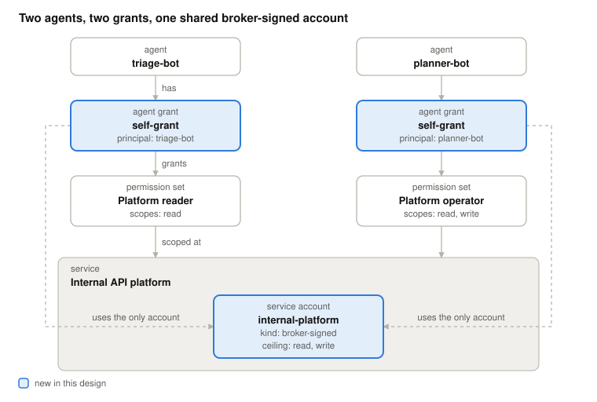
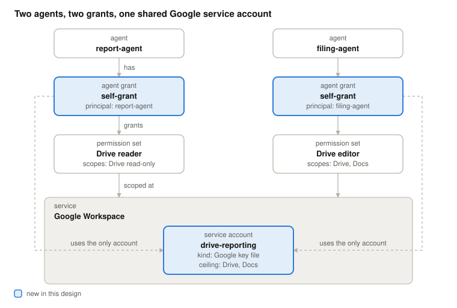
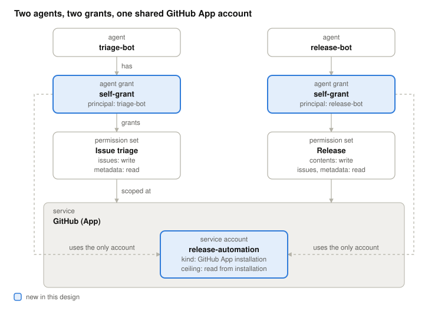
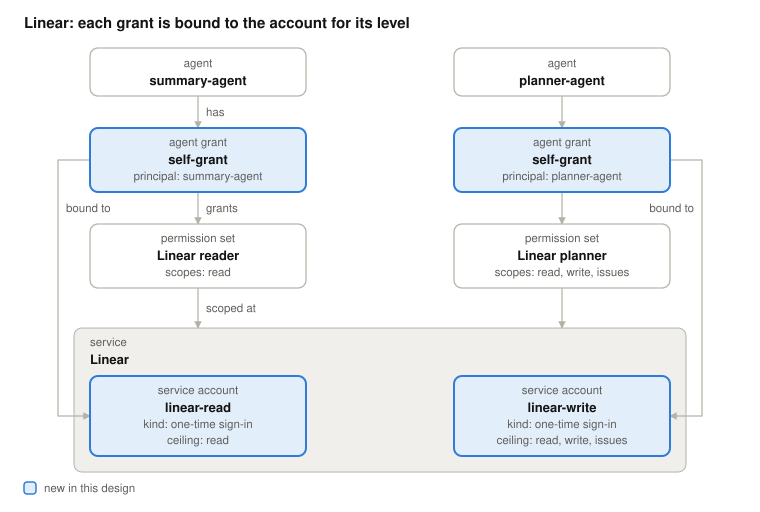
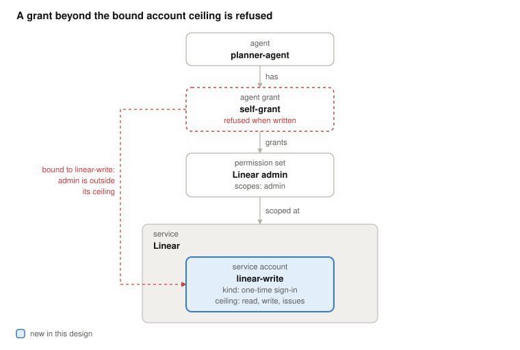
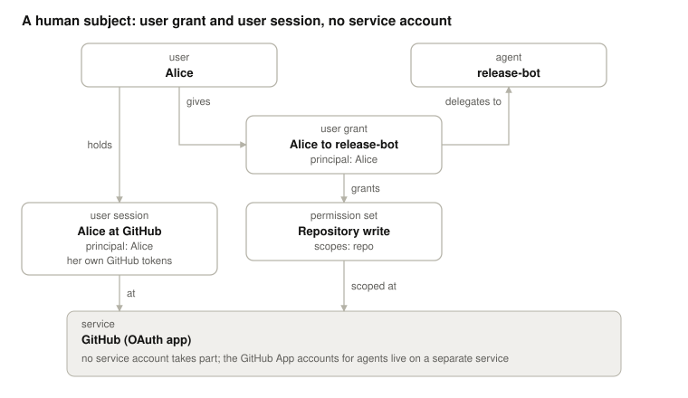

# Worked cases: agents acting on their own behalf

Instance diagrams for the six worked cases of the design in
[issue 478](https://github.com/zalando-incubator/agentic-identity-broker/issues/478).

Read each drawing top to bottom: an agent has one agent grant, the grant names permission
sets, and each permission set is scoped at a service. The line down the side shows which of
the service's accounts the grant uses: solid when the grant names it, dashed when the service
has only one. Blue marks the records the design adds.

## Case 1: shared internal platform

## Case 2: shared Google service account

## Case 3: shared GitHub App installation

## Case 4: Linear, one account per level

## Case 5: a grant beyond the ceiling

## Case 6: a human behind the same agent

