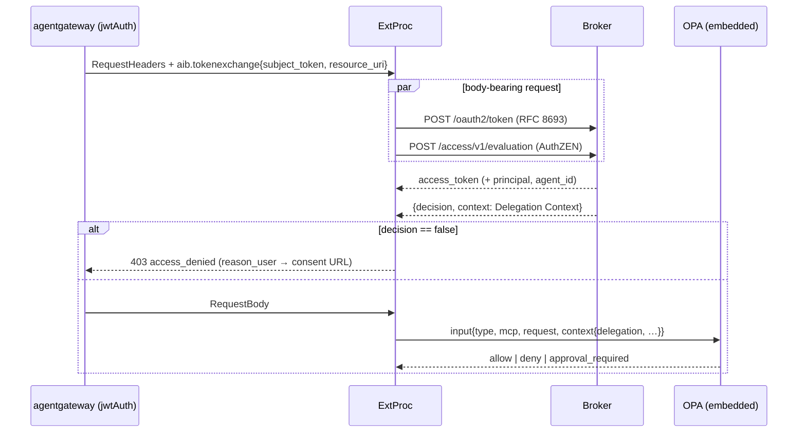

# Design: Delegation Policy Information Point (AuthZEN Access Evaluation API)

**Status**: Draft — Design Discussion
**Date**: 2026-10-24
**Related**: ADR 028 (ExtProc OPA), ADR 036 (approval cache and gate), ADR 018 (approval auth boundaries), ADR 033 (request security context), Feature 019 (permission sets), Feature 020 (ExtProc OPA), Feature 026 (approval sync)

---

## 1. Problem Statement

Today the authorization context that ExtProc hands to OPA travels as private extension fields on the RFC 8693 token exchange response:

| Field | Producer | Consumer |
|---|---|---|
| `granted_permission_sets` | `internal/domain/tokenexchange/service.go` (Feature 019, FR-012) | `internal/extproc/server/exchanger.go` → `authorization.ContextInput` → `input.context.granted_permission_sets` |
| `principal`, `agent_id` | same | ExtProc approval identity (ADR 036) and `approval.Invocation` |

This works, but it is implicit and hard to extend:

1. **Protocol coupling**. Policy attributes ride on an OAuth 2.0 token response. Every new attribute (canonical IDs, effective scopes, grant validity, agent metadata) widens a non-standard extension of RFC 8693 and changes the token cache entry in ExtProc.
2. **Lifetime coupling**. The attributes inherit the token cache window (`cache.max_ttl`, up to 1h, plus the stale-token outage window). A revoked or narrowed grant keeps feeding OPA until the exchanged token ages out.
3. **Ordering coupling**. OPA can only see context after a successful exchange. Header-only requests evaluate OPA before exchange and therefore get no context at all.
4. **Brittle policy references**. Policies key on UUIDs. The E2E fixtures hardcode `github_issues_service := "22222222-…"` because the context carries no canonical identifiers.
5. **Single consumer**. The data is reachable only by whoever performs token exchange. An AuthZEN-capable gateway (agentgateway, Traefik Hub, an MCP server acting as PEP) cannot ask the broker anything.

### Goals

1. Add an explicit broker endpoint that answers, for one specific request, "what does the broker know about this delegation?"
2. Interpret exactly the tokens token exchange interprets, with the same validator and the same CEL claim extraction, so principal and agent are derived identically.
3. Follow OpenID AuthZEN 1.0 wherever it has an answer; profile it narrowly where it has none.
4. Avoid new configuration surfaces. The broker needs no new config; ExtProc needs one optional block whose defaults derive from existing values.
5. Keep every failure mode fail-closed (Constitution Principle I).

### Non-Goals

- Moving tool-level policy (OPA) into the broker. ExtProc stays the tool-level PDP.
- Replacing `principal` and `agent_id` on the token exchange response. ADR 036 makes them the approval identity; they stay.
- Signed AuthZEN responses, search APIs, and batch evaluations in the first increment (all are additive later).

---

## 2. Standards Baseline

### 2.1 What AuthZEN 1.0 defines

The OpenID AuthZEN Authorization API 1.0 (Final, January 2026) defines the PEP→PDP leg:

- Information model: `subject {type, id, properties?}`, `resource {type, id, properties?}`, `action {name, properties?}`, free-form `context`.
- Access Evaluation API `POST /access/v1/evaluation` → `{ "decision": boolean, "context"?: object }`. The response `context` is explicitly for "reasons, advices/obligations, UI hints, step-up instructions, environmental information".
- Access Evaluations (batch), and Subject/Resource/Action Search with `page.next_token` pagination.
- PDP metadata at `/.well-known/authzen-configuration` (`policy_decision_point`, `access_evaluation_endpoint`, …) with mix-up protection: the returned `policy_decision_point` must equal the identifier the metadata was fetched from.
- Transport: HTTPS `POST`, `application/json`, `X-Request-ID` echoed, `200` for every decision including deny, `400/401/403/500` only for request-processing errors, unknown fields ignored, null members omitted.
- Security: the PDP SHOULD authenticate the PEP (OAuth-based is listed); a `401` carries `WWW-Authenticate`.

### 2.2 What it does not define

AuthZEN has **no PIP API**. The working group deferred the PIP↔PDP data flow until after the PEP↔PDP leg. The closest existing work is an individual draft (draft-gazitt-oauth-authzen-claims) that profiles the Resource Search API to return group and role claims for a token subject, and the COAZ family of drafts:

- **COAZ Framework** maps any protocol's information model to AuthZEN requests.
- **COAZ-MCP** (Working Group Draft, 2026) maps MCP messages. Its default mapping is `subject = {type: "identity", id: $token.sub}`, `context.agent = $token.?client_id`, `action.name = "tools/call"`, `resource = {type: "tool", id: $params.name}`. The PEP resolves identity from the validated token, must anchor `subject.id` to the token claim, treats every attribute a less-trusted party could set as untrusted, and fails closed on mapping or PDP errors.

### 2.3 How this design uses them

The broker is not a PIP in the strict XACML sense. It is the party that **owns one authorization decision**: whether a user's delegation to an agent is valid for a protected resource. Token exchange already makes this decision in `TokenExchangeService.Exchange` steps 2–9a before it ever touches a session. Exposing that decision through the AuthZEN **Access Evaluation API**, with the delegation facts in the response `context`, gives:

- a standard-shaped PDP any AuthZEN PEP can call,
- a `decision` that short-circuits denied requests before any token is minted or fetched,
- a `context` document that is the explicit, extensible policy-information payload the user asked for, consumed by ExtProc OPA exactly as a PIP result.

Two PDPs chain: the broker decides the delegation question, ExtProc OPA decides the tool question using the broker's facts. This mirrors COAZ-MCP's zero-trust split (user as subject, agent in context) without asking ExtProc to parse JWTs, which ADR 036 deliberately forbids.

### 2.4 Alternatives considered

| Option | Why not |
|---|---|
| Keep widening the token exchange response | Non-standard RFC 8693 extension, token-lifetime coupling, exchange-before-policy ordering, single consumer. |
| RFC 7662 Token Introspection | Resolves identity but has no resource or grant dimension, returns a flat claim set, and no gateway's AuthZEN middleware speaks it. |
| AuthZEN Resource Search (`resource.type = permission_set`) | Enumerates entities but gives no decision, and the request would need an asserted `subject.id`. Good later as an additive endpoint for UIs and agents (`search_resource_endpoint`). |
| OPA `http.send` from Rego to a broker endpoint | Credentials and URLs in policy, no cache control, per-policy brittleness, hard to test. |
| Agentgateway projects `sub`/`azp` into metadata and calls a PDP itself | Duplicates `token_exchange.claim_extraction` CEL in gateway config, the exact brittleness to avoid. The broker remains the only place that knows how to read the subject token. |

---

## 3. Design Overview



Header-only requests call the evaluation endpoint first, run OPA, and exchange only after `allow`, which preserves the current "evaluate before exchange" rule and finally gives those policies context.

**Ubiquitous language** (to add to the `ARCHITECTURE.md` glossary):

- **Delegation Decision**: the broker's AuthZEN decision that a verified principal's grant to a verified agent is active and covers a protected resource.
- **Delegation Context**: the credential-free facts returned with a Delegation Decision: resolved subject, agent, resource service, grant observation, and granted permission sets with effective scopes.

---

## 4. Endpoint Contract

### 4.1 PDP metadata

`GET /.well-known/authzen-configuration` on the end-user server (same server as `/oauth2/token`, `/api/approvals`, and `/.well-known/oauth-authorization-server`).

```http
HTTP/1.1 200 OK
Content-Type: application/json
Cache-Control: max-age=3600

{
  "policy_decision_point": "https://broker.example.com",
  "access_evaluation_endpoint": "https://broker.example.com/access/v1/evaluation"
}
```

`policy_decision_point` is the broker's public base URL, the value already used for consent URLs (`OAuth2SessionService.GetCallbackBaseURL`) and the RFC 8414 `issuer`. No new configuration. The document is served whenever token exchange is configured; otherwise the route returns `404`.

### 4.2 Access Evaluation request profile

`POST /access/v1/evaluation`, `Content-Type: application/json`.

```json
{
  "subject": {
    "type": "urn:ietf:params:oauth:token-type:jwt",
    "id": "eyJhbGciOiJSUzI1NiIsImtpZCI6ImsxIn0…"
  },
  "action": { "name": "urn:ietf:params:oauth:grant-type:token-exchange" },
  "resource": { "type": "protected_resource", "id": "https://api.github.com" },
  "context": { "agent": "github-assistant" }
}
```

| Field | Rule |
|---|---|
| `subject.type` | MUST be `urn:ietf:params:oauth:token-type:jwt` (RFC 8693 §3 token type identifier). The broker resolves the subject from the credential; it never accepts an asserted identity. Other types, including `identity`, return `400` in this increment (see §9). |
| `subject.id` | The subject token, byte-for-byte the value token exchange would receive as `subject_token`. Validated by the same `JWTValidator.ValidateSubjectToken`; principal and agent extracted by the same `CELEvaluator` expressions (`token_exchange.claim_extraction.*`). |
| `action.name` | MUST be `urn:ietf:params:oauth:grant-type:token-exchange`. The question is exactly the RFC 8693 delegation question. Other names return `400`. |
| `resource.type` | MUST be `protected_resource`. |
| `resource.id` | The resource URI as token exchange receives it. Normalized with `tokenexchange.Normalize` and resolved with `FindByProtectedResource`. |
| `context.agent` | OPTIONAL anchoring, mirroring COAZ-MCP PEP step 6. If present it MUST equal the resolved agent's UUID or canonical ID; a mismatch returns `400`. |
| anything else | Ignored, per AuthZEN forward compatibility. |

Carrying the credential in the request body follows RFC 8693 (`subject_token` in the form body) and RFC 7662. The broker already treats `/oauth2/token` bodies as sensitive and never logs them; the handler reuses that posture. The alternative, the ADR 018 §1 header pair (`Authorization: Bearer <subject token>` plus `X-Client-Assertion`), would leave `subject.id` without a value the PEP can supply before exchange, and would move the PEP credential out of the header AuthZEN expects.

### 4.3 PEP authentication

`Authorization: Bearer <client_assertion>`: the same privileged-client assertion ExtProc already presents to `GET /api/approvals` (ADR 018 §2). Validation reuses `ApprovalRequestAuthenticator.authorizeClientAssertion` (`JWTValidator.ValidateClientAssertion` + `CELEvaluator.AuthorizePrivilegedClient`). The CEL request context follows the established pseudo-grant-type convention:

| CEL field | Value |
|---|---|
| `request.grant_type` | `authzen_evaluation` (alongside `approval_create`, `approval_sync`) |
| `request.resource` | `resource.id` |
| `request.principal`, `request.agent_id` | resolved from the subject token, available to the predicate as for token exchange |

Operators whose CEL predicate already allows a gateway for token exchange typically allow it here with one more `grant_type` value; the default predicate `true` needs no change.

### 4.4 Response profile: permit

```http
HTTP/1.1 200 OK
Content-Type: application/json
Cache-Control: private, max-age=60
X-Request-ID: bfe9eb29-ab87-4ca3-be83-a1d5d8305716

{
  "decision": true,
  "context": {
    "subject": { "type": "identity", "id": "alice@example.com" },
    "agent": {
      "type": "agent",
      "id": "7c9e6679-7425-40de-944b-e07fc1f90ae7",
      "canonical_id": "github-assistant"
    },
    "resource": {
      "type": "service",
      "id": "22222222-2222-2222-2222-222222222222",
      "canonical_id": "github",
      "resource_uri": "https://api.github.com",
      "scopes": ["repo:read", "read:user"]
    },
    "grant": {
      "id": "770e8400-e29b-41d4-a716-446655440002",
      "updated_at": "2026-10-20T09:12:00Z",
      "valid_until": "2026-12-31T00:00:00Z"
    },
    "permission_sets": [
      {
        "id": "770e8400-e29b-41d4-a716-446655440001",
        "canonical_id": "github-readonly",
        "services": [
          {
            "id": "22222222-2222-2222-2222-222222222222",
            "canonical_id": "github",
            "scopes": ["repo:read", "read:user"]
          }
        ]
      }
    ]
  }
}
```

Semantics, all computed by the code token exchange already runs:

- `subject.id` and `agent.id`: the CEL-extracted principal and the registered agent UUID (`agentRepository.Get`).
- `resource`: the service found for the normalized URI; `scopes` are the **effective** scopes for that service from `resolveEffectiveScopes` (permission-set union, service-requirement ceiling applied).
- `grant`: the `AuthorizationRef` observation already carried on exchange responses and errors (never credentials).
- `permission_sets[]`: each granted entry with its canonical ID and the services the user included, each with that permission set's scopes for the service.
- `canonical_id` keys are omitted when the administrator set none (null members omitted, per AuthZEN). Policies SHOULD match on `canonical_id` and MAY fall back to `id`.
- The document is additive-only. New facts are new keys; existing keys never change meaning.

### 4.5 Response profile: deny

Every reason token exchange turns into `access_denied` or `invalid_target` becomes `decision: false` with the same diagnostic vocabulary (`tokenexchange.FailureDetail`) under `reason_admin`, and the same consent URL under `reason_user`:

```http
HTTP/1.1 200 OK
Content-Type: application/json
Cache-Control: no-store

{
  "decision": false,
  "context": {
    "subject": { "type": "identity", "id": "alice@example.com" },
    "agent": { "type": "agent", "id": "7c9e6679-7425-40de-944b-e07fc1f90ae7", "canonical_id": "github-assistant" },
    "reason_admin": { "grant_missing": "user has not granted permission for this agent to access the requested service" },
    "reason_user": { "consent_url": "https://broker.example.com/agents/7c9e6679-7425-40de-944b-e07fc1f90ae7" }
  }
}
```

Deny cases: agent not registered, grant missing, grant expired, grant has no permission sets, grant references an undeclared or missing permission set, requested service not included by the grant, no service registered for the resource URI. Deny responses carry the resolved subject and agent so the PEP can log and correlate, but never permission-set or scope data.

### 4.6 HTTP status mapping

| Status | When | Body |
|---|---|---|
| `200` | Evaluated, including every deny | AuthZEN decision |
| `400` | Malformed JSON, missing required member, unsupported `subject.type`/`action.name`/`resource.type`, `context.agent` mismatch, **or an invalid/expired subject token** | `{"error": "...", "error_description": "..."}` |
| `401` | Missing or invalid client assertion | same, plus `WWW-Authenticate: Bearer realm="<policy_decision_point>"` |
| `403` | Client assertion valid but CEL predicate false | same |
| `500` | Repository or CEL evaluation failure | same |
| `503` | JWKS for either trust anchor unavailable (parity with approval middleware) | same |

An invalid subject token is `400` rather than `decision: false`: the PDP could not establish a subject, which is a request error in AuthZEN terms, and it keeps parity with token exchange (`invalid_grant`). The PEP must deny in both cases; the distinction tells it that re-authentication, not consent, is the remedy. AuthZEN only says an error body is "an error message string"; the broker keeps its existing JSON error shape and places the message in `error_description`.

`X-Request-ID` is echoed when present (AuthZEN) and the `traceresponse` header continues to be emitted (ADR 033).

### 4.7 Freshness

`Cache-Control: private, max-age=N` where `N = min(60, seconds until grant.valid_until)`; deny responses are `no-store`. The PEP MAY cache a permit per `(subject token, resource URI)` for at most `max-age`. This bounds revocation propagation to about one minute, the same bound the approval cache uses (`tool_approvals.max_staleness`), and is strictly better than today's token-lifetime coupling. ETag-based revalidation is a later, additive option.

---

## 5. Broker Implementation

Hexagonal placement (Principle VI, XII):

**Domain** (`internal/domain/tokenexchange/`): extract the delegation steps of `TokenExchangeService.Exchange` (subject validation, CEL extraction, agent lookup, `VerifyAgentAccess`, `resolveEffectiveScopes`, service lookup) into one method, for example `ResolveDelegation(ctx, subjectToken, resourceURI) (*Delegation, error)`, returning a credential-free value with `Principal`, `Agent`, `Service`, `Grant`, `EffectiveScopes`, and resolved `PermissionSets`. `Exchange` calls it and continues with the session steps; a new `Evaluate(ctx, EvaluationRequest) (*DelegationDecision, error)` maps the same errors to `decision: false` plus reasons. Keeping both in `tokenexchange` avoids a second bounded context for the same invariants and keeps diagnostics (`Diagnostic`, `FailureDetail`, `AuthorizationRef`) shared. Only `resolveEffectiveScopes` needs to additionally return the per-permission-set service scopes it already walks.

**Ports**: none new. The handler depends on the domain service.

**Adapters** (`internal/adapters/http/handlers/authzen/`): `EvaluationHandler` (request decoding, profile validation, AuthZEN serialization, status mapping, `Cache-Control`, `X-Request-ID`) and `MetadataHandler`. Middleware: generalize `RequireApprovalClientAssertion` so the request-context grant type is a parameter, and register the route with `authzen_evaluation`; no second authenticator.

**Routing**: `/.well-known/authzen-configuration` next to the RFC 8414 route; `/access/v1/evaluation` with the client-assertion middleware. Both registered only when token exchange is configured, matching how approval routes gate on `ApprovalRequestAuthenticator`.

**App**: `app/handlers.go` gains the two handlers; `builder.go` wires them from the existing `TokenExchangeService`, `JWTValidator`, and `CELEvaluator`.

**Configuration**: nothing new. Enabled by the presence of token exchange configuration; identifier from `GetCallbackBaseURL()`.

**Contracts and governance**:

- `api/enduser/openapi.yaml`: add both paths, the `AuthZENEvaluationRequest`, `AuthZENDecision`, and `DelegationContext` schemas, and the `clientAssertion` security scheme (Principle IV, X).
- `adrs/043-authzen-delegation-evaluation.md` (Proposed → Accepted with the feature PR): decision, the subject-type profile, the `authzen_evaluation` grant type, deprecation of `granted_permission_sets` on the RFC 8693 response (Feature 019 FR-012) after one release once ExtProc consumes the Delegation Context, and the explicit statement that `principal`/`agent_id` stay per ADR 036. It amends ADR 028's input schema (§6).
- `ARCHITECTURE.md`: glossary entries from §3, the three-gates table becomes four rows (Delegation Decision between Broker CEL and ExtProc OPA), and §3.1.4 public API list.
- Audit: a successful or denied evaluation emits the same credential-free security-context fields as token exchange (ADR 033 finalizes `Actor`/`CallingPeer` at the same seam).

---

## 6. ExtProc Implementation

**Port** (`internal/extproc/server/server.go`): `DelegationResolver` with `Resolve(ctx, subjectToken, resourceURI string) (DelegationResult, error)`, alongside `Exchanger`, `Authorizer`, and `ApprovalGate`. `DelegationResult` carries `Decision bool`, `Context map[string]any` (the AuthZEN context verbatim), and `ReasonUser map[string]any` for the 403 body.

**Adapter** (`internal/extproc/delegation/`): AuthZEN client that discovers `access_evaluation_endpoint` from `<policy_decision_point>/.well-known/authzen-configuration` at startup, verifies the mix-up rule, authenticates with the existing `AssertionProvider`, and caches permits keyed by `{subjectToken, resourceURI}` (struct key, as the token cache) for `min(Cache-Control max-age, delegation_context.max_staleness)`. Denies are not cached. No stale-on-error serving: a transport failure yields no context.

**Pipeline**:

- Body-bearing: in `RequestHeaders`, run `Exchanger.Exchange` and `DelegationResolver.Resolve` concurrently (`errgroup`); both need only the already-validated metadata pair. `decision: false` → `403 access_denied` with `reason_user` in `error_description`, no body buffering. Otherwise buffer the body as today.
- Header-only: `Resolve` → OPA → `Exchange` on allow. A `false` decision denies before OPA.
- Resolver transport error: continue with `delegation_available: false` so the policy decides (default deny per `default_decision`), the same contract policies already use for `granted_permission_sets_available`.

**OPA input** (`authorization.ContextInput`, amending ADR 028 §Input Schema):

```json
"context": {
  "delegation_available": true,
  "delegation": { "...the AuthZEN response context from §4.4..." },
  "granted_permission_sets_available": true,
  "granted_permission_sets": { "<ps uuid>": ["<service uuid>"] },
  "agent_session_id": "sess-abc123"
}
```

`granted_permission_sets*` are derived from `delegation.permission_sets` when the resolver is enabled and remain populated from the exchange response when it is not, so existing policies keep working through the deprecation window.

**Configuration** (one optional block; `Validate()` gains four numbered rules):

```yaml
delegation_context:
  enabled: true                     # default false; requires authorization.enabled
  policy_decision_point: ""         # default: scheme and host of oauth2.token_endpoint
  request_timeout: 5s               # must be positive
  max_staleness: 60s                # upper bound on cached permits
```

`policy_decision_point` must be `https` unless `oauth2.tls.allow_http` is set. Startup fails if metadata discovery fails or the returned identifier differs, consistent with ExtProc's fail-fast invariant.

**Policy example** (replaces the UUID literals in the fixtures):

```rego
package aib.extproc.authz
import rego.v1

default result := {"action": "deny", "reasons": ["default deny"]}

delegation := input.context.delegation if input.context.delegation_available

granted_service(canonical) if {
	some ps in delegation.permission_sets
	some svc in ps.services
	svc.canonical_id == canonical
}

result := {"action": "allow"} if {
	input.type == "mcp_tool_call"
	input.mcp.tool_name == "list_repositories"
	delegation.resource.canonical_id == "github"
	granted_service("github")
	"repo:read" in delegation.resource.scopes
}
```

---

## 7. Example Journey (Principle XIV)

Decoded subject token presented by the agent through agentgateway:

```json
{ "iss": "https://idp.example.com", "sub": "alice@example.com", "azp": "github-assistant-client",
  "aud": "https://mcp.example.com", "exp": 1761300000 }
```

With `principal_expression: subject_token.sub` and `agent_id_expression: resolveAgentIdByClientId(subject_token.azp)`, the broker resolves `alice@example.com` and agent `7c9e6679-…` (canonical `github-assistant`).

1. ExtProc fetches `GET /.well-known/authzen-configuration` once at startup (§4.1).
2. For a `tools/call` to `https://api.github.com`, ExtProc sends the request in §4.2 with `Authorization: Bearer <client_assertion>` and receives the permit in §4.4, in parallel with the RFC 8693 exchange.
3. OPA evaluates the policy in §6 with `input.context.delegation`; `list_repositories` is allowed because `github` is granted with `repo:read`.
4. Alice revokes the grant in the consent UI. Within `max-age` (60s) the next evaluation returns the deny in §4.5; ExtProc answers `403 access_denied` whose description carries the consent URL, before OPA runs and without touching the token vault.

---

## 8. Phasing

1. **Broker endpoint** (additive, no behavior change): refactor `ResolveDelegation`, handlers, routing, OpenAPI, ADR 043, E2E scenarios on the end-user server (permit, each deny reason, 400/401/403, metadata mix-up, `X-Request-ID` echo).
2. **ExtProc consumer** (opt-in via `delegation_context.enabled`): resolver, cache, pipeline change, input schema, config validation, ExtProc E2E with the broker fixture, fixture policies migrated to canonical IDs.
3. **Deprecation**: after one release with the resolver available, remove `granted_permission_sets` from the RFC 8693 response and from `ContextInput` through the superseding note in ADR 043. `principal` and `agent_id` remain (ADR 036).

---

## 9. Trade-offs and Open Questions

**Decided** (stakeholder confirmation 2026-10-24)

- Access Evaluation API as the endpoint shape; Resource Search stays a later addition.
- Subject token carried in the AuthZEN `subject` with the RFC 8693 token-type URI; `Authorization` carries the client assertion.
- Asserted `identity` subjects return `400` in this increment.
- `granted_permission_sets` on the RFC 8693 response is deprecated and removed after one release; `principal` and `agent_id` stay.
- One extra broker round trip per cache miss, run concurrently with the exchange, in return for standard shape, bounded staleness, and a single trust boundary for token interpretation.
- Token in the AuthZEN `subject` rather than in the `Authorization` header (§4.2 rationale).
- `decision: false` for every delegation failure; `400` for an unverifiable subject (§4.6).
- No new broker configuration; one optional ExtProc block with derived defaults.

**Open**

1. **Asserted subjects for third-party PEPs.** Decided for this increment (`400`). The later ADR question is only whether a CEL-gated `identity` subject type should ever be accepted for gateways that validate JWTs themselves.
2. **Agent as subject or context.** COAZ-MCP puts the agent in `context.agent`; this design returns it as a typed entity in the response `context` and accepts an optional anchoring value in the request. Confirm with stakeholders before the OpenAPI is frozen.
3. **Batch evaluations.** `/access/v1/evaluations` is cheap to add once the single evaluation exists; useful if a PEP wants to pre-check several resources for one token.
4. **Resource Search.** `search_resource_endpoint` for `permission_set` and `service` would let UIs and agents discover what a token can reach; out of scope here.
5. **Cache-Control default.** 60s mirrors `tool_approvals.max_staleness`; operators may want it configurable on the broker side later.
